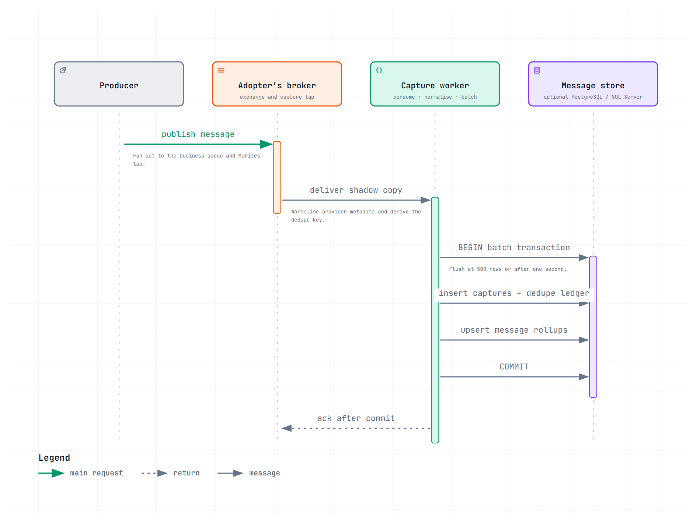
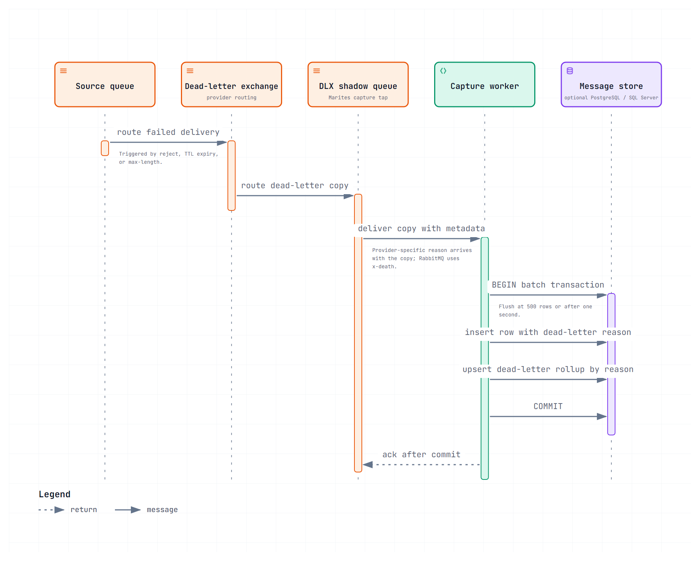

# Capture lifecycle

Version 0.1 | November 2026 | Status: Approved — Product owner, 2026-11-11

How a published message becomes a counted row, and the four points where this stops working.

## 1. The path

The sequence describes the design contract. The message store is optional and adopter-owned; capture writes only when it is configured.

Three properties of this path matter more than the sequence itself.

**The copy is non-destructive.** The business queue and the shadow queue are separate bindings on the same exchange. The production consumer never sees Marites, and Marites never consumes from the production queue.

**Both writes share one transaction.** Rows and counters commit together or not at all. If they could diverge, counts would drift from reality — and counts are the figure trusted over months, so drift would be unrecoverable.

**The ack comes last.** A crash mid-batch produces redelivery, not a gap. The failure mode is a duplicate, which is recoverable for rows; a gap is not. For counters a duplicate is also permanent, because rollups are never rebuilt, so redelivered messages are checked against a ledger before they are counted (ADR-019).

## 2. The dead-letter branch

This branch joins the same capture, batch, transaction, and acknowledgement path after the provider routes a failed message to its dead-letter exchange.

Provider dead-letter metadata arrives with the copy (RabbitMQ exposes it as `x-death`), so the reason is recorded at capture time rather than reconstructed later. That is what turns "a pile of messages" into "1,204 rejected, 3 expired, 88 dropped for maxlen".

**A dead letter is the same message seen twice** — once entering its original exchange, once arriving at the DLX. Both are captured. The two counts are separate series and must never be summed; see [data-and-contracts/data-model.md](../07-data-and-contracts/data-model.md) §3.2.

## 3. Where this stops working

| Failure | What the operator sees | Why |
|---|---|---|
| Shadow binding absent | Queue listed, `captureState: disabled` | Capture is forward-only — a binding added now sees only what is published next |
| Topology write refused | `captureState: unavailable`, preflight names the missing permission | `ERR-BRK-001`; the product degrades to metadata only |
| No dead-letter exchange | `deadLetterConfigured: false` | Failures are discarded by the broker before Marites could see them. Never rendered as `0` |
| Worker stalled while depth grows | `captureState: stale` | The dangerous case: looks like quiet traffic. `ERR-QUE-001` on captured-message operations only; live operations are unaffected |
| Shadow queue overflows | Capture-gap warning (FR-018) | `x-max-length` drops the oldest copy silently; the worker compares its count with the broker's publish counter and flags a divergence |
| Storage ceiling reached | `captureState: capped` | Rows pause; **rollups continue**, so counts survive and only investigation stops |

The last two are the reason `captureState` exists as a field rather than being inferred from a count of zero.

## 4. Backfill, and why it is not part of this path

Capture is forward-only (C-002). A binding added today sees only what is published next, so the messages already sitting in a queue are invisible to it — and those are exactly the ones an operator wants to look at on day one.

**Backfill reuses peek rather than adding a second mechanism.** It is `get-and-requeue` on a dedicated channel with `prefetch = 1`, bounded by a count the operator enters, rate-limited per queue, and run only when a person asks for it.

| Property | Value | Why |
|---|---|---|
| Mechanism | `POST /api/queues/{vhost}/{name}/get` with `reject_requeue_true` | Reads a queued message without a consumer — but not without cost: see the quorum-queue caveat below |
| Bound | The operator's count, defaulting to 100 and capped at 1,000 | A backfill is an investigation, not a migration |
| Rate | `MARITES_BACKFILL_PER_SECOND`, default 20 | Slow enough that a live consumer is not starved |
| Opt-in | Per queue, never automatic, never at setup | It has side effects on the queue, and consent must precede them |
| Stop condition | Any `nack`, any connection error, or the operator cancelling | Partial is fine; a backfill that keeps going after a failure is not |

**What it costs, stated where the operator starts it.** On a classic queue `reject_requeue_true` sets `redelivered` and the rate is bounded, and the dialog says *not side-effect free* rather than *read-only*. **On a quorum queue with a delivery limit it destroys messages**: measured at M1 against RabbitMQ 3.13.7, five peeks of one message left the queue empty and the dead-letter exchange empty — the message was gone, not dead-lettered (architecture overview §2). Backfill therefore refuses on a quorum queue with `ERR-CAP-001` rather than rate-limiting a loss.

**Backfilled messages are counted and stored exactly like live ones.** They enter the same batch path, so they are subject to ADR-019's ledger and ADR-024's compaction and need no special case. What they do not get is a claim about traffic before the binding: the rollup records them at the time they were read, not the time they were published, so a backfilled day is a day of investigation, not a day of traffic. The queue stays `live` throughout — backfill is a read, and `captureState` describes the tap, not the operator's reading of it.

## 5. References

- Requirements: [business/requirements.md](../02-business/requirements.md) FR-002, FR-003, FR-015, FR-018
- Design rationale: [architecture/architecture-overview.md](../05-architecture/architecture-overview.md) §2–§3
- Storage semantics: [data-and-contracts/data-model.md](../07-data-and-contracts/data-model.md) §3
- Metric presentation: [experience/dashboard-and-operations.md](../08-experience/dashboard-and-operations.md) §1
