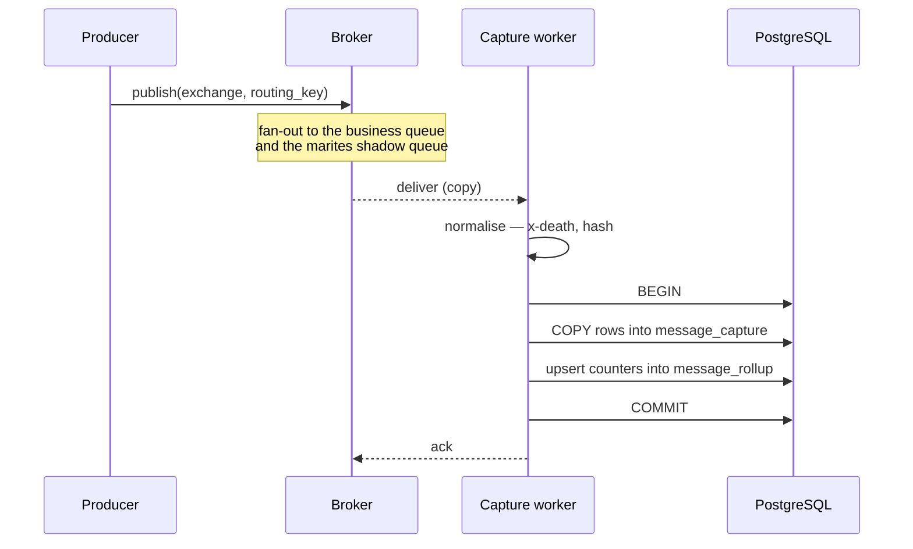
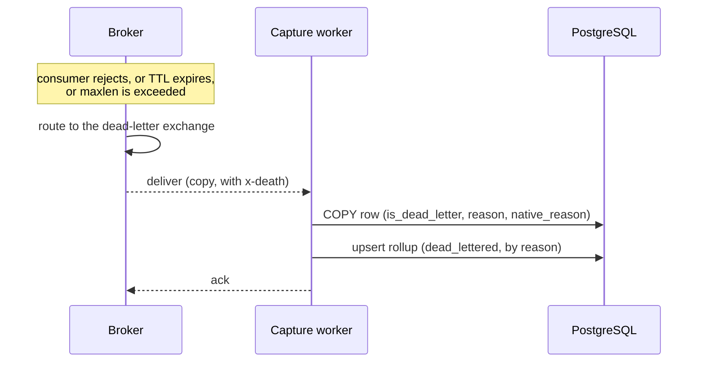

# Capture lifecycle

Version 0.1 | 07 November 2026 | Status: Draft

How a published message becomes a counted row, and the four points where this stops working.

## 1. The path

Three properties of this path matter more than the sequence itself.

**The copy is non-destructive.** The business queue and the shadow queue are separate bindings on the same exchange. The production consumer never sees Marites, and Marites never consumes from the production queue.

**Both writes share one transaction.** Rows and counters commit together or not at all. If they could diverge, counts would drift from reality — and counts are the figure trusted over months, so drift would be unrecoverable.

**The ack comes last.** A crash mid-batch produces redelivery, not a gap. The failure mode is a duplicate, which is recoverable for rows; a gap is not. For counters a duplicate is also permanent, because rollups are never rebuilt, so redelivered messages are checked against a ledger before they are counted (ADR-019).

## 2. The dead-letter branch

The same path, entered from the dead-letter exchange rather than the source exchange.

The `x-death` header arrives with the message, so the reason is recorded at capture time rather than reconstructed later. That is what turns "a pile of messages" into "1,204 rejected, 3 expired, 88 dropped for maxlen".

**A dead letter is the same message seen twice** — once entering its original exchange, once arriving at the DLX. Both are captured. The two counts are separate series and must never be summed; see [data-and-contracts/data-model.md](../07-data-and-contracts/data-model.md) §3.2.

## 3. Where this stops working

| Failure | What the operator sees | Why |
|---|---|---|
| Shadow binding absent | Queue listed, `captureState: disabled` | Capture is forward-only — a binding added now sees only what is published next |
| Topology write refused | `captureState: unavailable`, preflight names the missing permission | `ERR-BRK-001`; the product degrades to metadata only |
| No dead-letter exchange | `deadLetterConfigured: false` | Failures are discarded by the broker before Marites could see them. Never rendered as `0` |
| Worker stalled while depth grows | `captureState: stale` | The dangerous case: looks like quiet traffic. `ERR-QUE-001` on captured-message operations only; live operations are unaffected |
| Shadow queue overflows | Capture-gap warning (FR-018) | `x-max-length` drops the oldest copy silently; the worker compares its count with the broker's publish counter and flags a divergence |
| Storage ceiling reached | `captureState: capped` | Rows pause; **rollups continue**, so counts survive and only investigation stops |

The last two are the reason `captureState` exists as a field rather than being inferred from a count of zero.

## 4. What this lifecycle does not cover

Backfill of messages that were already in a queue before the binding existed. That is a separate, rate-limited, user-initiated operation — `peek` in [data-and-contracts/api-catalog.md](../07-data-and-contracts/api-catalog.md) — not part of continuous capture.

## 5. References

- Requirements: [business/requirements.md](../02-business/requirements.md) FR-002, FR-003, FR-015, FR-018
- Design rationale: [architecture/architecture-overview.md](../05-architecture/architecture-overview.md) §2–§3
- Storage semantics: [data-and-contracts/data-model.md](../07-data-and-contracts/data-model.md) §3
- Metric presentation: [experience/dashboard-and-operations.md](../08-experience/dashboard-and-operations.md) §1
