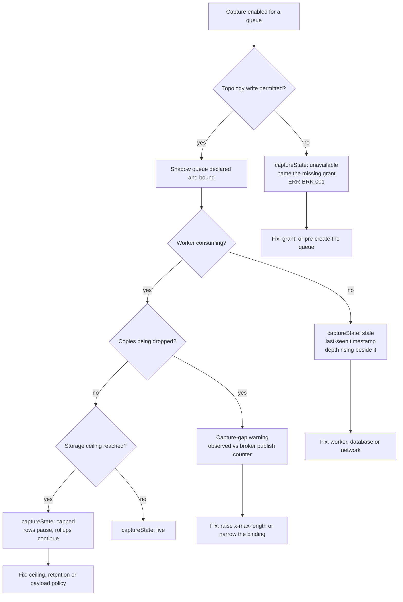
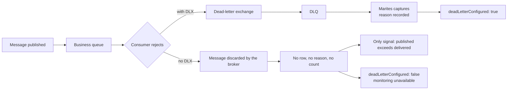
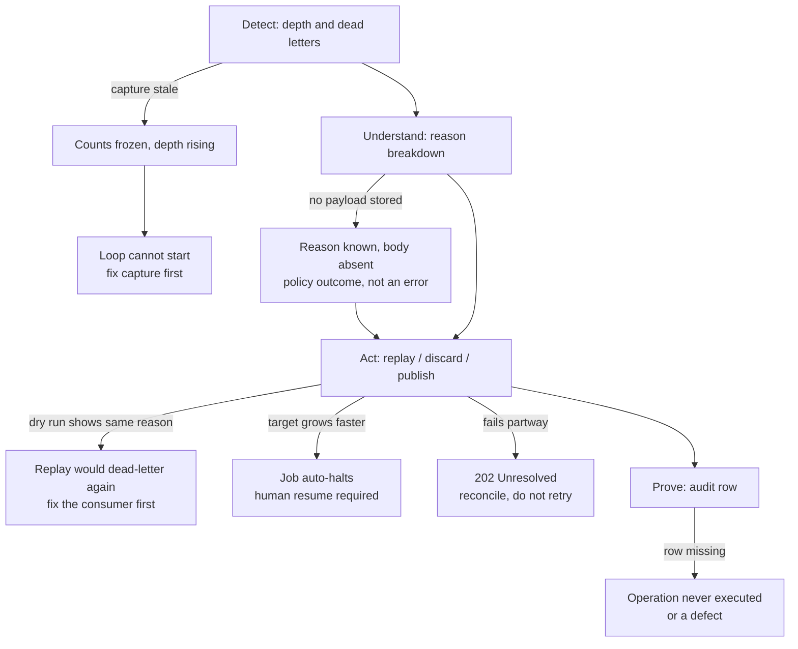
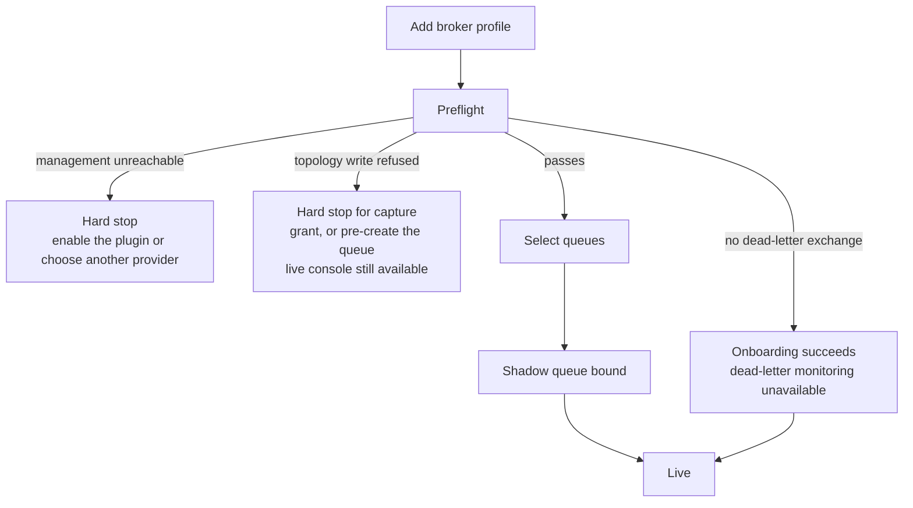

# Failure paths

Version 0.1 | 09 November 2026 | Status: Draft

The three lifecycles describe what happens when things work. This document draws what happens when they do not, because a failure path that exists only as a table row is a failure path nobody has looked at end to end.

Diagrams are inline Mermaid. They sequence behaviour; they introduce no rule. The owning documents are cited on each.

## 1. Capture: the three ways a queue stops being observed

Three failures look similar on a dashboard and have nothing in common in their cause. The diagram exists to make the branch explicit — which state you are in decides who fixes it.

| State | Who fixes it | What must never be shown |
|---|---|---|
| `unavailable` | The adopter's platform team — a permission | A queue that looks healthy with no capture |
| `stale` | Product or environment — see [runbook §5](../11-operations/runbook.md) | A frozen count presented as current |
| `capped` | The adopter — a storage decision | Zero traffic; counts are still accruing |
| Capture gap | The adopter — the shadow queue's bound | An "exact" label on a number known to be short |

Owned by [capture lifecycle](capture-lifecycle.md) §3 and [failure modes](../05-architecture/failure-modes.md) §2–§5.

## 2. Dead-letter blind spot: when the count is honest and useless

The one failure with no clean fix. A queue with no dead-letter routing loses failures before Marites can see them, so the dead-letter figure is unavailable rather than zero — and unavailable is true but uninformative.

`deadLetterConfigured: false` is the honest label; the published-versus-delivered gap is the only remaining signal, and it is tracked under FR-018. Neither is a substitute for the adopter configuring a dead-letter exchange ([DEC-004](../01-project/decisions-and-open-questions.md)).

## 3. Recovery: where the loop breaks

The loop is Detect → Understand → Act → Prove. Each arrow below is a place it can stop.

| Break | The wrong response | The right response |
|---|---|---|
| Counts frozen | Replay from memory | Fix capture; a replay aimed by a stale count is aimed blind |
| Body absent | Report a bug | Read the policy; `sampled` and `none` are choices |
| Dry run shows the same reason | Press replay anyway | Fix the consumer, then replay |
| Auto-halt | Resume immediately | The condition has not changed; it will halt again |
| `Unresolved` | Retry | Poll the operation record and reconcile |

Owned by [recovery lifecycle](recovery-lifecycle.md) §2–§4 and [DOC-UX-001 §3](../08-experience/dashboard-and-operations.md).

## 4. Onboarding: the three exits

Two of the three exits are hard stops and one is a degraded success. The distinction matters commercially: an adopter whose queues have no dead-letter exchange still gets volume, inspection and replay — only the failure reason is missing ([onboarding lifecycle](onboarding-lifecycle.md) §3).

## 5. What these diagrams do not show

- **Timing.** No timeouts, thresholds or retry intervals are drawn, because none are set ([failure modes §10](../05-architecture/failure-modes.md)).
- **Multi-cluster.** A failure in one profile does not propagate, but the diagrams show one profile ([architecture overview](../05-architecture/architecture-overview.md) §10).
- **Broker-side failure.** If the broker loses messages, every path above reports what Marites observed, not what happened.

## 6. References

- States and their meanings: [VOCABULARY §15](../14-reference/vocabulary.md)
- Component behaviour per failure: [failure modes](../05-architecture/failure-modes.md)
- Operator response: [runbook](../11-operations/runbook.md)
- Error outcomes: [error catalog](../07-data-and-contracts/error-catalog.md)
