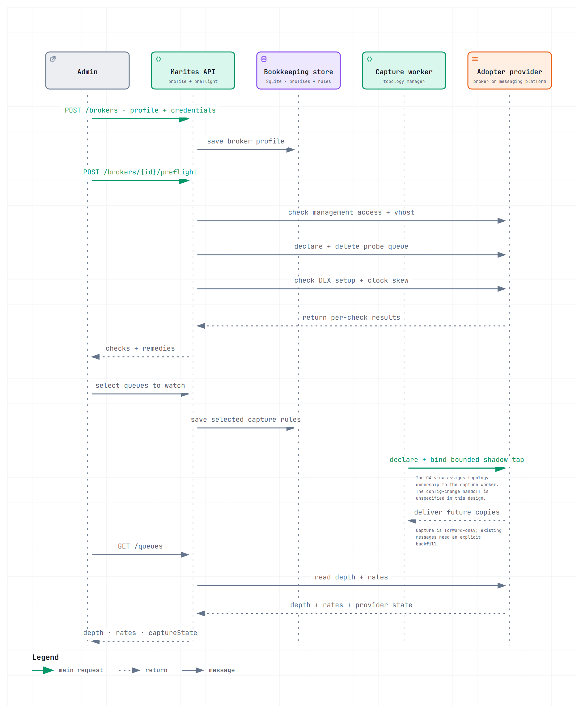

# Onboarding lifecycle

Version 0.1 | November 2026 | Status: Approved — Product owner, 2026-11-11

From "we have a broker" to "the dashboard is useful", including the three places it stops.

## 1. The path

The C4 model assigns tap declaration to the capture worker. The current design does not specify how API-saved queue rules trigger worker reconciliation; this sequence does not imply a direct API-to-worker call.

## 2. Why preflight is not a formality

A misconfigured broker produces an application that looks broken. The adopter sees an empty dashboard and concludes the product does not work, when the actual cause is a missing `configure` grant.

Preflight exists to convert that into a sentence: *"your user lacks configure on `marites.`"*

| Check | Failure means |
|---|---|
| `management_api_reachable` | No metadata at all — the dashboard cannot exist |
| `vhost_visible` | Wrong user or vhost |
| `topology_write_permitted` | Capture impossible; live console only, and the UI says so |
| `dead_letter_configured` | Per queue — failures are unobservable, never report `0` |
| `shadow_declarable` | Broker policy blocks topology writes |
| `clock_skew` | `x-death` timestamps will be wrong, quietly |

The last one is the subtlest: nothing fails, the numbers are simply wrong.

## 3. The three ways this stops

| Stop | What the adopter sees | What they can do |
|---|---|---|
| Management API blocked | Setup cannot complete | Enable the plugin, or choose another provider |
| Topology writes refused | Preflight fails on `topology_write_permitted` | Grant `configure`/`write`/`read` on `^marites\.`, or have their platform team pre-create the queues |
| No dead-letter exchange | Onboarding succeeds; dead-letter monitoring shows "unavailable" | Configure `x-dead-letter-exchange` on new queues; existing queues need recreation |

Only the second is a hard stop. The third is a degraded but working product, which is why it does not block anything.

## 4. What onboarding does not do

- **It does not create the adopter's queues, exchanges or dead-letter topology.** Marites creates only objects prefixed `marites.` — see [operations/deployment-and-onboarding.md](../11-operations/deployment-and-onboarding.md) §4.1.
- **It does not backfill automatically.** Messages already in a queue require an explicit, rate-limited peek.
- **It does not verify message content.** Whether the payload contains something the adopter should not store is their responsibility, recorded in §1.7 of the same document.

## 5. References

- Prerequisites: [operations/deployment-and-onboarding.md](../11-operations/deployment-and-onboarding.md) §1
- Preflight endpoint: [data-and-contracts/api-catalog.md](../07-data-and-contracts/api-catalog.md) §2
- Capability gating: [architecture/architecture-overview.md](../05-architecture/architecture-overview.md) §6.2
