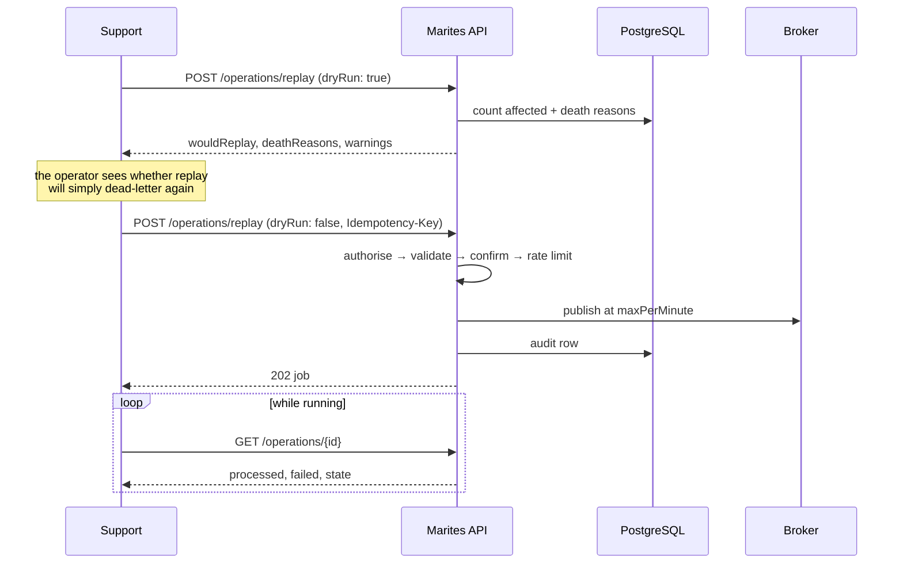

# Recovery lifecycle

Version 0.2 | November 2026 | Status: Draft

The loop Support actually runs, and why each step exists.

## 1. The loop

| Step | Question | What the product provides | Requirement |
|---|---|---|---|
| **Detect** | Is anything failing? | Queue depth, dead-letter count, capture health | FR-001, FR-004, FR-018 |
| **Understand** | What failed, and why? | Reason breakdown, message detail, payload | FR-005, FR-006, FR-007 |
| **Act** | Retry, discard, or publish | Peek, discard, replay, publish | FR-008…FR-011 |
| **Prove** | What did we do? | Append-only audit | FR-016 |

A feature that serves none of these four is not MVP. That test is stricter than a priority column and it is the one applied when scoping the contract.

## 2. Act, in detail

This is the only step that changes anything, so it carries every guard.



**Why the dry run is not optional.** A dead letter replayed to its origin dead-letters again if the consumer still rejects it. Without the preview, an operator retries 200 messages into the same broken consumer and concludes the tool failed. With it, they see the reason first and fix the cause.

**Why the job is `202` and not `200`.** A replay that fails partway has already published some messages. Reporting it as a plain failure invites a retry that sends the successful portion twice. It is `Unresolved`, and the client reconciles through the operation record — `ERR-OPR-004`.

**Why auto-halt exists.** If the target queue's depth climbs faster than the replay drains it, the replay is making the incident worse. The job pauses itself and requires a human to resume.

## 3. The four operations, by risk

| Operation | Effect | Guards |
|---|---|---|
| Peek | Reads the live queue | Rate limited; warns when `destructive` (RabbitMQ get-and-requeue) |
| Discard | Removes specific messages | Typed queue name; dry run |
| Purge | Removes everything in a queue | Admin only; typed queue name; environment tag on `prod`; dry run |
| Replay | Re-sends to the origin | Dry run; rate limit; auto-halt; idempotency key |
| Publish | Injects a new message | Idempotency key; schema validation; audit with payload hash |

Every one of them writes an audit row. None of them is scheduled, and purge is never automatic.

### 3.1 Hold, command, record

Every destructive operation runs in the same three steps, and the order is the design (ADR-023):

```
1. HOLD      receive the message (broker lock) → write operation_intent with the
             complete bodies → COMMIT                    ← the copy exists from here
2. COMMAND   discard / purge / replay: issue it to the broker
3. RECORD    on confirmation → write operation_audit + operation_payload in one
             transaction → delete the intent
```

**Why the hold is a committed write and not a variable.** Step 1 is the only moment the payload exists to be recorded. Holding it in memory would satisfy the words and lose it in the one crash that matters — the one between the command and the record.

**What each failure leaves behind:**

| Failure | Broker state | What is recorded |
|---|---|---|
| Crash before step 1 commits | Untouched; the lock expires and the message returns | Nothing. No command was issued |
| Hold cannot be written | Untouched; no command is issued | `ERR-OPR-007` to the caller. **A destructive operation that cannot be recorded does not happen** |
| Broker refuses the command | Untouched | Intent marked `abandoned`; the audit records the attempt as `failure`, without evidence, because nothing was destroyed |
| Broker succeeds, record fails | Applied | Intent survives. Retried until the audit row lands; the payload is already safe from step 1 |
| Crash between step 2 and step 3 | **Unknown** | Reconciliation on restart resolves the intent against the broker and writes the audit row from the answer |

The last row is the only window where the pair is not atomic. It is resolved by asking the broker, not by a transaction — and for purge the question is weaker, because an emptied queue cannot be asked about individual messages. There the operation's own count and the queue depth before and after are the evidence.

**What the operator sees.** The confirmation shows what is about to be destroyed — the bodies, before the command, not only in the audit afterwards (DOC-UX-003 §3.7). A discard that fails at step 1 says so in words: *nothing was discarded, the record could not be written*.

## 4. Where the loop breaks

| Break | What it looks like | Mitigation |
|---|---|---|
| Capture stopped | Dead-letter count frozen while depth grows | `captureState: stale`, visible on the queue |
| No dead-letter routing | Failures never reach the product | `deadLetterConfigured: false`; publishes-versus-deliveries gap is the only signal |
| Provider cannot replay | Control absent for that provider | `ProviderCapabilities.canReplay`; `ERR-CAP-001` if a client asks anyway |
| Operator unsure of environment | Replay aimed at `prod` by mistake | Environment shown on every confirmation; typed tag required for `prod` |

The second row is the one with no clean answer: a queue discarding messages that never reach any DLQ shows a persistent gap between published and delivered counts. That is tracked under FR-018 and is not solved by this lifecycle.

## 5. Compensation — what cannot be undone

Every operation in §3 is one-way. There is no unpublish, no un-purge, and no un-replay, and the product does not pretend otherwise. That makes compensation a **new forward action plus a record**, never a reversal — and saying so once is better than leaving a reader to discover it at the worst moment.

| Operation | Reversible? | What the product offers instead |
|---|---|---|
| Publish | **No** | A correcting message published through the same guarded path, and an audit row naming the actor and the original payload hash. There is no link from the correction to the original: a publish creates a message, it does not amend one |
| Replay | **No** | Nothing. A second replay re-sends; the idempotency key prevents a double-submit of *one* request, not a second deliberate replay |
| Discard | **No** | Nothing for the copy. Where the discard targeted the shadow queue rather than the adopter's queue, the original is untouched — that distinction is the only recovery there is |
| Purge | **No** | Nothing. Restoring the queue is the adopter's broker backup, not a product feature |
| Row retention or a dropped partition | **No** | Counts survive, because they were never derived from rows ([data model §3.1.1](../07-data-and-contracts/data-model.md)) |
| A ceiling pause | **Yes** | Automatic: rows resume once the sweeper frees space. This is the only "undo" in the product |

**Who coordinates it.** Support executes and owns the correction; Admin authorises purge; the adopter's platform team owns anything broker-side, including restore. The product's contribution is the audit row — it is the only artefact that establishes what happened, and it is why FR-016 exists.

Four properties make this tolerable rather than reckless:

1. **Nothing destructive is scheduled** (NFR-004). Every operation that would need compensation was chosen by a person, moments earlier, after a dry run.
2. **`Unresolved` is the one state that admits doubt** (`ERR-OPR-004`). A partial replay is not a failure to retry; it is a set of messages to reconcile, which is compensation done deliberately.
3. **The audit row is the compensating record.** It does not undo the act; it makes the act attributable, which is what an incident review actually needs.
4. **Counting is separate from storing.** A mistaken purge costs the investigation window, never the history. That is the whole reason the two tiers exist.

**The rule, stated once:** the product never claims to undo. It offers a forward action and a record, and the UI says so before the button is pressed rather than after.

## 6. References

- Requirements: [business/requirements.md](../02-business/requirements.md) §2–§3
- Operation safety and confirmation UX: [experience/dashboard-and-operations.md](../08-experience/dashboard-and-operations.md) §3
- Endpoint shapes: [data-and-contracts/api-catalog.md](../07-data-and-contracts/api-catalog.md) §6
- Error outcomes: [data-and-contracts/error-catalog.md](../07-data-and-contracts/error-catalog.md) §8
