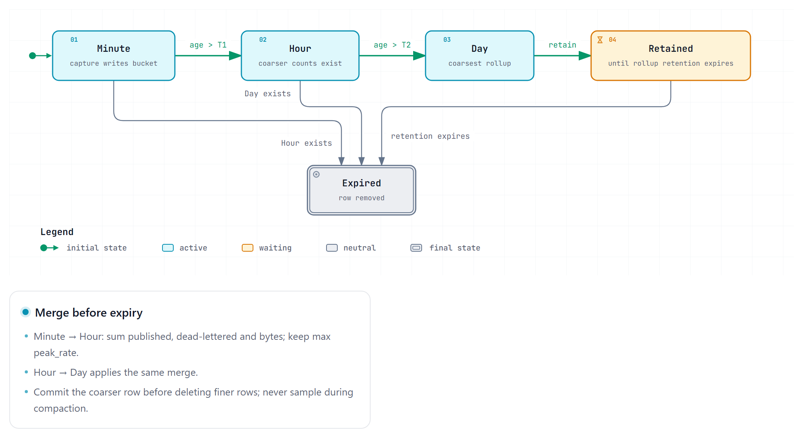
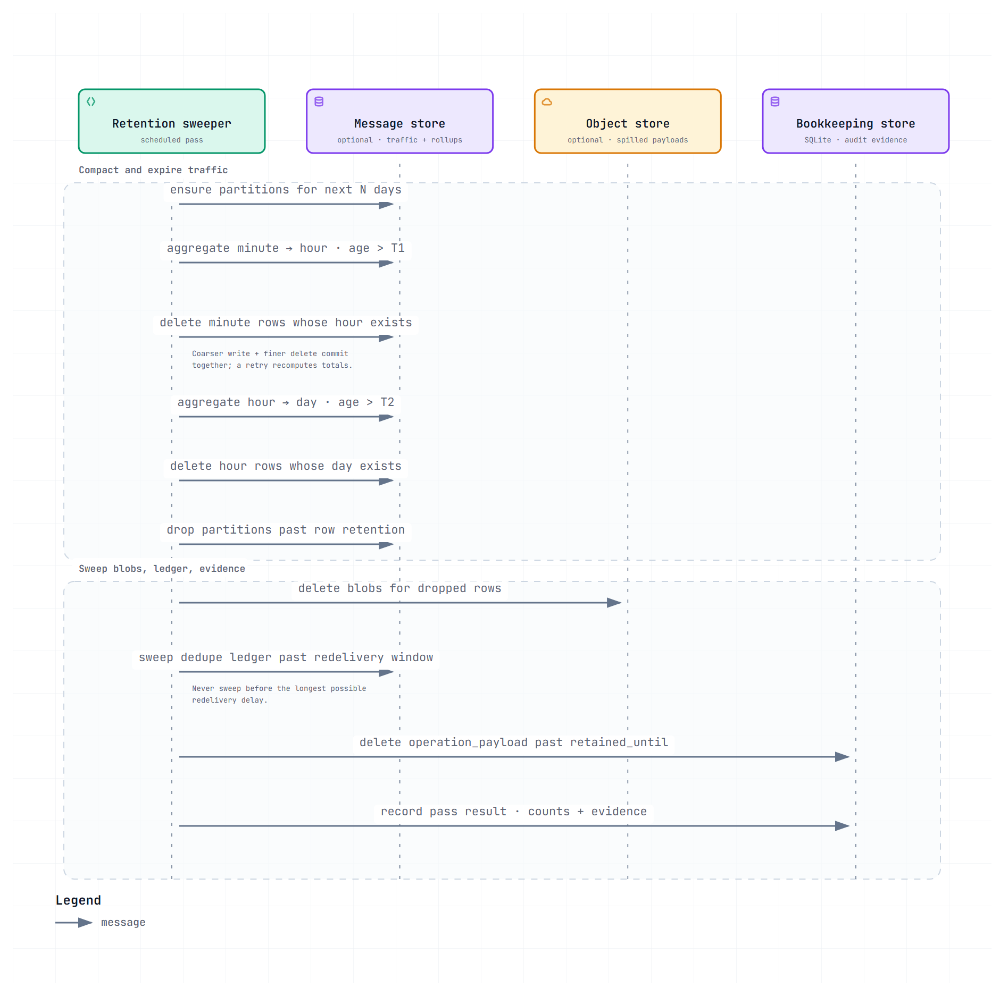
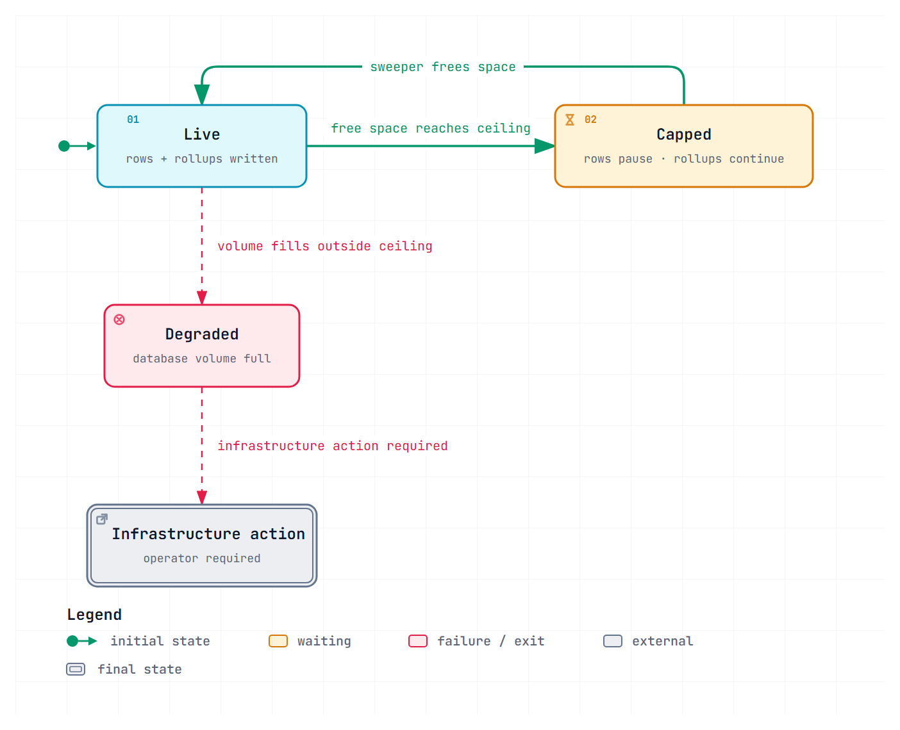

# Retention and compaction lifecycle

Version 0.1 | November 2026 | Status: Draft

Counts are kept; rows expire. This document draws the machine that does that, because the order of its steps is the difference between a total that is right and a total that quietly doubles.

Every threshold below is **configured**, and the defaults are owned by [data model §3.1.2 and §4](../07-data-and-contracts/data-model.md). They are written here as `T1`, `T2` and `T3` rather than repeated as numbers, so this document cannot drift from the one that owns them.

## 1. The invariant this lifecycle protects

> Admin-set retention applies to `message_capture` only. It never changes a count.

Owned by [data model §3.1.1](../07-data-and-contracts/data-model.md). Everything below exists to keep it true: the sweeper cannot see `message_rollup`, and compaction only ever merges counts into coarser counts.

## 2. Tier lifecycle

Three tiers, each aggregated from the one above it and then deleted. Nothing is derived from `message_capture` — that is the whole design.

**Diagram source:** [rollup-tiers.lifecycle.json](diagrams/rollup-tiers.lifecycle.json).

Three properties, each a correctness requirement:

- **A coarser row must exist before a finer row is deleted.** Otherwise a day's total is derived from hours that were already dropped.
- **Counts sum; `peak_rate` takes the maximum.** Summing a peak reports an hourly peak that never occurred.
- **Compaction never samples.** A sample would make a day row unequal to the sum of its hours, and the two would then disagree forever.

## 3. One sweeper pass

The order is the contract. Each step is idempotent, so a crash mid-pass resumes rather than corrupts.

**Diagram source:** [retention-sweeper.sequence.json](diagrams/retention-sweeper.sequence.json).

The message store is optional and adopter-owned; operation evidence is swept from Marites’ always-present SQLite store. Spilled payload objects are deleted from the optional object store.

**Two stores, one pass.** Everything against `D` and `O` is traffic and belongs to the adopter; the last two lines are Marites' own bookkeeping. They are in the same pass because they are one schedule to reason about, not because they share a transaction — and the evidence sweep is the *only* thing that deletes `operation_payload`, which is why it is listed rather than assumed.

| Step | If it is skipped | If it runs twice |
|---|---|---|
| Ensure partitions | Capture stalls when the last partition fills | Idempotent |
| Compaction — write the coarser row and delete the finer rows | Finer tiers grow without bound | **Cannot double and cannot half-delete.** Totals are recomputed and assigned, and the write and the deletion commit together ([ADR-024](../05-architecture/decisions.md)) |
| Drop partitions | Rows outlive their retention | Idempotent |
| Delete spilled objects | The object store grows while rows do not | Idempotent |
| Sweep the ledger | The ledger grows without bound | Idempotent, and **only** after the redelivery window — sweeping early reopens the double-count ADR-019 closes |
| Sweep payload evidence | The bookkeeping store grows without bound, and bodies outlive the term the audit promised | Idempotent — a delete on `retained_until`, which is written once and never moved |

**The ledger row is the subtle one.** Its window must exceed the longest possible redelivery delay. A sweep that runs early deletes the entry that would have absorbed a redelivery, and the message is counted twice — with no error and no gap.

## 4. The storage ceiling

The ceiling is the only part of this lifecycle that changes behaviour rather than data.

**Diagram source:** [storage-ceiling.lifecycle.json](diagrams/storage-ceiling.lifecycle.json).

| State | Rows | Rollups | Reads | What the operator sees |
|---|---|---|---|---|
| `Live` | Written | Written | Normal | Normal figures |
| `Capped` | **Paused** | **Written** | Normal | "Capped" — counts continue, payload inspection stops |
| Volume full | Fail | Fail | Degraded | An infrastructure error, **not** `capped` |

**`Capped` and a full disk must not share a label.** The first is the product making a decision it was configured to make; the second is the environment failing. Collapsing them hides an infrastructure incident behind a product setting ([failure modes §5](../05-architecture/failure-modes.md)).

Recovery from `Capped` is automatic: once the sweeper frees space, rows resume without an operator action. Recovery from a full volume is not.

## 5. Where this can still go wrong

| Failure | Consequence | Status |
|---|---|---|
| Compaction retried for one window | Additive upserts would double that window's counts, permanently | Prevented by recomputing and assigning the window's totals rather than adding to them ([ADR-024](../05-architecture/decisions.md)) |
| Sweep interrupted partway through a window | A retry recomputes from the surviving rows and overwrites a correct total with a smaller one | Prevented by committing the coarser write and the finer deletion together, so a partly deleted tier cannot exist ([ADR-024](../05-architecture/decisions.md)) |
| Row retention above rollup retention | A period shows zero counts that an operator can still browse | Prevented in application code, not by a constraint ([data dictionary](../07-data-and-contracts/data-dictionary.md) §4) |
| Partition dropped for the wrong queue | One queue's short retention deletes another's window | Prevented by reading the minimum retention across rules ([migration plan](../07-data-and-contracts/migration-plan.md) §3) |
| Ledger swept before redelivery completes | A redelivery is counted twice | Prevented by the window; not asserted by a test |
| Spilled objects orphaned | The object store grows while rows do not | Prevented by the sweeper's delete step, which removes an object only when no remaining row carries its hash ([data dictionary](../07-data-and-contracts/data-dictionary.md) §6) |

Every one of them has a designed guard. The first two are the pair that would have damaged the number the product exists to produce — one by inflating it, the other by shrinking it without a symptom.

## 6. What an operator can and cannot change

| Control | Owner | Effect |
|---|---|---|
| Row retention per queue | Admin | How long rows stay inspectable. **Never** changes a count |
| Rollup retention | Admin | How far back counts go. Must exceed the reporting horizon |
| Payload policy per queue | Admin | What is stored. **Never** changes a count |
| Partition interval | Operator at deploy | Daily or hourly. Structural; changing it later is a migration |
| Storage ceiling | Operator at deploy | When rows pause |

The split is deliberate: an Admin can change what is inspectable, and an Operator decides how much disk that is allowed to cost. Collapsing the two is how a routine "reduce disk usage" change deletes a year of executive reporting ([data model §4](../07-data-and-contracts/data-model.md)).

## 7. References

- Retention invariant and tiers: [data model §3.1](../07-data-and-contracts/data-model.md)
- Degradation order: [data model §4.1](../07-data-and-contracts/data-model.md)
- Column definitions and indexes: [data dictionary](../07-data-and-contracts/data-dictionary.md)
- Sweeper and partition DDL: [migration plan](../07-data-and-contracts/migration-plan.md) §3
- Component behaviour: [failure modes §6](../05-architecture/failure-modes.md)
