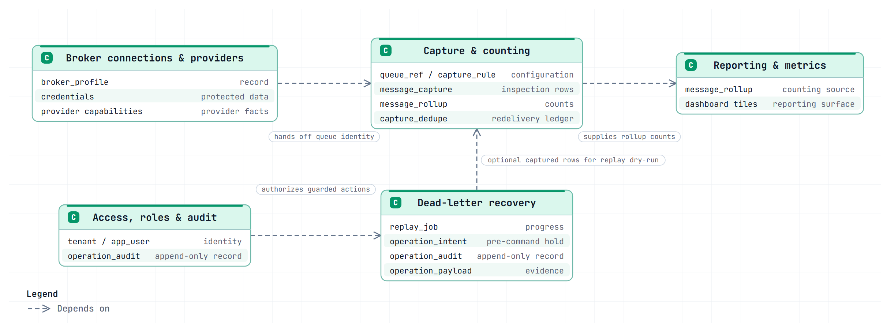

# Documentation area catalog

## Purpose and boundary

The five responsibilities below are the first bounded-context map under ADR-025. They are model boundaries inside one modular monolith, not five services or deployment units. The deployable shape remains one image with three entrypoints ([architecture overview §6, §9](../05-architecture/architecture-overview.md)). Aggregate roots and layer rules are specified in [backend DDD architecture](../05-architecture/backend-ddd.md).

## Documented responsibility map



This map shows responsibilities and handoffs, not aggregate structure. Capture is optional for live recovery, though a replay dry-run can read captured rows. Dead-letter Recovery owns the append-only `operation_audit` record; Access, Roles, and Audit Access authorizes and reads its projection. The table has one writer.

Rebuild the preview from the repository root with:

```bash
python docs/05-architecture/diagrams/build.py docs/04-domains/diagrams/domain-responsibility-map.class.json
```

## Bounded contexts and persistence ownership

| Bounded context | Aggregate roots / domain records | Persistence and important boundary |
|---|---|---|
| Broker connections and providers | `BrokerProfile`; `ProviderCapabilities` is a provider snapshot | `broker_profile`; credentials are write-only, and Marites creates only its own `marites.` objects |
| Capture and counting | `QueueRef` with one `CaptureRule`; message captures, dedupe entries, and rollups are bulk records/projections | `queue_ref`, `capture_rule`, `message_capture`, `capture_dedupe`, `message_rollup`; dedupe, rows, and counts share one message-store transaction |
| Dead-letter recovery | `OperationIntent`, `ReplayJob`, immutable `OperationRecord`; proposals are `action = proposal` audit records, not a separate table | `operation_intent`, `replay_job`, `operation_audit`, `operation_payload`; stage bodies before effects, audit only after broker confirmation, reconcile ambiguous outcomes |
| Reporting and metrics | No write aggregate; rollup query projections | `message_rollup` only; never rebuild counts from retained message rows |
| Access, roles, and audit access | `Tenant`, `AppUser`; audit is a read projection owned by Dead-letter Recovery | `tenant`, `app_user`; Entra owns sessions and Marites stores no tokens |

These roots are model boundaries, not a one-table-per-aggregate rule. The record mapping and invariants are detailed in [backend DDD architecture §1–2](../05-architecture/backend-ddd.md). The thirteen current product tables remain unchanged; the event Outbox is a separately marked planned infrastructure record, not part of that count.

## Responsibility coverage

| Documentation area | Responsibilities | Records | Boundary and handoff | Existing sources | Remaining work |
| --- | --- | --- | --- | --- | --- |
| Broker connections and providers | Register, test and remove broker profiles; preflight readiness; the provider capability record; credentials | `broker_profile`, `ProviderCapabilities`, credential payload | Never provisions or alters the adopter's topology (ADR-001); creates only `marites.`-prefixed objects. Hands queue identity to capture | [Deployment §1–§4](../11-operations/deployment-and-onboarding.md); [architecture §6](../05-architecture/architecture-overview.md); [vocabulary §12–§14](../14-reference/vocabulary.md); [onboarding lifecycle](../03-workflows/onboarding-lifecycle.md); FR-012 to FR-014 | DEC-008 premise unconfirmed; no Service Bus or Pub/Sub platform configured |
| Capture and counting | Shadow bindings, normalisation, batching, exact rollups, row retention, capture health | `queue_ref`, `capture_rule`, `message_capture`, `message_rollup`, `capture_dedupe` | Counting is separate from storing (ADR-007). A dead letter is observed twice and never summed. Capture is forward-only (C-002). Supplies counts to reporting | [Architecture §2–§4, §7](../05-architecture/architecture-overview.md); [data model §3–§4](../07-data-and-contracts/data-model.md); [capture lifecycle](../03-workflows/capture-lifecycle.md); ADR-002, 007, 011, 012, 019; FR-002 to FR-005, FR-015, FR-018, FR-022 | Throughput unmeasured until the M2 load test. Counting is protected end to end — ADR-019 for redelivery, ADR-024 for a retried compaction — and backfill reuses peek rather than adding a mechanism (capture lifecycle §4) |
| Dead-letter recovery | Peek, discard, purge, replay and publish behind one guard chain | `replay_job`, `operation_audit`, confirm tokens (stateless) | Live operations need no capture. Replay and publish are the highest-risk surface. No scheduled destructive operation, ever (NFR-004) | [Experience §3](../08-experience/dashboard-and-operations.md); [recovery lifecycle](../03-workflows/recovery-lifecycle.md); [API catalog §6](../07-data-and-contracts/api-catalog.md); FR-008 to FR-011 | Quorum-queue peek effect unverified (TC-010); per-provider semantics in vocabulary §14 and adapter design |
| Reporting and metrics | Four dashboard tiles, granularity availability, the Viewer reporting surface | `message_rollup` tiers | Reads rollups only, never `message_capture`. `published` and `dead_lettered` are separate series | [Experience §1](../08-experience/dashboard-and-operations.md); [data model §3.1.2](../07-data-and-contracts/data-model.md); [API catalog §5](../07-data-and-contracts/api-catalog.md); FR-004, FR-005, FR-020, FR-021 | Metric endpoints deferred to M2; visual tokens are specified in [visual design](../08-experience/visual-design.md), with no independent design review |
| Access, roles and audit | Identity mapping, roles to capabilities, break-glass, append-only audit | `app_user`, `tenant`, `operation_audit` | Entra ID owns sessions; Marites stores no tokens. A tenant is a team in one organisation (ADR-014) | [Architecture §8](../05-architecture/architecture-overview.md); [experience §2](../08-experience/dashboard-and-operations.md); [vocabulary §2](../14-reference/vocabulary.md); ADR-008; FR-016, FR-017 | Role-assignment flow; break-glass procedure; tenancy isolation case planned (TC-022) |

## Standard for each future area specification

1. Purpose, confirmed scope and exclusions.
2. Actors, actions and ownership boundaries, separating accepted policy from proposed design.
3. Records and vocabulary, citing [VOCABULARY](../14-reference/vocabulary.md) rather than restating it.
4. Rules, state meanings, workflows and deadlines.
5. Incoming and outgoing facts, with the authoritative source of each.
6. Authorisation, exposure, audit and consistency expectations.
7. Screens and verification links where applicable.
