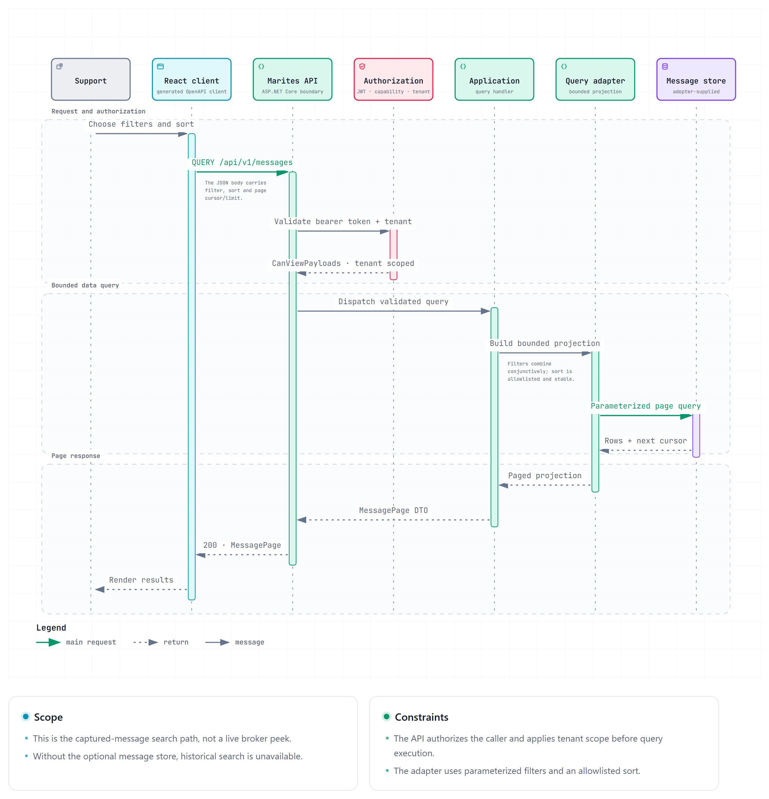
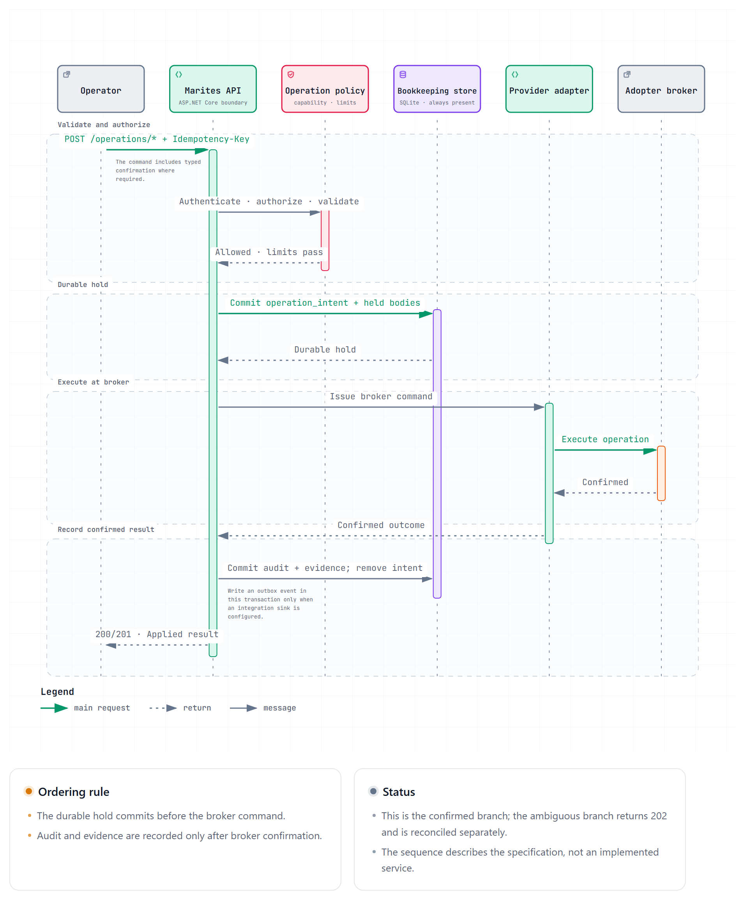
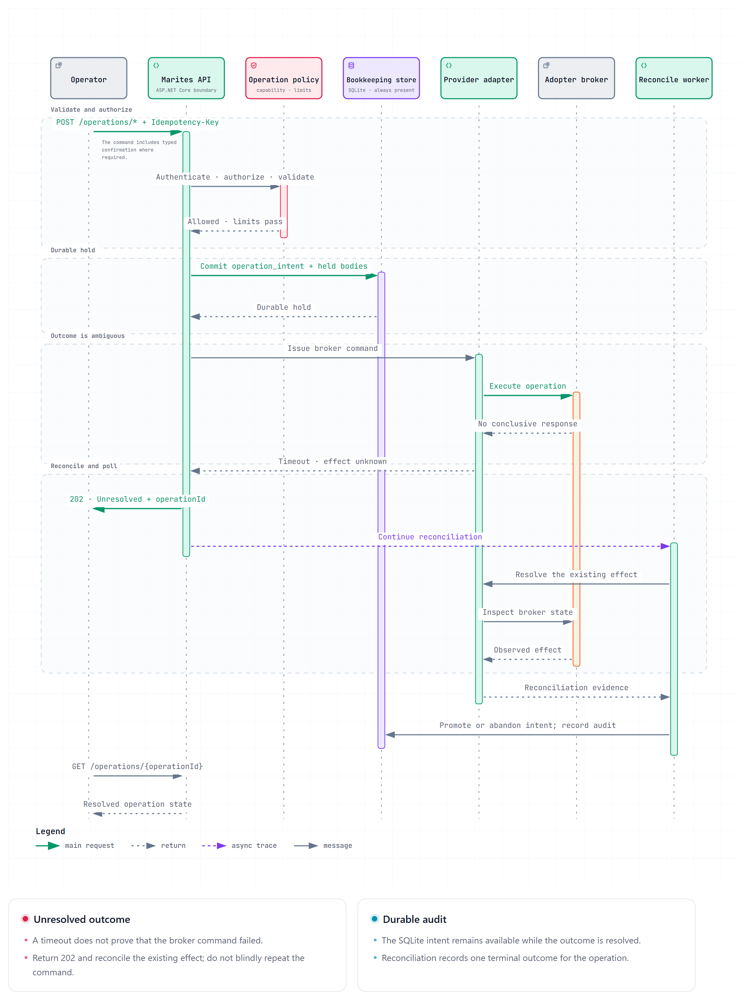

# API Architecture and Non-Functional Requirements

**Scope.** This document defines implementation rules for the ASP.NET Core HTTP boundary. The served OpenAPI contract remains authoritative for paths and payloads. The existing business rules, error outcomes, role/capability matrix, single-container deployment, and two-store split remain in force.

## 1. Request pipeline

The API uses thin endpoint mappings. Middleware performs transport and cross-cutting work; Application handlers perform use cases and Domain remains framework-independent.

1. Trusted-proxy `ForwardedHeaders` configuration, when deployed behind an explicitly trusted proxy.
2. Exception-to-ProblemDetails handling and correlation ID creation. Logs redact credentials, authorization headers, and message bodies.
3. HSTS outside development and HTTPS redirection; TLS terminates only at the app or a configured trusted proxy.
4. Routing and response compression.
5. CORS with the configured origin allowlist and required request headers/methods.
6. JWT Bearer authentication and role/capability authorization.
7. Tenant-aware rate limiting and endpoint input validation.
8. Output caching only for explicitly eligible read endpoints, after authentication/authorization and with a tenant-safe cache key.
9. Thin endpoint mapping to Application commands or queries.

Exact middleware registration must match the selected ASP.NET Core version and hosting proxy. CORS `OPTIONS` preflight is transport infrastructure, not a seventh business endpoint verb.

## 2. Security and access control

- Validate JWT Bearer access tokens for issuer, audience, signature, and expiry. Entra ID/OIDC remains the production identity source; roles arrive as App Roles and map to capability policies (ADR-008).
- Every endpoint enforces authorization server-side. Hiding a React control is a usability rule, not an authorization control. Tenant scope is applied before query projection or aggregate access.
- FluentValidation checks request shape, lengths, formats, and field-level constraints; Domain methods enforce business invariants. Input is parameterized for data access and output is safely encoded.
- HTTPS is mandatory. HSTS is enabled in production. Reverse-proxy forwarding is honored only for trusted proxy addresses.
- Default to same-origin deployment. If cross-origin use is configured, CORS explicitly allowlists origins, headers, and the business methods `GET`, `POST`, `PUT`, `PATCH`, `DELETE`, and `QUERY`; never use wildcard origins with credentials. Allow `Idempotency-Key`, `If-Match`, and `Authorization` where needed.
- Credentials and payload bodies do not appear in logs, traces, cache keys, or ProblemDetails. Broker credentials remain write-only (NFR-003); payloads remain accessible only to Support/Admin (DEC-002).

## 3. Traffic management and reliability

| Control | API rule |
|---|---|
| Rate limiting | Apply per-tenant policies to mutating operations and expensive searches. Return `429` with stable `ERR-CMN-004` and `Retry-After`; the client waits that duration. |
| Idempotency | Require `Idempotency-Key` for retryable `POST`, `PUT`, `PATCH`, and `DELETE` commands. Persist request identity and outcome; same key/same input returns `AlreadyApplied`, same key/different input returns `ERR-CMN-005`. `GET` and `QUERY` are safe/idempotent reads and do not use mutation idempotency keys. |
| Revision control | Existing configuration updates carry `If-Match`; stale revisions return `409 ERR-CMN-006`. Re-read and re-apply instead of blind retry. |
| Timeouts/cancellation | Every HTTP operation must use a bounded server-side timeout. Per-endpoint budgets are implementation settings and must be recorded before release; this design sets no latency SLA. The request cancellation token flows through Application and database/provider clients. Long-running work returns an operation ID and continues under the worker's own bounded lifetime. |
| Outbound resilience | Polly resilience pipelines may be applied to outbound provider, identity, AI, and storage calls. Scope circuits and concurrency limits per broker profile/dependency. Retry only transient, safe/idempotent work; never blindly retry a partially completed broker mutation. |
| Degradation and fallback | Preserve explicit `stale`, `capped`, `unavailable`, and `Unresolved` states. A safe fallback may use explicitly marked last-known metadata; it never fabricates counts, renders a failed read as zero, or substitutes a different target for a mutation. One broker profile failing does not stall another (ADR-010). |

No retry policy may retry a command after an ambiguous broker outcome without first reconciling `/operations/{operationId}`. This preserves ADR-023 and `ERR-OPR-004` behavior.

## 4. Data handling and performance

### Paging, filtering, and sorting

Use cursor paging with stable order, `limit` from 1 to 200 (default 50), and an opaque `nextCursor`. Existing wire responses (`MessagePage`, `AuditPage`) retain their `items`/`nextCursor` fields. Internal Application DTOs may use common `PagedRequest<TFilter>` and `PagedResponse<T>` shapes without renaming v1 wire contracts.

Simple resource reads and bounded scalar filters remain `GET`. Captured-message search is the complex structured read and uses `QUERY /messages` with a JSON body:

- `filter`: the existing queue, broker, routing key, correlation ID, dead-letter, death reason, and time range criteria; supplied filters combine conjunctively.
- `sort`: an allowlisted field and direction. For v1, `capturedAt` descending is the only accepted order, preserving FR-006; additional fields/directions require a requirement and contract change. No arbitrary SQL field is accepted.
- `page`: opaque cursor and limit. Changing filters or sort discards the cursor.

`/audit` and metric endpoints keep their current scalar `GET` parameters. Replay's request filter remains on `POST /operations/replay` because execution can change broker state. `POST /operations/peek` remains a command because provider implementations can have effects even though the operator calls it a read-like action.

### Cache and persistence

- OutputCache is opt-in per endpoint. A `QUERY` cache key includes a canonical digest of the request body, the URI query component, API version, representation headers, and tenant/authorization scope. It never stores the raw body in the key or logs.
- Shared caching is disabled for message payloads, audit payload evidence, and other sensitive responses. Metric/configuration reads may use short-lived tenant-scoped caching if invalidation and freshness are defined.
- `IDistributedCache` is an Infrastructure adapter for deployments needing a shared cache. It is optional: the single-container profile must not acquire a mandatory Redis or other external service dependency. Output caching for authenticated `QUERY` requires an explicit custom policy; framework defaults alone are insufficient.
- Brotli/Gzip response compression is enabled for suitable JSON responses, excluding already-compressed payloads and respecting `Accept-Encoding`.
- Use bounded connection pools per data store. `AddDbContextPool` applies only to EF Core-backed work; Dapper uses the underlying provider pool. SQLite bookkeeping and the optional PostgreSQL/SQL Server message store have separate pool/configuration limits.
- The high-volume capture path remains Npgsql binary `COPY` with one transaction for dedupe, rows, and rollups (ADR-011/019). No ORM change tracking or API request pipeline is inserted into that path.

## 5. Developer experience and maintainability

- Keep the `/api/v1` prefix. `Asp.Versioning.Http` is the intended versioning adapter; path versioning remains the public rule. No version is added to the host name or query string.
- Use lowercase plural resource paths and kebab-case multiword segments. Keep action paths only for explicit commands such as `/operations/replay`.
- `POST` creates a resource with `201 Created` and `Location`, or submits a state-changing command. `PUT` replaces the addressed policy resource; `PATCH` applies a partial configuration change; `DELETE` removes the Marites-owned resource and returns `204` where no result representation is needed.
- Preserve standard status codes: `200`, `201`, `204`, `400`, `401`, `403`, `404`, `409`, `422`, `429`, and sanitized `500`. Preserve Marites-specific `202 Unresolved` and `503 Unavailable`; these are load-bearing error outcomes and must not be collapsed into `500`.
- Every error uses RFC 9457 `application/problem+json` with stable `code`, `outcome`, `retryable`, and operator `remedy` where applicable. Clients branch on stable codes, not `detail` prose.
- OpenAPI is the contract source for the generated React client. Both current and deferred specifications use OpenAPI 3.2.1 so `QUERY` is represented by the native `query` Operation Object. Select an ASP.NET Core/OpenAPI generator and client-generator version that preserve the operation and request body; promotion is blocked until both sides can describe it.
- Interactive API documentation must display the `QUERY` request body and method correctly. No handwritten duplicate DTO or undocumented route is permitted.

## 6. Observability and operations

- Emit structured JSON logs through the configured logging provider (Serilog is the proposed adapter), with correlation/trace IDs on HTTP requests, outbox delivery, and background operations.
- OpenTelemetry traces and metrics cover ASP.NET Core requests, outbound HTTP/provider calls, database operations, queue/worker activity, operation reconciliation, cache behavior, and rate limiting. Do not attach tokens, credentials, payloads, or unbounded user values as attributes.
- Expose `/health/live` for process liveness and `/health/ready` for dependencies required to serve the selected mode. Optional message-store absence is a healthy live-only configuration under DEC-016; it is not a failed readiness check for live broker features.
- Alertable measures include request duration/error rate, `429` counts, dependency/circuit state, operation reconciliation lag, outbox age/failure count, capture lag, compaction lag, and storage ceiling.
- API verification includes Domain unit tests, persistence/provider integration tests, and `WebApplicationFactory` tests for middleware, authorization, ProblemDetails, OpenAPI generation, QUERY semantics/cache isolation, and operation idempotency. Existing acceptance criteria and workflow tests remain authoritative for business behavior.

## 7. API sequences

### Structured message query

### Recovery command and reconciliation

#### Confirmed outcome

#### Ambiguous outcome

An outbox event is written with the post-operation record only when an integration sink is configured. It does not replace the durable hold or reconciliation step.

## 8. Document control

Revision 0.3 records that event delivery is conditional on a configured sink. This remains a specification; no application source files, functional requirements, or screen behavior changed.
