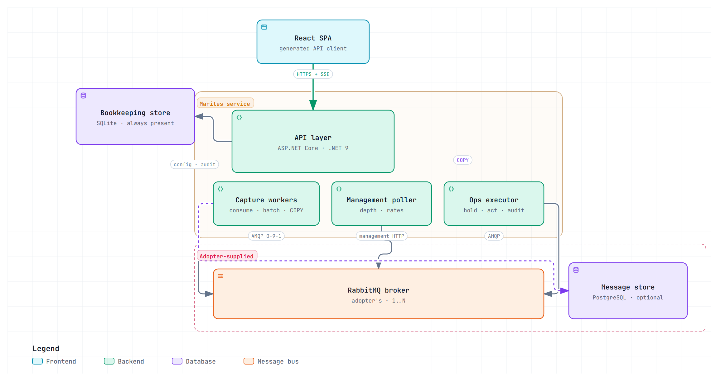

---

document_id: DOC-ARCH-001

title: Solution Architecture Specification

product: Marites

version: 0.1

date: 2026-11

status: Draft — all decisions resolved; no implementation

---


# DOC-ARCH-001 — Solution Architecture Specification


**Source:** [requirements](../02-business/requirements.md), [vocabulary](../14-reference/vocabulary.md), [decisions](decisions.md). Owning document for structure. Settled choices are recorded as ADRs and cited, not restated.


## 1. Architecture baseline


One self-hosted service, one React frontend, an optional PostgreSQL message store, a SQLite bookkeeping file, and a contract-first HTTP boundary that other backend implementations may satisfy. No microservices, no second broker, no message bus between Marites and its own store.





*One service, one optional message store, one bookkeeping store, and a broker the adopter already runs. The API layer and its three workers are one image with three entrypoints (ADR-009); the dashed path is the capture write, which never passes through the API.*


## 2. The constraint that shapes everything


**AMQP has no peek** (SRS C-001). A queue is a destructive read stream: consuming a message removes it, and two consumers on one queue are *competing* consumers — they split messages rather than both observing them.


So "monitor every message" cannot be implemented by attaching a listener. Three strategies exist, and only the first is the product:


### Strategy A — Shadow bindings (primary)


Declare a Marites-owned queue and bind it to the same exchange with the same routing key. RabbitMQ fans out to both queues, so production consumers are untouched and Marites receives a full copy.


- Captures every message published **after** the binding exists (SRS C-002).

- For dead letters, bind to the dead-letter exchange directly. This yields the dead-lettering event itself plus the `x-death` headers explaining why.

- Requires `configure`, `write` and `read` on the `marites.` prefix (`read` is what lets the worker consume its own shadow queue), plus `read` on the watched exchange so the binding can be made. Managed brokers vary — Amazon MQ restricts management API operations and can disable continuous capture entirely.

- Every shadow queue is declared with `x-max-length`, `x-message-ttl`, and its own DLX. A monitor must never be the reason a broker fills its disk (NFR-002).

- Overflow is silent. `x-max-length` drops the oldest copy by default (`reject-publish` would back-pressure producers and violate NFR-002), so a stalled worker loses copies without any error. The worker therefore compares its observed per-queue count with the broker's own publish counter from the management API on every poll, and raises a capture-gap warning (FR-018) when the two diverge beyond a tolerance. The gap is surfaced, never absorbed into a figure described as exact (ADR-019).


### Strategy B — Management API peek (backfill)


`POST /api/queues/{vhost}/{name}/get` with `ackmode=reject_requeue_true` pulls bodies and puts them back. This is the only way to see what is already sitting in a queue before a binding existed.


Blocking, slow, and it disrupts ordering. Must be rate-limited and user-initiated — never on a timer. Used for one-shot backfill and the explicit "inspect now" action (FR-008).


**Peek is not side-effect free.** `reject_requeue_true` sets the `redelivered` flag, and on a quorum queue with a delivery limit a requeue may count toward that limit, so repeated peeks could push a message into the dead-letter exchange. Treat this as unverified until M1 tests it against the target broker version; until then peek on a quorum queue is rate-limited per queue and the UI says it is not side-effect free.


### Strategy C — Firehose tracing (fallback)


The `rabbitmq_tracing` plugin logs publish/deliver events broker-wide. No topology changes, but it is a global file-based firehose: heavy, unsearchable, and it needs broker filesystem access. Offered only where A and B are both blocked.


## 3. Where the tap lives — one hop, not three


A frequent instinct is to insert a second RabbitMQ cluster: *main cluster → tap cluster → Marites API → Postgres.* The instinct — that something must copy messages out — is right. The mechanism is not, for four reasons.


**1. RabbitMQ has no "point at another cluster" tap.** Native clustering fuses nodes into one logical broker, requiring a shared Erlang cookie and a low-latency network. You cannot cluster two independently operated clusters across a network boundary and get tap behaviour. The real cross-cluster mechanisms are:


- **Federation** — a downstream exchange pulls copies from an upstream exchange, non-destructively.

- **Shovel** — moves messages from a source to a destination; destructive from a queue, safe only from an exchange or an unconsumed queue.


The design is therefore *possible* via Federation, at the cost of a second cluster to install, patch, upgrade, back up, and page someone about.


**2. It adds failure points to the thing whose job is to detect failure.** A three-hop chain has three places to break silently. A monitor that quietly stops monitoring is worse than no monitor, because people trust it.


**3. Routing ingestion through the HTTP API is the wrong shape.** If an external tap POSTs messages in, the API becomes a high-throughput ingest tier: one HTTP hop per message, extra serialisation, and a web tier sized for write throughput rather than for users.


**4. It is not needed.** The capture worker is already a tap:


```

Adopter's broker  ──AMQP──▶  Marites capture worker  ──COPY──▶  Postgres

        ▲                                                          │

        └────────────── Marites API ──── reads ────────────────────┘

```


Marites requires **AMQP and management access to whichever broker holds the queues**. What publishes into that broker, or what feeds it upstream, is invisible to Marites and irrelevant to this architecture.


### When a separate hop is justified


| Situation | Use |

|---|---|

| Managed broker blocks topology writes | Federate the upstream exchange into a small broker you control, then tap that |

| Broker and Marites in different network zones | A **relay** — one container, not a cluster: consumes, batches, pushes over HTTPS with a disk-backed buffer |

| Long Marites outages with zero capture loss tolerated | Same relay, buffer sized to the outage |


In every case the added component is a **relay**: one process, no Erlang, no quorum queues, no cluster upgrade path, no split-brain.


### Non-negotiable if any hop is added


The pipeline must expose **lag and last-seen timestamps per hop**, and the dashboard must raise a stale-capture warning when a queue's capture stops advancing while its depth grows (FR-018). Without that, a broken tap is indistinguishable from a quiet system.


## 4. Counting and storage are separate concerns


Exact counts are required for all traffic (FR-002, FR-004); storing a row per message is not survivable at volume (NFR-001). These are different problems with different solutions, specified in [DOC-DATA-001 §3](../07-data-and-contracts/data-model.md). The architectural consequence is a single writer that produces **two** outputs per batch: counters and rows, committed in one transaction.


## 5. Contract-first: the API boundary


The frontend and the backend are separate codebases, built at different times. Without an executable contract they drift, and the drift surfaces as runtime 500s rather than compile errors:


1. **`07-data-and-contracts/openapi/openapi.yaml` is the source of truth.** Written and reviewed before any C# code.

2. **Frontend types are generated** (`openapi-typescript` + `orval`) — never hand-maintained. A field renamed in the contract breaks the React build, which is the correct place to discover it.

3. **A black-box conformance suite** (`contract-tests/`) exercises the running service over HTTP rather than its internals, so it stays valid for any future implementation of the same contract without assuming one exists.

4. **`GET /api/v1/capabilities`** returns a feature list, so the UI hides actions the connected backend cannot perform instead of returning 500s.


Writing the contract first also forces the API to be reviewed as a design artefact — endpoint shapes, error codes, permission boundaries — instead of being discovered afterwards by reading controllers.


The C# backend stays deliberately thin: routing, validation, orchestration. One-file slices keep the implementation legible next to the contract it satisfies.


## 6. Provider abstraction and module map


```

src/

  Marites.Contracts/     # OpenAPI-generated DTOs, enums, error codes. Zero dependencies.

  Marites.Domain/        # ~6 types: BrokerProfile, QueueRef, CaptureRule, MessageCapture,

                         # OperationKind, Role. Behaviour only where it prevents a bug.

  Marites.Brokers/       # Ports, provider registry, capability model. References no SDK.

  Marites.Brokers.RabbitMq/    # AMQP 0-9-1 + Management API — reference implementation

  Marites.Brokers.ServiceBus/  # AMQP 1.0 + Azure.Messaging.ServiceBus

  Marites.Brokers.PubSub/      # gRPC + Google.Cloud.PubSub.V1

  Marites.Storage/       # DbContext, migrations, COPY-based bulk writer, partition sweeper.

  Marites.Operations/    # Guard chain: authorize → validate → dry-run → confirm → rate-limit → execute → audit.

  Marites.Capture/       # Worker logic: topology setup, consume loop, batching, backpressure.

  Marites.Identity/      # Entra ID JWT validation, role→capability mapping, policies.

  Marites.Api/           # Minimal API endpoints, one folder per slice. Composition root.

  Marites.Worker/        # Capture host. Same image, different entrypoint.

tests/

  Marites.UnitTests/

  Marites.IntegrationTests/   # Testcontainers: real Postgres + real RabbitMQ

  contract-tests/             # Black-box HTTP conformance tests

apps/web/                     # React frontend

data-and-contracts/openapi/openapi.yaml         # The product boundary

```


### 6.1 Four ports, not one interface


A single `IMessageBroker` interface would fail on the first provider, because the platforms share vocabulary but not semantics. Four narrow ports express what the product actually needs:


| Port | Responsibility | v1 support |

|---|---|---|

| `IBrokerAdmin` | Discover topology, read metadata (depth, rates, consumers), declare and remove shadow resources, check permissions | All three |

| `IMessageTap` | Establish a non-destructive observation stream from a source | All three — exchange binding, topic subscription, subscription |

| `IMessagePublisher` | Publish or replay to a destination | All three |

| `IMessageInspector` | Peek at messages without consuming them | All three — but by different means: get+requeue, `PeekMessages`, pull-and-hold |


All three v1 providers satisfy all four ports, so the split is not about absence — it is about **shape**. `IMessageInspector` is a one-call operation on Service Bus and a multi-step requeue dance on RabbitMQ; `IMessageTap` is an exchange binding on one platform and a subscription on the others. Collapsing them into one interface would push those differences into `if (provider == ...)` branches.


A future provider may genuinely lack a port. When that happens it is a **declared** state, not an exception: the provider registry resolves a kind to an implementation and reports which ports it satisfies, and the capability record carries that to the UI.


### 6.2 The capability record


Every provider publishes its capabilities; the UI gates features on them rather than assuming.


```

ProviderCapabilities {

  kind, display_name, support_tier,

  can_tap, can_peek, can_publish, can_discard, can_purge, can_replay,

  can_declare_shadow,

  addressing_model,      // exchange_routing | topic_subscription | queue_only | log_offset

  dead_letter_model,     // dlx | dlq_subqueue | redrive_policy | dead_letter_topic | convention | none

  counting_model,        // exact | approximate | derived

  replay_model,          // republish | offset_reset | seek | redrive | none

  discard_model,         // delete_one | truncate | purge_entity | none

  supports_headers, max_payload_bytes

}

```


`replay_model` and `discard_model` exist because neither operation is uniform. Replay is a republish on RabbitMQ and Service Bus, and a subscription seek on Pub/Sub — two mechanisms with different blast radii sharing one button label. The matrix is owned by [VOCABULARY §14](../14-reference/vocabulary.md).


The offset-reset case is the dangerous one: it rewinds an entire consumer group rather than a message, reprocesses everything from that point, and cannot be rate-limited per message. It must be a distinct Admin-only action, not the same control with a different backend.


`GET /api/v1/brokers/{id}/capabilities` returns this per broker profile. This is the mechanism that makes "provider-specific screens" shippable: a provider with no bespoke screen falls back to the generic set, and the UI never renders a button the backend cannot honour.


`counting_model` is a correctness field, not a UI hint. All three v1 providers report exact counts; the field exists so that a future platform reporting estimates or offset-derived figures would be labelled `≈` rather than presented as exact. A monitor that presents an estimate as an exact count is worse than one that admits uncertainty.


### 6.3 Normalised death record


Dead lettering is the product's core value and the least portable concept in messaging. Each provider expresses it differently — a DLX with an `x-death` array, a DLQ sub-queue with `DeadLetterReason`, a redrive policy with a receive count, a dead-letter topic, or nothing at all.


Every adapter maps into one record, preserving the provider's own wording rather than discarding it:


```

DeathInfo {

  is_dead_letter, reason,          // reason values: VOCABULARY §4

  native_reason,                   // provider's own string, never translated away

  death_count, first_dead_at,

  origin_source                    // the queue or topic it came from, if known

}

```


`native_reason` exists because normalisation that discards detail is how a diagnostic tool becomes useless. The normalised `reason` powers aggregation and cross-provider comparison; `native_reason` is what an engineer reads when debugging.


### 6.4 Provider-specific screens with a generic floor


The frontend holds a **screen registry** keyed by `addressing_model` and `kind`:


| Addressing model | Screens |

|---|---|

| `exchange_routing` | Exchange list, bindings, routing-key filters, `x-death` detail |

| `topic_subscription` | Topic list, subscriptions, filter rules, dead-letter sub-queue |

| `queue_only` | Queue list, receive-count, redrive configuration |

| `log_offset` | Topic/partition view, consumer-group lag, offset ranges |

| *(baseline)* | Queue list, message list, counts, message detail |


A provider ships on the baseline and gains bespoke screens later without blocking its release. This is what keeps "provider-specific screens" from becoming "write a separate screen set for every provider before shipping one".


Twelve projects, split by **capability**, not by layer. `Operations` exists because replay, discard, and publish share a guard chain and an audit obligation — a real boundary. There is no `Application` project holding everything, because that is where layered architectures rot.


### Why vertical slices rather than a full onion (ADR-005)


The onion's promise is swappable infrastructure. Here only one infrastructure is genuinely swappable — **the broker**. PostgreSQL is a commitment, not a choice, so `IRepository<T>` over EF Core is ceremony. The HTTP boundary is protected by the OpenAPI contract rather than by interfaces, because the other implementations are in different languages and a C# interface cannot help them.


Dependency inversion is applied at exactly three seams:


| Port | Why it is a real seam |

|---|---|

| `IBrokerAdmin` | Management API is HTTP and mockable; managed providers differ. Preflight needs a fake. |

| `IMessageTap` / `IMessagePublisher` | AMQP client specifics; capture must be testable without a live broker. |

| `IClock` | `x-death` timestamps, retention sweeps, confirm-token TTL — all clock-dependent. |


Everything else uses concrete types.


### Slice anatomy


One file per use case — endpoint, handler, request, response, validation together:


```

Marites.Api/Features/

  Queues/ListQueues.cs          Messages/SearchMessages.cs

  Queues/GetQueueDetail.cs      Messages/GetMessagePayload.cs

  Operations/ReplayMessages.cs  Brokers/AddBrokerProfile.cs

  Operations/PurgeQueue.cs      Brokers/RunPreflight.cs

```


A slice may call `Storage` and `Operations` directly. It may not hold a business rule another slice needs — those move to `Domain` or `Operations`. Sizing test: *if you delete the feature, you delete one file.*


Dispatch goes through a **~50-line in-house dispatcher** (ADR-013): `IRequest<TResponse>`, `IHandler<TRequest, TResponse>`, a registry, and `Send<T>`. It is deliberately not a framework — no pipeline behaviours, no conventions, no scanning magic. Cross-cutting concerns are explicit decorators in the composition root. If the dispatcher grows beyond that, it has become the dependency we rejected on licensing grounds, and the argument only moves from licence risk to maintenance cost.


### The rule that keeps it honest


One architecture test using ArchUnitNET:


- `Marites.Api` must **not** reference `Npgsql` or any provider SDK (`RabbitMQ.Client`, `Azure.Messaging.ServiceBus`, `Google.Cloud.PubSub.V1`)

- `Marites.Brokers` must reference **no** provider SDK — only `Marites.Brokers.*` implementations may

- `Marites.Storage` must **not** reference `Marites.Api` or any provider SDK

- `Marites.Contracts` must reference **nothing**


That test delivers most of what a four-project onion promises, and it fails the build the moment someone shortcuts a boundary.


## 7. Read and capture paths


**Read:**


```

React (MSAL token) → /api/v1/... → slice handler → EF Core query

                   → Postgres → DTO from Marites.Contracts → JSON

```


Reads are thin: projections straight to contract DTOs, no domain logic in the query path.


**Capture:**


```

Worker host

  → topology setup (shadow queue + bindings, bounded)

  → AsyncEventingBasicConsumer, prefetch 1,000   ← at least 2× the batch size

  → normalize (x-death, hash, inline-vs-spill)

  → Channel<CapturedMessage> buffer          ← decouples AMQP thread from DB

  → batch: 500 rows or 1 s

  → BEGIN

  → skip redelivered duplicates via ledger   ← ADR-019

  → Npgsql binary COPY into message_capture  ← not EF Core

  → upsert message_rollup counters           ← same transaction

  → COMMIT

  → ack multiple=true to the batch's last delivery tag (only after durable commit)

```


Two non-obvious choices:


- **`COPY`, not EF Core** (ADR-011). EF Core's batched insert tops out in the low thousands per second with change tracking; `BeginBinaryImport` exceeds 50k. Capture is the one path where this matters.

- **`Channel<T>` between consumer and writer.** RabbitMQ's dispatch thread must never block on PostgreSQL, or broker flow control engages and the broker's problem becomes ours.


The `ack` comes after the commit. A crash mid-batch produces redelivery, not a gap — the correct trade for a monitor.


**Prefetch must exceed the batch size.** With ack-after-commit, at most `prefetch` messages are in flight. A prefetch below the batch size means the 500-row trigger can never fire, every flush waits for the 1 s timer, and throughput collapses to `prefetch ÷ 1 s` (200 msg/s at the old value of 200) against an NFR-001 target of 5,000. Sustained throughput per channel is bounded by `prefetch ÷ commit round-trip`, so 1,000 leaves headroom for a 200 ms commit. Verify with a load test at M2.


**Redelivery is not free for counters.** Rows tolerate a duplicate; additive rollup counters do not, and rollups are never rebuilt from rows (ADR-007). A crash between `COMMIT` and `ack` would therefore over-count permanently. ADR-019 adds a redelivery ledger, so a redelivered message is counted once.


## 8. Identity and authorization


Entra ID via OIDC (ADR-008). React uses MSAL.js with auth code + PKCE; the API validates JWT bearer tokens. Roles are **Entra App Roles** arriving in the `roles` claim — cleaner than security groups, which require a Graph call per request.


Roles map to **capabilities**, not endpoints. Policy-based authorization, with the role→capability table living in exactly one place (`Marites.Identity`). The matrix is owned by [DOC-UX-001 §2](../08-experience/dashboard-and-operations.md).


Two things that will bite if left implicit:


- **Break-glass admin is mandatory for self-hosted software.** When Entra is unreachable or misconfigured, an on-prem install must still be administrable. A local admin account, disabled by default, enabled by environment variable, with every use written to the audit log.

- **`MARITES_AUTH_MODE=none|entra`.** The single-server profile needs no identity provider. `none` binds to loopback only and refuses to start on a non-loopback address.


## 9. Process topology


One image, three entrypoints:


| Command | Runs | Used by |

|---|---|---|

| `marites api` | HTTP only | K8s Deployment (N replicas behind a Service) |

| `marites worker` | Capture only | K8s Deployment (scaled by shard count) |

| `marites all` | Both in one process | Docker Compose, single server |


Splitting is a deployment concern, not a code concern — the same assemblies either way. Capture replicas claim queue shards via PostgreSQL advisory locks, so scaling out is safe and no queue is captured twice.


## 10. Multiple clusters


Adopters run more than one cluster — prod and staging, per-region, per-team. This does not add hops. Marites is a client of **N clusters in a star**:


```

          ┌── prod cluster ──────┐

Marites ──┼── staging cluster ───┤   one hop per cluster,

          └── eu-west cluster ───┘   independent connections

```


Each cluster gets its own `broker_profile`, preflight result, health state, and capture worker with its own connection — **bulkhead isolation**. One unreachable or slow cluster must not stall the others.


**Identity is never the queue name.** `orders` exists in prod and staging simultaneously. Every key is `(broker_profile_id, vhost, queue_name)`; every captured row carries `broker_profile_id`.


**Environment tags are a safety feature.** Every operation confirmation displays cluster and environment; prod is visually distinct; replay against `prod` requires typing the environment tag, matching the purge pattern.


**Dedupe.** If clusters are linked by Federation or Shovel, the same message exists in more than one cluster and is captured once per cluster. Policy choice is DEC-008; the default is per-cluster scoping, because aggressive cross-cluster dedupe can mask a genuine double-publish.


**Storage:** one PostgreSQL for all clusters. Do not give each cluster its own database — cross-cluster comparison is the reason people want a single dashboard.


**Ceiling:** dozens of clusters, not hundreds. Beyond roughly fifty, add regional relays that aggregate per zone — the relay from §3, not a second broker.


## 11. Why not microservices


One team, one database, and capture writes to the store the API reads. Splitting now buys network partitions and distributed transactions for nothing. The worker boundary in §9 is already the seam to cut along if capture outgrows the API, and because `Marites.Capture` has no dependency on `Marites.Api`, that cut stays cheap.


## 12. Document control


Revision 0.1 records the initial architecture. ADR-001 to ADR-019 are Accepted (ADR-019, redelivery-safe counting, was added and accepted in November 2026). Reviewed November 2026: prefetch sized above the batch, `read` added to the shadow-queue grant, SSE settled as the live transport, and "redact" removed from the capture path (DEC-006). No code exists and no behaviour has been observed.

