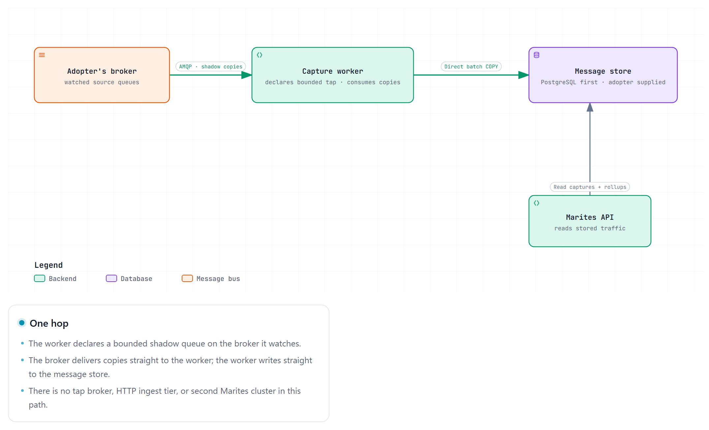
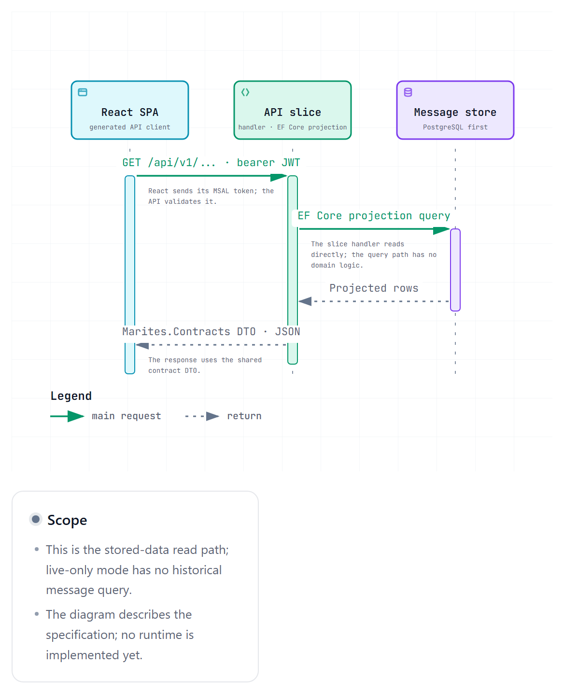
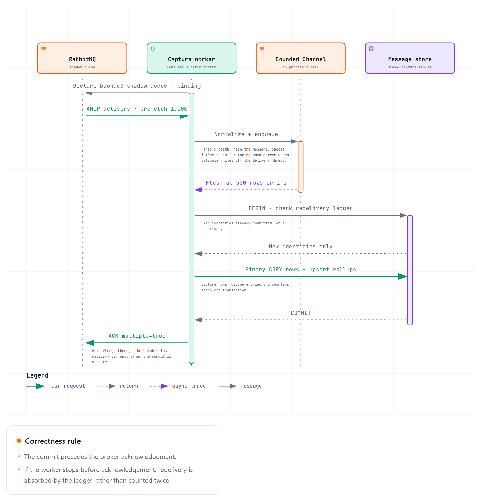
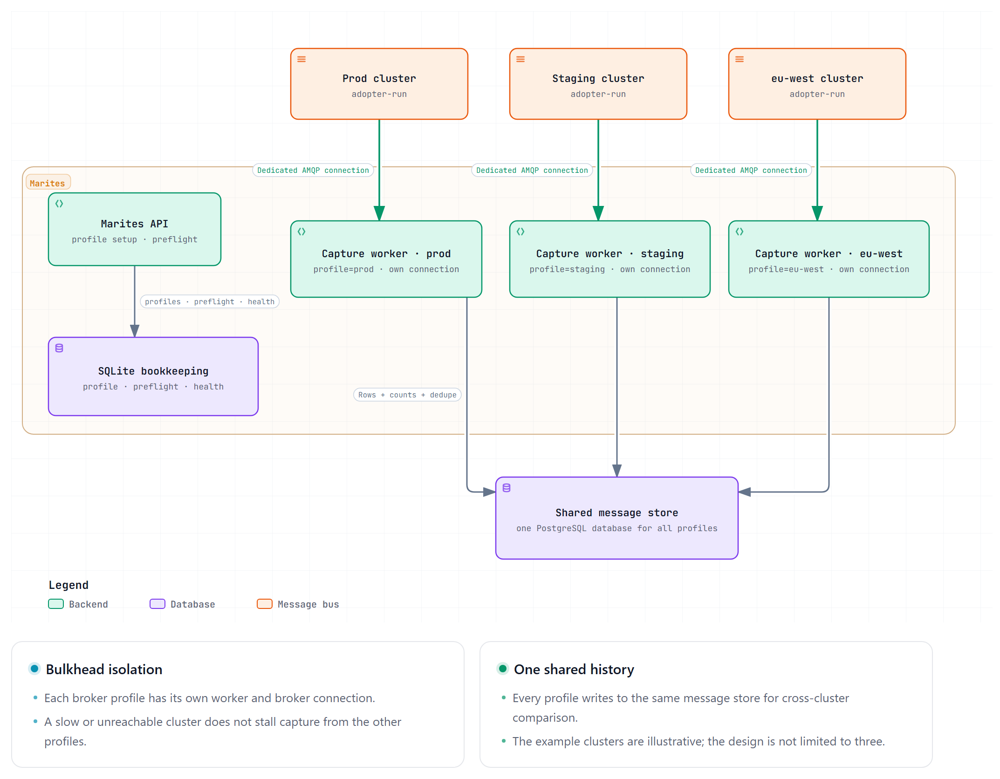

# DOC-ARCH-001 — Solution Architecture Specification

**Source:** [requirements](../02-business/requirements.md), [vocabulary](../14-reference/vocabulary.md), [decisions](decisions.md). Owning document for structure. Settled choices are recorded as ADRs and cited, not restated.

## 1. Architecture baseline

One self-hosted application, one React frontend, an always-present SQLite bookkeeping store, and an optional adopter-supplied message store (PostgreSQL first, SQL Server second). The React SPA and API meet at a contract-first HTTP boundary. Provider adapters connect Marites to one or more adopter-run RabbitMQ, Azure Service Bus, or Google Pub/Sub platforms. No microservices, no second broker, no message bus between Marites and its stores.


*The RabbitMQ/PostgreSQL reference view, with the worker decomposition this section is about. The API and capture worker share one image with the `marites api`, `marites worker`, and `marites all` entrypoints (ADR-009). Capture writes go directly to the message store, not through the API. The provider-agnostic view, and the ownership of the two stores, is [C4 §2](c4-model.md).*

## 2. The constraint that shapes everything

**AMQP has no peek** (SRS C-001). A queue is a destructive read stream: consuming a message removes it, and two consumers on one queue are *competing* consumers — they split messages rather than both observing them.

So "monitor every message" cannot be implemented by attaching a listener. Three strategies exist, and only the first is the product:

### Strategy A — Shadow bindings (primary)

Declare a Marites-owned queue and bind it to the same exchange with the same routing key. RabbitMQ fans out to both queues, so production consumers are untouched and Marites receives a full copy.

- Captures every message published **after** the binding exists (SRS C-002).
- For dead letters, bind to the dead-letter exchange directly. This yields the dead-lettering event itself plus the `x-death` headers explaining why.
- Requires `configure`, `write` and `read` on the `marites.` prefix (`read` is what lets the worker consume its own shadow queue), plus `read` on the watched exchange so the binding can be made. Managed brokers vary — Amazon MQ restricts management API operations and can disable continuous capture entirely.
- Every shadow queue is declared with `x-max-length`, `x-message-ttl`, and its own DLX. A monitor must never be the reason a broker fills its disk (NFR-002).
- Overflow is silent. `x-max-length` drops the oldest copy by default (`reject-publish` would back-pressure producers and violate NFR-002), so a stalled worker loses copies without any error. The worker therefore compares its observed per-queue count with the broker's own publish counter from the management API on every poll, and raises a capture-gap warning (FR-018) when the two diverge beyond a tolerance. The gap is surfaced, never absorbed into a figure described as exact (ADR-019).

### Strategy B — Management API peek (backfill)

`POST /api/queues/{vhost}/{name}/get` with `ackmode=reject_requeue_true` pulls bodies and puts them back. This is the only way to see what is already sitting in a queue before a binding existed.

Blocking, slow, and it disrupts ordering. Must be rate-limited and user-initiated — never on a timer. Used for one-shot backfill and the explicit "inspect now" action (FR-008).

**Peek is destructive on a quorum queue, and the loss is silent.** Measured against RabbitMQ 3.13.7 (M1, November 2026): a durable quorum queue with `x-delivery-limit: 3`, a dead-letter exchange and a DLQ, one message, then five `reject_requeue_true` gets. Four peeks returned the message; afterwards the queue held zero and the DLQ held zero. **The message was destroyed, and it did not land in the dead-letter exchange** — the failure the earlier wording anticipated.

So a rate limit is not a mitigation: it bounds how fast messages are lost, not whether. On a quorum queue Marites does not offer peek at all and returns `ERR-CAP-001`, because the only non-destructive read of a body is the shadow-queue copy, which is capture (M2), not peek. On a classic queue `reject_requeue_true` sets `redelivered` and counts toward no limit, so peek remains available there and the dialog says *not side-effect free*.

### Strategy C — Firehose tracing (fallback)

The `rabbitmq_tracing` plugin logs publish/deliver events broker-wide. No topology changes, but it is a global file-based firehose: heavy, unsearchable, and it needs broker filesystem access. Offered only where A and B are both blocked.

## 3. Where the tap lives — one hop, not three

A frequent instinct is to insert a second RabbitMQ cluster: *main cluster → tap cluster → Marites API → Postgres.* The instinct — that something must copy messages out — is right. The mechanism is not, for four reasons.

**1. RabbitMQ has no "point at another cluster" tap.** Native clustering fuses nodes into one logical broker, requiring a shared Erlang cookie and a low-latency network. You cannot cluster two independently operated clusters across a network boundary and get tap behaviour. The real cross-cluster mechanisms are:

- **Federation** — a downstream exchange pulls copies from an upstream exchange, non-destructively.
- **Shovel** — moves messages from a source to a destination; destructive from a queue, safe only from an exchange or an unconsumed queue.

The design is therefore *possible* via Federation, at the cost of a second cluster to install, patch, upgrade, back up, and page someone about.

**2. It adds failure points to the thing whose job is to detect failure.** A three-hop chain has three places to break silently. A monitor that quietly stops monitoring is worse than no monitor, because people trust it.

**3. Routing ingestion through the HTTP API is the wrong shape.** If an external tap POSTs messages in, the API becomes a high-throughput ingest tier: one HTTP hop per message, extra serialisation, and a web tier sized for write throughput rather than for users.

**4. It is not needed.** The capture worker is already a tap:



Marites requires **AMQP and management access to whichever broker holds the queues**. What publishes into that broker, or what feeds it upstream, is invisible to Marites and irrelevant to this architecture.

### When a separate hop is justified

| Situation | Use |
|---|---|
| Managed broker blocks topology writes | Federate the upstream exchange into a small broker you control, then tap that |
| Broker and Marites in different network zones | A **relay** — one container, not a cluster: consumes, batches, pushes over HTTPS with a disk-backed buffer |
| Long Marites outages with zero capture loss tolerated | Same relay, buffer sized to the outage |

In every case the added component is a **relay**: one process, no Erlang, no quorum queues, no cluster upgrade path, no split-brain.

### Non-negotiable if any hop is added

The pipeline must expose **lag and last-seen timestamps per hop**, and the dashboard must raise a stale-capture warning when a queue's capture stops advancing while its depth grows (FR-018). Without that, a broken tap is indistinguishable from a quiet system.

## 4. Counting and storage are separate concerns

Exact counts are required for all traffic (FR-002, FR-004); storing a row per message is not survivable at volume (NFR-001). These are different problems with different solutions, specified in [DOC-DATA-001 §3](../07-data-and-contracts/data-model.md). The architectural consequence is a single writer that produces **two** outputs per batch: counters and rows, committed in one transaction.

## 5. Contract-first: the API boundary

The frontend and the backend are separate codebases, built at different times. Without an executable contract they drift, and the drift surfaces as runtime 500s rather than compile errors:

1. **`07-data-and-contracts/openapi/openapi.yaml` is the source of truth.** Written and reviewed before any C# code.
2. **Frontend types are generated** (`openapi-typescript` + `orval`) — never hand-maintained. A field renamed in the contract breaks the React build, which is the correct place to discover it.
3. **A black-box conformance suite** (`contract-tests/`) exercises the running service over HTTP rather than its internals, so it stays valid for any future implementation of the same contract without assuming one exists.
4. **`GET /api/v1/capabilities`** returns a feature list, so the UI hides actions the connected backend cannot perform instead of returning 500s.

Writing the contract first also forces the API to be reviewed as a design artefact — endpoint shapes, error codes, permission boundaries — instead of being discovered afterwards by reading controllers.

The C# backend stays deliberately thin: routing, validation, orchestration. One-file slices keep the implementation legible next to the contract it satisfies.

## 6. Provider abstraction and module map

```
src/
  Marites.Contracts/     # OpenAPI-generated DTOs, enums, error codes. Zero dependencies.
  Marites.Domain/        # ~6 types: BrokerProfile, QueueRef, CaptureRule, MessageCapture,
                         # OperationKind, Role. Behaviour only where it prevents a bug.
  Marites.Application/   # Use cases, commands, queries, orchestration and ports.
  Marites.Infrastructure/ # SQLite/message-store and broker adapters, capture writer, external clients.
  Marites.Api/           # Thin HTTP presentation layer and composition root.
  Marites.Worker/        # Application/Infrastructure host. Same image, different entrypoint.
tests/
  Marites.UnitTests/
  Marites.IntegrationTests/   # Testcontainers: real Postgres + real RabbitMQ
  contract-tests/             # Black-box HTTP conformance tests
apps/web/                     # React frontend
data-and-contracts/openapi/openapi.yaml         # The product boundary
```

### 6.1 Four ports, not one interface

A single `IMessageBroker` interface would fail on the first provider, because the platforms share vocabulary but not semantics. Four narrow ports express what the product actually needs:

| Port | Responsibility | v1 support |
|---|---|---|
| `IBrokerAdmin` | Discover topology, read metadata (depth, rates, consumers), declare and remove shadow resources, check permissions | All three |
| `IMessageTap` | Establish a non-destructive observation stream from a source | All three — exchange binding, topic subscription, subscription |
| `IMessagePublisher` | Publish or replay to a destination | All three |
| `IMessageInspector` | Peek at messages without consuming them | All three — but by different means: get+requeue, `PeekMessages`, pull-and-hold |

All three v1 providers satisfy all four ports, so the split is not about absence — it is about **shape**. `IMessageInspector` is a one-call operation on Service Bus and a multi-step requeue dance on RabbitMQ; `IMessageTap` is an exchange binding on one platform and a subscription on the others. Collapsing them into one interface would push those differences into `if (provider == ...)` branches.

A future provider may genuinely lack a port. When that happens it is a **declared** state, not an exception: the provider registry resolves a kind to an implementation and reports which ports it satisfies, and the capability record carries that to the UI.

### 6.2 The capability record

Every provider publishes its capabilities; the UI gates features on them rather than assuming.

```
ProviderCapabilities {
  kind, display_name, support_tier,
  can_tap, can_peek, can_publish, can_discard, can_purge, can_replay,
  can_declare_shadow,
  addressing_model,      // exchange_routing | topic_subscription | queue_only | log_offset
  dead_letter_model,     // dlx | dlq_subqueue | redrive_policy | dead_letter_topic | convention | none
  counting_model,        // exact | approximate | derived
  replay_model,          // republish | offset_reset | seek | redrive | none
  discard_model,         // delete_one | truncate | purge_entity | none
  supports_headers, max_payload_bytes
}
```

`replay_model` and `discard_model` exist because neither operation is uniform. Replay is a republish on RabbitMQ and Service Bus, and a subscription seek on Pub/Sub — two mechanisms with different blast radii sharing one button label. The matrix is owned by [VOCABULARY §14](../14-reference/vocabulary.md).

The offset-reset case is the dangerous one: it rewinds an entire consumer group rather than a message, reprocesses everything from that point, and cannot be rate-limited per message. It must be a distinct Admin-only action, not the same control with a different backend.

`GET /api/v1/brokers/{id}/capabilities` returns this per broker profile. This is the mechanism that makes "provider-specific screens" shippable: a provider with no bespoke screen falls back to the generic set, and the UI never renders a button the backend cannot honour.

`counting_model` is a correctness field, not a UI hint. All three v1 providers report exact counts; the field exists so that a future platform reporting estimates or offset-derived figures would be labelled `≈` rather than presented as exact. A monitor that presents an estimate as an exact count is worse than one that admits uncertainty.

### 6.3 Normalised death record

Dead lettering is the product's core value and the least portable concept in messaging. Each provider expresses it differently — a DLX with an `x-death` array, a DLQ sub-queue with `DeadLetterReason`, a redrive policy with a receive count, a dead-letter topic, or nothing at all.

Every adapter maps into one record, preserving the provider's own wording rather than discarding it:

```
DeathInfo {
  is_dead_letter, reason,          // reason values: VOCABULARY §4
  native_reason,                   // provider's own string, never translated away
  death_count, first_dead_at,
  origin_source                    // the queue or topic it came from, if known
}
```

`native_reason` exists because normalisation that discards detail is how a diagnostic tool becomes useless. The normalised `reason` powers aggregation and cross-provider comparison; `native_reason` is what an engineer reads when debugging.

### 6.4 Provider-specific screens with a generic floor

The frontend holds a **screen registry** keyed by `addressing_model` and `kind`:

| Addressing model | Screens |
|---|---|
| `exchange_routing` | Exchange list, bindings, routing-key filters, `x-death` detail |
| `topic_subscription` | Topic list, subscriptions, filter rules, dead-letter sub-queue |
| `queue_only` | Queue list, receive-count, redrive configuration |
| `log_offset` | Topic/partition view, consumer-group lag, offset ranges |
| *(baseline)* | Queue list, message list, counts, message detail |

A provider ships on the baseline and gains bespoke screens later without blocking its release. This is what keeps "provider-specific screens" from becoming "write a separate screen set for every provider before shipping one".

The backend uses four dependency layers under the modular-monolith deployment: `Marites.Domain`, `Marites.Application`, `Marites.Infrastructure`, and `Marites.Api`. Feature slices remain inside Application and the API endpoint groups; they no longer combine endpoint, persistence, and business rules in one file. The detailed context, aggregate, persistence, and event boundaries are owned by [backend DDD architecture](backend-ddd.md) (ADR-025).

`Marites.Contracts` remains a generated, dependency-free HTTP contract package. The API and worker hosts are composition roots. Only Infrastructure contains concrete database and provider SDK adapters. Application depends on Domain; Infrastructure implements Application ports; API calls Application use cases and wires implementations. No Domain type depends on a framework, database, provider SDK, HTTP type, or contract DTO.

ADR-013 remains in force: use the small in-house dispatcher, not a third-party mediator. Vertical slices are a way to organize use cases within the layers, not a substitute for the layers. `IBrokerAdmin`, `IMessageTap` / `IMessagePublisher`, `IClock`, and the storage port remain explicit seams. Capture retains its direct batch write path and Npgsql binary `COPY` (ADR-011); ordinary bookkeeping and query persistence use the adapters described in [backend DDD architecture](backend-ddd.md).

The dependency rule is enforced at project boundaries: Domain references no outer layer; Application references Domain; Infrastructure references Application and Domain; API references Application and the Infrastructure composition root. Provider SDKs and database packages do not flow into Domain, Application, or endpoint code.

## 7. Read and capture paths

**Read:**



Reads are thin: Application query handlers project read models to contract response DTOs without loading aggregate graphs for rules that do not apply. API/Infrastructure mapping keeps external DTOs out of Domain. See [backend DDD architecture §4–6](backend-ddd.md).

**Capture:**



Two non-obvious choices:

- **`COPY`, not EF Core** (ADR-011). EF Core's batched insert tops out in the low thousands per second with change tracking; `BeginBinaryImport` exceeds 50k. Capture is the one path where this matters.
- **`Channel<T>` between consumer and writer.** RabbitMQ's dispatch thread must never block on PostgreSQL, or broker flow control engages and the broker's problem becomes ours.

The `ack` comes after the commit. A crash mid-batch produces redelivery, not a gap — the correct trade for a monitor.

**Prefetch must exceed the batch size.** With ack-after-commit, at most `prefetch` messages are in flight. A prefetch below the batch size means the 500-row trigger can never fire, every flush waits for the 1 s timer, and throughput collapses to `prefetch ÷ 1 s` against an NFR-001 target of 5,000. Sustained throughput per channel is bounded by `prefetch ÷ commit round-trip`, so the default of 1,000 reaches the 5,000 msg/s target only while a commit round-trip stays at or under 200 ms. That is the ceiling, not headroom: a slower commit needs a higher in-flight limit, and the setting is a starting point rather than a validated value. Operators can tune the in-flight limit with `MARITES_PREFETCH_COUNT` (configuration reference §2); verify the setting with a load test at M2.

**Redelivery is not free for counters.** Rows tolerate a duplicate; additive rollup counters do not, and rollups are never rebuilt from rows (ADR-007). A crash between `COMMIT` and `ack` would therefore over-count permanently. ADR-019 adds a redelivery ledger, so a redelivered message is counted once.

## 8. Identity and authorization

Identity is **explicitly configured**, never inferred (ADR-008). `MARITES_AUTH_MODE` selects one of three modes, and the server refuses to start with a value it does not recognise:

| Mode | Who proves identity | What the API accepts |
|---|---|---|
| `entra` | Entra ID via OIDC. React uses MSAL.js with auth code + PKCE | A JWT bearer token on every request, validated for issuer, audience, signature and expiry. Roles arrive as **App Roles** in the `roles` claim — cleaner than security groups, which require a Graph call per request |
| `google` | Google sign-in. React opens the Google popup and receives a Google ID token | The ID token once, at `POST /auth/google`; afterwards a **Marites session** cookie |
| `none` | Nobody. The single-server evaluation profile | No credentials. Loopback only, refused on any non-loopback address |

**Google sign-in, step by step.** The browser obtains a Google ID token through the popup; no client secret is involved, and the client ID is public configuration. The API validates the token before trusting any claim: signature against Google's published keys, issuer (`accounts.google.com` or `https://accounts.google.com`), audience (the configured client ID), and expiry, with a small clock-skew allowance. A token that fails any check is `401 ERR-AUTH-001`.

A valid token proves identity, not permission. The API looks the verified `(issuer, subject)` pair up in `app_user` — the **explicit Marites role mapping** — and the row's role becomes the caller's role. A valid Google account with no mapping gets **no access**: the answer is `403 ERR-AUTH-002`, not a default role, and the response names the caller's own `subject` so an operator can create the mapping. Mapping is an operator action (`marites identity grant`), recorded in the bookkeeping store; it is never derived from a Google group, a domain suffix, or an email pattern.

**The Marites session.** After a successful exchange the API sets `marites_session`: HttpOnly (unreadable from JavaScript), `SameSite=Lax`, `Secure` whenever the public URL is HTTPS, scoped to `/`, and signed with a key derived from `MARITES_KEK`. The cookie carries the user, role, issue time and absolute expiry — not a Google token, which is discarded. Sessions expire absolutely after `MARITES_SESSION_HOURS` (default 8) and are validated on every request: signature, expiry, the user still exists, and the session was issued after the user's last revocation. `POST /auth/logout` clears the cookie and sets the user's revocation timestamp, which invalidates every session that user holds — the "sign out everywhere" behaviour a stolen laptop needs. Logout is idempotent.

**CSRF.** A cookie is attached by the browser automatically, so a state-changing request must prove it came from Marites' own page. Every write authenticated by the session cookie carries `X-CSRF-Token`, compared against the `marites_csrf` cookie issued alongside the session (double submit); a mismatch is `403 ERR-AUTH-002` with a remedy, and nothing executes. `SameSite=Lax` blocks the cross-site POST in modern browsers; the token is the control that does not depend on browser behaviour. Reads are not required to carry it, and bearer-authenticated requests are exempt — a token in a header is not attached automatically.

Roles map to **capabilities**, not endpoints, in both modes. Policy-based authorization, with the role→capability table owned by `Marites.Application` as part of authorization orchestration. The matrix is owned by [DOC-UX-001 §2](../08-experience/dashboard-and-operations.md) and is identical for Entra and Google — the provider decides *who*, never *what*.

Two things that will bite if left implicit:

- **Break-glass admin is mandatory for self-hosted software.** When the identity provider is unreachable or misconfigured, an on-prem install must still be administrable. A local admin account, disabled by default, enabled by environment variable, with every use written to the audit log. It exists in every mode, including `google`.
- **`none` binds to loopback only.** The single-server profile needs no identity provider; `none` refuses to start on a non-loopback address. So does plain HTTP outside loopback, because a session cookie or bearer token over cleartext is a token on the wire.

## 9. Process topology

One image, three entrypoints:

| Command | Runs | Used by |
|---|---|---|
| `marites api` | HTTP only | K8s Deployment (N replicas behind a Service) |
| `marites worker` | Capture only | K8s Deployment (scaled by shard count) |
| `marites all` | Both in one process | Docker Compose, single server |

Splitting is a deployment concern, not a code concern — the same assemblies either way. Capture replicas claim queue shards via PostgreSQL advisory locks, so scaling out is safe and no queue is captured twice.

## 10. Multiple clusters

Adopters run more than one cluster — prod and staging, per-region, per-team. This does not add hops. Marites is a client of **N clusters in a star**:



Each cluster gets its own `broker_profile`, preflight result, health state, and capture worker with its own connection — **bulkhead isolation**. One unreachable or slow cluster must not stall the others.

**Identity is never the queue name.** `orders` exists in prod and staging simultaneously. Every key is `(broker_profile_id, vhost, queue_name)`; every captured row carries `broker_profile_id`.

**Environment tags are a safety feature.** Every operation confirmation displays cluster and environment; prod is visually distinct; replay against `prod` requires typing the environment tag, matching the purge pattern.

**Dedupe.** If clusters are linked by Federation or Shovel, the same message exists in more than one cluster and is captured once per cluster. Policy choice is DEC-008; the default is per-cluster scoping, because aggressive cross-cluster dedupe can mask a genuine double-publish.

**Storage:** one shared adopter message store for all clusters, plus the always-present SQLite bookkeeping store. Do not give each cluster its own message database — cross-cluster comparison is the reason people want a single dashboard. PostgreSQL is the first supported message-store engine; SQL Server follows at M7.

**Ceiling:** dozens of clusters, not hundreds. Beyond roughly fifty, add regional relays that aggregate per zone — the relay from §3, not a second broker.

## 11. Why not microservices

One team and one shared message store; capture writes to the store the API reads. The separate SQLite bookkeeping store does not participate in capture transactions. Splitting now buys network partitions and distributed transactions for nothing. The worker boundary in §9 is already the seam to cut along if capture outgrows the API, and because the worker host has no dependency on the API presentation layer, that cut stays cheap.

## 12. Document control

Revision 0.2 records the current architecture. ADR-001 to ADR-025 stand; ADR-004 and ADR-005 are superseded. Reviewed November 2026: DDD layers and two-store responsibilities follow ADR-025 and ADR-022, prefetch is configurable above the batch size, `read` is included in the shadow-queue grant, SSE is the live transport, and "redact" is removed from the capture path (DEC-006). No code exists and no behaviour has been observed.
