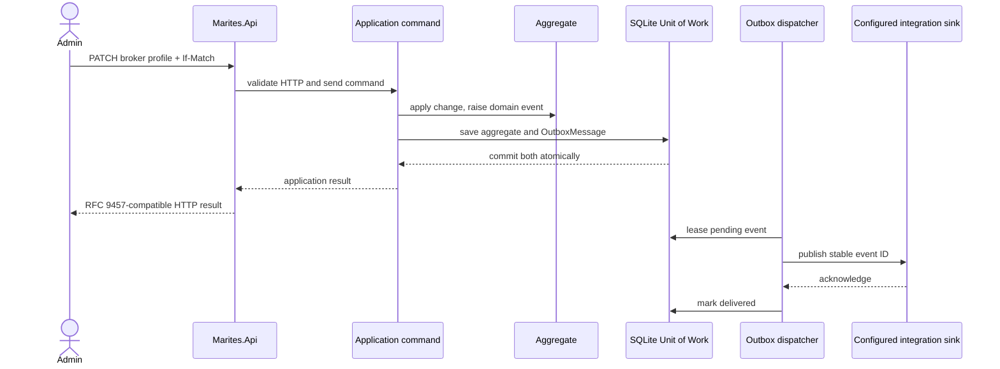

# Backend DDD and Clean Architecture

**Scope.** This document defines the backend model and dependency boundaries for the existing modular monolith. It preserves the product behavior, storage split, provider semantics, and HTTP boundary already recorded in the requirements, ADRs, data model, workflows, and API contract. Bounded contexts are code-model boundaries inside one product; they are not microservices or deployment units.

## 1. Bounded-context map

The five current responsibility areas are formalized as bounded contexts. `operation_audit` has one writer and one owning context; other contexts may read its projection but do not own or update the record.

| Bounded context | Owns | Aggregate roots and records | Boundary / key rule |
|---|---|---|---|
| Broker Connections and Providers | Broker profiles, credentials, preflight outcomes, capability snapshots | `BrokerProfile`; `ProviderCapabilities` is a provider snapshot, not an aggregate | Marites connects to adopter-run brokers and creates only its own `marites.` objects. It never provisions or repairs adopter topology (ADR-001). Tenant identity is supplied by Access, Roles, and Audit Access. |
| Capture and Counting | Queue observation identity, capture policy, capture batches, redelivery ledger, rollup tiers | `QueueRef` with one `CaptureRule`; `message_capture`, `capture_dedupe`, and `message_rollup` are high-volume write/read records, not one-message aggregates | Queue identity is `(broker_profile_id, vhost, name, source_kind)`. Capture is forward-only; redelivery ledger, row insert, and rollup update share one message-store transaction (ADR-019). |
| Dead-letter Recovery | Guarded peek/discard/purge/replay/publish, proposals, operation progress, audit evidence | `OperationIntent`, `ReplayJob`, and immutable `OperationRecord` (`operation_audit` plus retained `operation_payload`) | Bodies are held before destructive effects; audit/evidence is promoted only after broker confirmation; reconciliation closes the external-effect window (ADR-023). No scheduled destructive operation (NFR-004). |
| Reporting and Metrics | Read-only metric and availability projections | No write aggregate; projections read `message_rollup` only | Counts remain available after message rows expire; `published` and `dead_lettered` are separate observations and are never summed. |
| Access, Roles, and Audit Access | Tenant membership, role-to-capability policy, identity and audit authorization | `Tenant`, `AppUser`; reads the Recovery context's append-only audit projection | Entra owns sessions; Marites stores no access tokens. Tenant scope and capability policy are enforced server-side. Audit has one writer in Dead-letter Recovery. |

The aggregate names above describe the domain model, not a one-table-per-aggregate rule. In particular, message captures and rollups are not loaded as object graphs, and `operation_audit` is never updated or deleted.

## 2. Aggregates and invariants

| Aggregate root | Entities/value objects inside or associated with it | Invariants owned by the root/application boundary | Current persistence mapping |
|---|---|---|---|
| `Tenant` | `TenantId`, `TenantSlug`, tenant name | Slug is unique and normalized; all owned configuration and reads are tenant-scoped | `tenant` in bookkeeping SQLite |
| `AppUser` | `UserId`, `TenantId`, `Role`, break-glass marker | Roles map to the single capability matrix; break-glass is disabled by default and every use is audited | `app_user` in bookkeeping SQLite |
| `BrokerProfile` | `BrokerProfileId`, `ProviderKind`, `EnvironmentTag`, `CredentialKind`, encrypted credential envelope, `Revision` | Name unique per tenant; credentials are write-only and never logged; stale revision is rejected; a failing mandatory preflight prevents capture enablement | `broker_profile`; capability snapshot is `capabilities_json` |
| `QueueRef` | `QueueRefId`, `BrokerProfileId`, `Vhost`, `SourceKind`, one `CaptureRule`; `CapturePolicy`, `PayloadPolicy`, `RowRetention` | Queue identity includes broker and vhost; one capture rule per queue; row retention cannot outlive required rollup coverage; unsupported provider action returns `ERR-CAP-001` | `queue_ref` plus `capture_rule` in bookkeeping SQLite |
| `OperationIntent` | `OperationId`, actor/tenant identity, target, typed confirmation, held bodies, expiry | No destructive broker command without a durable body hold; state is `held`, `promoted`, or `abandoned`; expired unresolved intents are reconciled before cleanup | `operation_intent` in bookkeeping SQLite |
| `ReplayJob` | `ReplayJobId`, progress, halt reason, actor and target | Rate and batch limits apply; partial effect is `Unresolved` and reconciled, never blind-retried; auto-halt when the target grows faster than it drains | `replay_job` in bookkeeping SQLite |
| `OperationRecord` | immutable audit facts plus per-message evidence with its independent retention date | One append-only operation record after broker confirmation; payload evidence is complete up to the stated bound; evidence expiry never deletes the audit fact or its surviving hash | `operation_audit` and `operation_payload` in bookkeeping SQLite |

`TenantId`, `UserId`, `BrokerProfileId`, `QueueRefId`, `ReplayJobId`, `OperationId`, and `AuditId` are distinct strongly typed IDs in C#. They persist in the existing UUID columns; IDs are opaque at the HTTP boundary. Immutable value objects include `ProviderKind`, `EnvironmentTag`, `CredentialKind`, `CapturePolicy`, `PayloadPolicy`, `Revision`, `TimeRange`, `Cursor`, and `CapabilitySet`. Provider-specific credential encryption and wire formats stay in Infrastructure.

Repository ports are named per root: `ITenantRepository`, `IAppUserRepository`, `IBrokerProfileRepository`, `IQueueRefRepository`, `IOperationIntentRepository`, `IReplayJobRepository`, and `IOperationRecordRepository`. Reporting uses read-only query ports such as `IMessageSearchQuery` and `IMetricReadQuery`; raw `message_capture` and rollup tables do not receive generic aggregate repositories.

### Domain services and specifications

- `OperationGuard` evaluates tenant, actor, role/capability, provider capability, environment confirmation, typed confirmation, dry-run, and operation limits before a command is issued. The authoritative rule stays on the server.
- `CapturePolicyEvaluator` enforces storage ceiling, payload mode, row retention, and rollup-retention floor. It returns a projected storage cost without mutating the broker.
- Provider adapters normalize provider facts into the domain vocabulary; provider SDK calls and `x-death` parsing are infrastructure concerns, not domain services.
- Named specifications may express `QueueCanCapture`, `OperationCanRun`, and `EvidenceIsRetained`. They contain pure domain predicates and do not query HTTP, a database, or a broker themselves.
- Metric availability is a query projection over rollup tiers, not an aggregate invariant.

### Domain events

Events are raised only after a domain transition succeeds. The initial event vocabulary is `BrokerProfileRegistered`, `BrokerProfileChanged`, `PreflightCompleted`, `CapturePolicyChanged`, `RecoveryOperationStarted`, `RecoveryOperationResolved`, `ProposalSubmitted`, and `PayloadEvidenceExpired`. Event payloads carry IDs and outcome facts, never credentials or message bodies. Capture does not emit one event per message; the high-throughput batch path remains governed by ADR-019 and ADR-024.

## 3. Four backend layers

| Layer/project | Responsibility | Dependency rule |
|---|---|---|
| Domain (`Marites.Domain`) | Aggregates, entities, immutable value objects, strongly typed IDs, domain events, domain services, specifications, and one repository interface per aggregate root | Depends on no outer layer, framework, database, provider SDK, or HTTP/OpenAPI DTO |
| Application (`Marites.Application`) | Commands, queries, use cases, input validation, authorization orchestration, DTOs, repository ports for read projections, unit-of-work boundary, and event collection | Depends on Domain; does not know endpoint paths, HTTP status codes, or concrete adapters |
| Infrastructure (`Marites.Infrastructure`) | EF Core/Dapper persistence adapters, SQLite and message-store adapters, Npgsql `COPY` capture writer, outbox dispatcher, provider clients/adapters, Entra/AI clients, caching adapters | Implements Domain/Application ports; never called directly by Domain |
| Presentation/API (`Marites.Api`) | Thin ASP.NET Core endpoints, HTTP-to-application mapping, RFC 9457 responses, middleware, authentication/authorization, and API composition root | Calls Application use cases; contains no business rules, database queries, or provider SDK use |

`Marites.Contracts` remains a separate generated HTTP contract package and contains no Domain types. `Marites.Worker` is a host and composition root for Application/Infrastructure capture work; it does not create a fifth domain layer. All hosts remain in the existing one-image modular-monolith deployment (ADR-009).

Dependencies point inward: **API → Application → Domain** and **Infrastructure → Application/Domain**. API and worker composition roots are the only places that bind concrete adapters. Feature slices group related handlers and endpoints inside these layers; they do not bypass layer boundaries.

## 4. CQRS, validation, and transaction boundaries

Commands express state changes and return an application result. Queries return read models and do not load tracked aggregates unless a business rule requires it. Query handlers use no-tracking projections; message search and reporting keep their existing stable ordering, role, retention, and count semantics.

Application handlers use the existing small in-house dispatcher (ADR-013/DEC-007), not a third-party mediator. FluentValidation validates request shape and field-level input before a handler runs. Aggregate methods remain the final authority for invariants; duplicating a rule in request validation does not make it optional in Domain.

Unit of Work is scoped to one database transaction and its aggregate roots. The bookkeeping SQLite store and optional adopter message store are separate transactional boundaries; no `IUnitOfWork` spans them. The capture writer commits `capture_dedupe`, `message_capture`, and `message_rollup` together. Compaction recomputes absolute totals and commits the coarser write with finer-tier deletion (ADR-024).

Broker calls are outside a database transaction. For discard, purge, replay, and publish, `operation_intent` is the durable staging record; after broker confirmation, one bookkeeping transaction promotes the audit and evidence. A restart reconciles the intent against the broker. Neither an Outbox nor a Unit of Work is described as making the broker and either database atomic.

## 5. Persistence, clients, and the Outbox

EF Core maps ordinary bookkeeping/configuration aggregates and supported migrations. Dapper may serve flat, no-tracking query projections where it keeps the SQL explicit. The capture path remains the specialized storage port and Npgsql binary `COPY`; EF change tracking is not introduced there (ADR-011). PostgreSQL is first for the message store and SQL Server remains a separate planned provider (ADR-022).

Domain events that must be delivered outside the transaction use a transactional Outbox. The aggregate change and an `OutboxMessage` row are committed in the same bookkeeping-store transaction. A background dispatcher leases pending rows, publishes to a configured integration sink, and marks successful delivery. Delivery is at least once; each event has a stable ID and consumers deduplicate it. Retried delivery uses bounded backoff, and poison events remain visible for operator action rather than being silently discarded.

The Outbox is for integration-event delivery, not a second command bus. No external event sink is currently part of the product boundary, so no event is sent until a named subscriber and sink are configured. The planned `domain_event_outbox` record is documented separately from the twelve current product data tables. Capture-batch events are not routed through SQLite; if a future subscriber needs capture-originated integration events, the outbox write must join the message-store batch transaction and the storage-port contract must change first.

Provider, identity, AI, database, object-store, and cache clients live in Infrastructure. Adapter retries are scoped by broker profile/provider and must preserve bulkhead isolation. No external cache or event broker becomes mandatory for the single-container profile.

## 6. Request and event sequences

For broker-side operations, the separate sequence in [API architecture and NFRs](api-architecture-and-nfrs.md) shows durable intent and reconciliation. It does not use the Outbox as a substitute for the operation hold.

## 7. Document control

Revision 0.2 records the Codex documentation review on 2026-11-11. The DDD model and backend dependency rules follow ADR-025. Proposed event consumers and the eventual Outbox destination remain conditional implementation choices; no application source or database migration has been generated.
