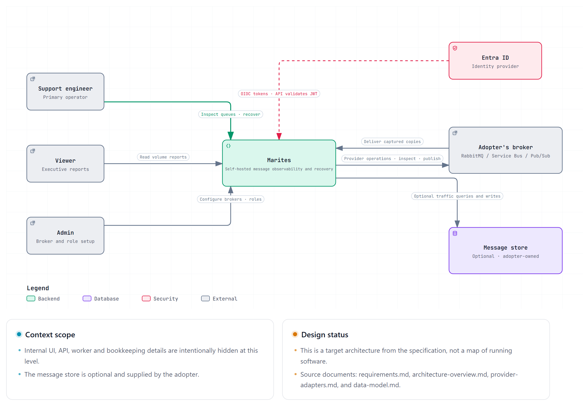
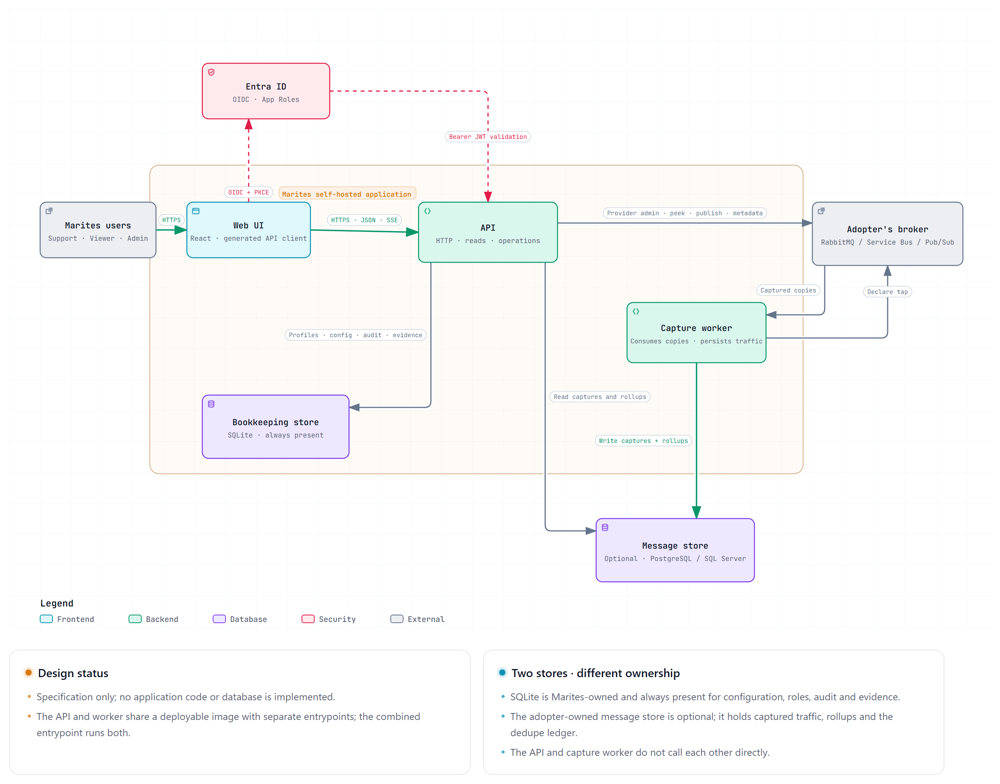
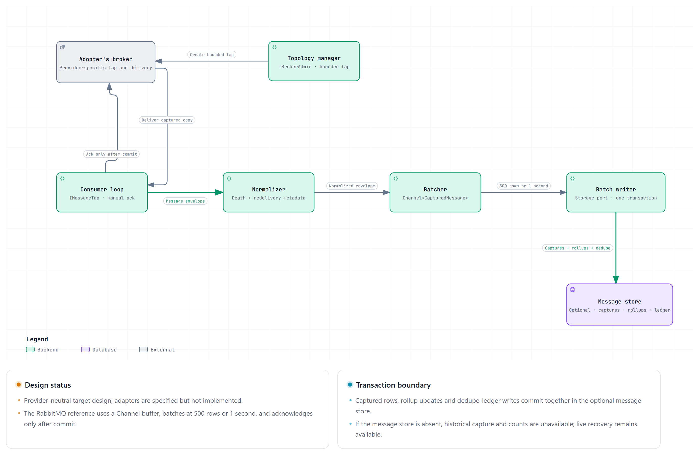

# C4 model

Version 0.1 | November 2026 | Status: Draft

The system at three zoom levels, in the C4 notation. Each level answers a different question for a different reader; none of them restates the others.

| Level | Answers | Reader |
|---|---|---|
| **1 — Context** | Who uses this, and what does it depend on? | Anyone, including a non-technical stakeholder |
| **2 — Containers** | What are the deployable pieces, and what talks to what? | Engineer, reviewer, security assessor |
| **3 — Components** | What is inside the one container that does real work? | Whoever implements or debugs capture |
| 4 — Code | — | **Deliberately omitted.** See §5. |

Each C4 level links to an interactive Archify view and its JSON source in the `diagrams/` folder. This document owns scope and interpretation; the views describe the specification, not implemented software.

## 1. System context

Marites serves three user roles and connects to adopter-run provider platforms, Entra ID, and an optional adopter-owned message store. Its own SQLite bookkeeping store is always present; provider infrastructure remains outside the Marites boundary.

**Diagram source:** [c4-context.architecture.json](diagrams/c4-context.architecture.json).

**What this level establishes, and what it deliberately hides.**

Marites is a **client** of the broker, not a peer of it. It never provisions, hosts or repairs one — that boundary is [ADR-001](decisions.md) and it is the single most consequential line in the whole design. Everything downstream follows from it: the prerequisite document, the preflight checks, and the fact that a misconfigured broker looks like a broken product.

The broker-to-Marites relationship represents message copies delivered through a configured tap or subscription. Marites remains a client: it initiates provider operations and does not provision or operate the broker.

## 2. Containers

The view separates the web UI, API, capture worker, and their external dependencies. The API and worker share an image with separate entrypoints; the combined entrypoint runs both in the single-server profile.

**Diagram source:** [c4-containers.architecture.json](diagrams/c4-containers.architecture.json).

**Three properties worth reading off this diagram.**

**The API and worker do not call each other directly.** The worker writes captured traffic to the optional message store, and the API queries it. Configuration, roles, audit, and operation evidence live in Marites’ separate, always-present SQLite bookkeeping store. The worker boundary still lets capture scale out or split into its own service later.

**The web UI never talks to the broker.** Browser-originated broker operations go through the API; the capture worker connects directly through provider-specific tap ports. Keeping broker credentials out of the browser protects secrets and controls polling load.

**Persistence follows write ownership.** Capture workers write `message_capture`, `message_rollup`, and `capture_dedupe` in the message store. The API owns configuration tables, and its operations executor writes audit and evidence in SQLite. The API reads message data when that optional store is configured.

## 3. Components — capture worker

The API is mostly request/response slices and reads well as a file tree ([architecture-overview.md](architecture-overview.md) §6). The worker is where the real machinery is, so it gets a component view.

**Diagram source:** [c4-capture-components.architecture.json](diagrams/c4-capture-components.architecture.json).

**Why the batcher exists.** A provider's delivery callback must not block on a database write; otherwise storage delays can trigger broker-side flow control. `Channel<T>` decouples message delivery from batch persistence.

**Why the ack is drawn last, and separately.** The commit must happen first. A crash between commit and ack produces a duplicate, which is recoverable; a crash between ack and commit would produce a gap, which is not.

**Why topology is a separate component from the consumer.** Creating a tap or subscription is a privileged provider operation; consuming is a separate delivery path. Keeping them apart makes setup permissions explicit and lets preflight test them independently.

## 4. Dynamic view — one message

The container view does not show the exact message ordering. For the ordering that matters — publish, fan-out, batch, commit, ack — see [workflows/capture-lifecycle.md](../03-workflows/capture-lifecycle.md).

## 5. Why there is no level 4

C4's fourth level is class diagrams. Three reasons not to maintain them here:

- **The contract is the better abstraction.** Anyone who needs to know how two parts interact reads `openapi.yaml`, not a class diagram that will be stale within a sprint.
- **The module map already covers structure.** [architecture-overview.md](architecture-overview.md) §6 lists twelve projects with a one-line responsibility each, which is what a code-level diagram would convey at this size.
- **They decay fastest.** A class diagram is correct for days. Maintaining one would produce a document that is confidently wrong, which is worse than no document.

## 6. What this model does not show

| Omitted | Why | Where it lives instead |
|---|---|---|
| Deployment topology (replicas, nodes, network zones) | Depends on the adopter's environment | [operations/deployment-and-onboarding.md](../11-operations/deployment-and-onboarding.md) §3 |
| Provider-specific internals | Three platforms, one capability model | [architecture-overview.md](architecture-overview.md) §6.1–6.3 |
| Authentication flows in detail | Token validation is a framework concern | [architecture-overview.md](architecture-overview.md) §8 |
| Failure and retry behaviour | Not a structural concern | [workflows/](../03-workflows/README.md) |

## 7. References

- Boundary decision: [decisions.md](decisions.md) ADR-001
- Capture design: [architecture-overview.md](architecture-overview.md) §2–§3
- Module structure: [architecture-overview.md](architecture-overview.md) §6
- Container behaviour in sequence: [workflows/capture-lifecycle.md](../03-workflows/capture-lifecycle.md)
