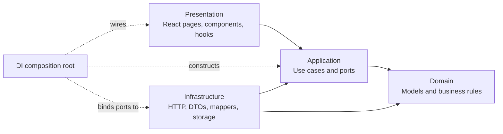
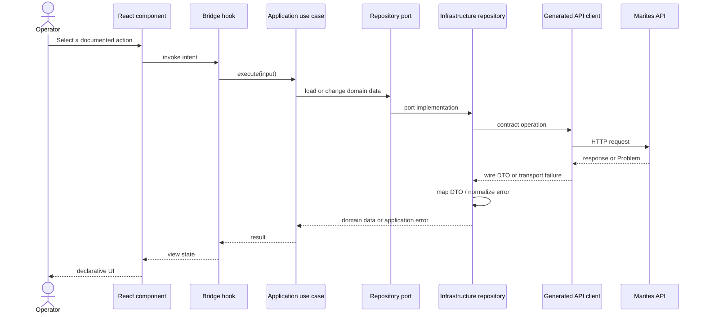

# Frontend Architecture Specification

**Scope.** This document defines the React client architecture. The HTTP contract remains the boundary between the client and service. The existing screen, route, workflow, role, accessibility, and visual requirements remain owned by the [experience specifications](../08-experience/README.md).

The `User` examples below illustrate the folder pattern only. The current API has no user-profile endpoint, so they do not add a screen, use case, or API operation to Marites.

## 1. Four frontend layers and the composition root

The client has four concentric layers. `src/di` is the separate composition root that connects their implementations at startup; it is not a fifth business layer.

```text
src/
├── domain/                  # Pure models & business rules (No React imports)
│   └── user/
│       └── User.ts
├── application/             # Use cases & repository interfaces
│   └── user/
│       ├── UserRepository.ts
│       └── GetUserProfile.ts
├── infrastructure/          # API calls, DTOs, & mappers
│   └── user/
│       ├── UserApiDto.ts
│       ├── UserMapper.ts
│       └── HttpUserRepository.ts
├── di/                      # Dependency wiring (Composition Root)
│   └── container.ts
└── presentation/            # React UI, pages, & bridge hooks
    └── user/
        ├── hooks/
        │   └── useUserProfile.ts
        └── components/
            └── UserProfileCard.tsx
```

| Layer | Owns | May depend on | Must not depend on |
|---|---|---|---|
| Domain (`src/domain`) | Pure TypeScript business models, interfaces, value objects, and core validation rules | Language/runtime primitives and other domain modules | React, UI libraries, state managers, HTTP clients, browser storage, or generated API types |
| Application (`src/application`) | Use cases/interactors and repository/service ports; coordinates business decisions | Domain | React, API routes, HTTP clients, DTOs, browser APIs, or infrastructure implementations |
| Infrastructure (`src/infrastructure`) | Generated API client adapters, wire DTOs, mappers, repository implementations, browser storage adapters | Application ports and Domain models | Presentation components or React state |
| Presentation (`src/presentation`) | React pages/components, styles, view state, and bridge hooks | Application use cases and presentation-only UI libraries | Infrastructure repositories, raw API DTOs, or business rules embedded in JSX |
| Dependency wiring (`src/di`) | Composition root that creates adapters and injects them into use cases/hooks | Concrete infrastructure and application constructors | Feature behavior or screen-specific business rules |

## 2. Dependency direction

Dependencies point inward: **Presentation → Application → Domain** and **Infrastructure → Application → Domain**. The composition root is the only place that names both concrete infrastructure adapters and the application ports they implement.



The UI calls a use case through a bridge hook. The repository implementation calls the contract-generated client and maps the response before returning it to Application. The component receives a view model and renders it; it does not parse HTTP responses or decide domain rules.



## 3. API boundary and DTO isolation

The OpenAPI contract is the only source for HTTP request/response types. The client is generated from the served contract. Handwritten duplicate wire types are a defect; handwritten Domain models are allowed and are not API DTOs.

Raw JSON and generated DTOs stop in `src/infrastructure`. A mapper validates the wire shape, translates contract enums and nullable fields, and returns a Domain model or a normalized Application error. React components and hooks never import `UserApiDto` or another API DTO. Unknown response fields remain tolerated as required by the contract conventions.

## 4. Error translation for the UI

Infrastructure translates HTTP failures, including RFC 9457 `Problem` responses, into a stable Application error shape. Domain code does not import `ProblemDetails`, HTTP status codes, or client-library errors.

| HTTP response | Application/UI handling |
|---|---|
| `401` / `ERR-AUTH-001` | Start the existing Entra re-authentication path. Preserve operation dialog contents and typed confirmation, then allow the operator to resume deliberately. |
| `403` / `ERR-AUTH-002` | Show the capability/role denial; do not retry. |
| `404` / `ERR-CMN-002`, `ERR-MSG-001` | Show the resource or retention outcome without revealing cross-tenant existence. |
| `409` / `ERR-CMN-003`, `ERR-CMN-005`, `ERR-CMN-006`, `ERR-OPR-002` | Present the conflict-specific remedy. For a stale revision, re-read before offering a new submission. |
| `422` / `ERR-CAP-001`, `ERR-BRK-001`, validation codes | Map stable codes and field errors to the relevant control or capability message. |
| `429` / `ERR-CMN-004` | Respect `Retry-After`; retry only after the indicated wait and only when the operation remains safe to repeat. |
| `202` / `ERR-OPR-004`, outcome `Unresolved` | Poll `/operations/{operationId}` and reconcile. Never automatically resubmit a potentially partial replay/discard/purge. |
| `503` / `ERR-BRK-002`, `ERR-OPR-007` | Show the service/dependency remedy. For `ERR-OPR-007`, explicitly state that the command was not issued and the messages remain untouched. |

Application errors retain stable `code`, `outcome`, `retryable`, optional `remedy`, field issues, and `Retry-After` when present. Display `detail` as human-facing text only; branch on `code`, never prose. Do not show server stack traces or raw transport exceptions.

## 5. Feature mapping

This table maps existing product features; it does not redefine routes or add backend endpoints. The experience specifications remain authoritative for screen behavior.

| Existing surface / flow | Presentation responsibility | Application use-case boundary | Infrastructure/API boundary | Domain rule source |
|---|---|---|---|---|
| Sign-in, callback, role landing, break-glass | Route guard, auth state, role-specific shell | Resolve session and permitted capabilities | Entra/MSAL adapter and current API capabilities | DOC-UX-001 §2; DOC-ARCH-001 §8; DEC-008 |
| `/setup` and broker management | Setup steps, profile form, preflight results | Create/update/remove broker; run preflight | `POST/PATCH/DELETE /brokers`, `POST /brokers/{id}/preflight` | DOC-UX-003 §3.5; FR-012/013 |
| Queue list and `/queues/:id` | Queue rows, detail, capability-gated action bar | List/get queue; set capture policy | `GET /queues`, `GET /queues/{queueId}`; deferred `PUT /queues/{queueId}/capture-policy` | DOC-UX-001 §4–5; DOC-UX-003 §3.2 |
| Message list and detail | Conjunctive filters, duplicate grouping, payload and `x-death` views | Search and retrieve captured messages | Deferred `QUERY /messages`, `GET /messages/{messageId}` | FR-006/007; DOC-UX-003 §3.3 |
| `/report` | Four distinct metric tiles, chart/table equivalents, range/granularity controls | Read summary, series, and availability | Deferred `GET /metrics/summary`, `/metrics/timeseries`, `/metrics/availability` | DOC-UX-001 §1; FR-004/005/020/021 |
| Peek, discard, purge, replay, publish | Confirmation dialogs, dry-run and progress views | Run guarded operation and reconcile its result | `POST /operations/*`; `GET /operations/{operationId}` | DOC-UX-001 §3; DOC-UX-003 §3.4/3.6/3.7; ADR-023 |
| Assistant proposal and review | Proposal banner/drawer and normal review dialog | Submit proposal or run the same guarded use case | Deferred `POST /operations/proposals`; operation endpoints | DOC-ARCH-004; DEC-010; DOC-UX-003 §3.8–3.9 |
| Audit and payload evidence | Audit list, evidence details, expiry state | List audit/evidence | Deferred `GET /audit`, `GET /audit/{auditId}/payloads` | FR-016/027; DOC-UX-003 §3.11 |
| Storage and assistant settings | Settings states and safe configuration forms | Read/update the existing configuration use cases where contracted | No additional endpoint is inferred here; contract gaps remain explicit | DOC-UX-003 §3.10; DOC-ARCH-004 |

The feature matrix is a coverage aid. A missing contract operation is recorded as a gap; it is not filled by adding an undocumented client call.

## 6. Document control

Revision 0.2 records the Codex documentation review on 2026-11-11, including alignment of message search to `QUERY /messages`. It preserves the existing experience requirements and adds no application source files.
