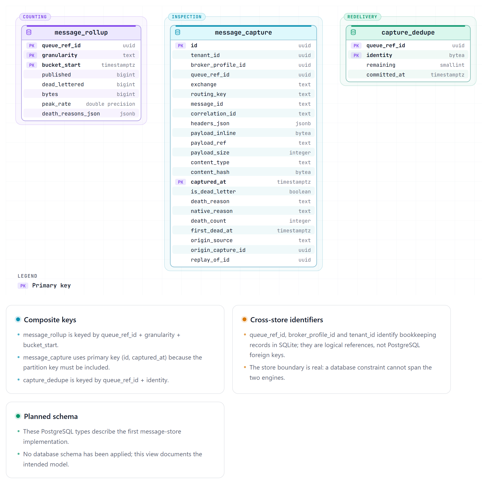

# DOC-DATA-002 — Data Dictionary

**Source:** [data model](data-model.md). Owning document for column types, nullability, defaults and constraints. The model owns the tables and their relationships; this document owns the columns. The Outbox section below is a planned infrastructure record and is not in the current twelve-table schema.

Type names in this dictionary use PostgreSQL notation for the first message-store implementation. The bookkeeping tables live in SQLite, but their physical SQLite type mapping is not specified yet. The message-store ERD below therefore shows the PostgreSQL-first schema only; it does not present the full model as deployed DDL.

Conventions used throughout: `uuid` values are server-assigned v4, never reused. Every timestamp is `timestamptz` and stored in UTC. Enumerated values are checked against [VOCABULARY](../14-reference/vocabulary.md) rather than against a database `ENUM` type, because adding a value to a Postgres enum requires a migration while the vocabulary is amended by prose first — and a check constraint can be replaced in one statement.

**Nullability rule.** A nullable column means "this fact may genuinely not exist", never "we did not get round to it". Where a value is absent because a policy or a provider does not supply it, the column is nullable and the reason is in the note.

## Schema view



**Diagram source:** [message-store schema](diagrams/message-store-schema.erd.json).

Rebuild the inline preview from the repository root with:

```bash
python docs/05-architecture/diagrams/build.py docs/07-data-and-contracts/diagrams/message-store-schema.erd.json
```

The message store keeps three traffic tables. Its `tenant_id`, `broker_profile_id` and `queue_ref_id` values identify records in the SQLite bookkeeping store; they are logical references, not database foreign keys across stores.

## 1. `tenant`

The isolation boundary. One row per team inside one organisation (ADR-014), not per customer.

| Column | Type | Null | Default | Constraint |
|---|---|---|---|---|
| `id` | uuid | no | `gen_random_uuid()` | primary key |
| `name` | text | no | — | length 1–100 |
| `slug` | text | no | — | unique, lowercase, `^[a-z0-9-]{2,40}$` |
| `created_at` | timestamptz | no | `now()` | — |

The slug appears in the shadow-queue name (`marites.{tenant}.{hash}`), which is why it is constrained: the prefix is effectively permanent once a broker ACL grants on it (VOCABULARY §9).

## 2. `broker_profile`

One row per connection to one broker. Configuration only — no live state.

| Column | Type | Null | Default | Constraint / note |
|---|---|---|---|---|
| `id` | uuid | no | `gen_random_uuid()` | primary key |
| `tenant_id` | uuid | no | — | FK `tenant(id)` on delete cascade |
| `name` | text | no | — | unique per tenant; 1–64 characters |
| `provider_kind` | text | no | — | check in (`rabbitmq`, `azure_service_bus`, `google_pubsub`) |
| `environment` | text | no | — | free-form tag (VOCABULARY §8); `prod` is special-cased in the UI only |
| `endpoint_enc` | bytea | no | — | the endpoint URI, encrypted; contains credentials for AMQP |
| `admin_uri` | text | yes | — | management base URL; null where the provider has none |
| `credential_kind` | text | no | — | VOCABULARY §13 |
| `credentials_enc` | bytea | **yes** | — | provider-shaped JSON, encrypted. **Null for ambient kinds**, which store no secret |
| `credentials_updated_at` | timestamptz | yes | — | set on create and on every rotation; the only credential fact the API returns |
| `namespace_or_vhost` | text | yes | — | vhost, namespace or project id, per provider |
| `tls_opts` | jsonb | no | `'{}'` | CA bundle PEM and hostname-verification flag |
| `capabilities_json` | jsonb | no | `'{}'` | last capability record read from the provider (DOC-ARCH-001 §6.2) |
| `is_default` | boolean | no | `false` | at most one per tenant — partial unique index |
| `preflight_state` | text | no | `'unknown'` | VOCABULARY §7 |
| `preflight_at` | timestamptz | yes | — | null until preflight has run |
| `revision` | integer | no | `1` | incremented on every update; the value `If-Match` compares |

`capabilities_json` is a cache, not a source of truth. It exists so the UI can gate controls without a round-trip to the broker; a stale cache shows a control the provider cannot honour, which the API refuses with `ERR-CAP-001`.

## 3. `queue_ref`

One row per watched entity. Named `queue_ref` for historical reasons; it holds queues, exchanges, topics and subscriptions (data model §2).

| Column | Type | Null | Default | Constraint / note |
|---|---|---|---|---|
| `id` | uuid | no | `gen_random_uuid()` | primary key |
| `broker_profile_id` | uuid | no | — | FK `broker_profile(id)` on delete cascade |
| `name` | text | no | — | the entity's own name, exactly as the broker reports it |
| `source_kind` | text | no | — | check in (`queue`, `exchange`, `topic`, `subscription`) |
| `vhost` | text | yes | — | RabbitMQ only; null for the other providers |
| `is_dlq` | boolean | no | `false` | true when the entity is a dead-letter queue or topic |
| `dead_letter_source` | text | yes | — | the source queue this DLQ belongs to, where the provider exposes it |
| `bound_at` | timestamptz | yes | — | when the shadow queue or subscription was created; null when capture was never enabled |
| `capture_enabled` | boolean | no | `false` | intent, not state — `captureState` is derived (VOCABULARY §15) |

Unique on `(broker_profile_id, vhost, name, source_kind)`. The vhost is in the key because `orders` exists in `/prod` and `/staging` simultaneously (VOCABULARY §10).

**`captureState` and `deadLetterConfigured` are not columns.** Both are live facts read from the broker on each poll, and storing them would create a second copy that goes stale between polls — the exact failure the field exists to prevent.

## 4. `capture_rule`

One row per queue, holding the policy an Admin sets.

| Column | Type | Null | Default | Constraint / note |
|---|---|---|---|---|
| `id` | uuid | no | `gen_random_uuid()` | primary key |
| `queue_ref_id` | uuid | no | — | FK `queue_ref(id)` on delete cascade; **unique** — one rule per queue |
| `bind_pattern` | text | no | `'#'` | routing-key pattern for the shadow binding |
| `enabled` | boolean | no | `true` | disabling stops capture without deleting the rule |
| `capture_mode` | text | no | `'rows'` | check in (`rows`, `counts`); VOCABULARY §16. `counts` writes no `message_capture` row and makes `row_retention_hours` inert |
| `payload_policy` | text | no | `'sampled'` | check in (`full`, `sampled`, `none`); VOCABULARY §5 |
| `sample_rate` | smallint | no | `100` | check ≥ 1; one payload stored per N messages when sampled |
| `row_retention_hours` | integer | no | `72` | check ≥ 1; must not exceed rollup retention |
| `max_rows` | bigint | yes | — | per-queue cap beneath the global ceiling |
| `max_bytes` | bigint | yes | — | per-queue cap beneath the global ceiling |
| `revision` | integer | no | `1` | incremented when the policy changes; surfaced as `QueueDetail.revision` |

The retention floor is enforced in the application, not by a check constraint, because it compares two rows in different tables. It is the guard described in data model §3.1.1 and it is a correctness requirement: rows outliving counts shows a period as zero that an operator can still browse.

## 5. `message_rollup`

The counting tier. Small, permanent, never derived from rows.

| Column | Type | Null | Default | Constraint / note |
|---|---|---|---|---|
| `queue_ref_id` | uuid | no | — | logical reference to `queue_ref(id)` in SQLite; part of the primary key, not a cross-store database FK |
| `granularity` | text | no | — | check in (`minute`, `hour`, `day`); part of the primary key |
| `bucket_start` | timestamptz | no | — | UTC, truncated to the granularity; part of the primary key |
| `published` | bigint | no | `0` | additive |
| `dead_lettered` | bigint | no | `0` | additive |
| `bytes` | bigint | no | `0` | additive |
| `peak_rate` | double precision | no | `0` | **maximum**, merged with `GREATEST` on upsert |
| `death_reasons_json` | jsonb | no | `'{}'` | per-reason counts, additive per key |

Primary key `(queue_ref_id, granularity, bucket_start)`. No surrogate key: the natural key is the identity, and a surrogate would allow two rows for one bucket, which is how a total doubles.

`peak_rate` is the one non-additive metric. Every other column sums *within a tier*; this one takes the maximum. A compaction that summed it would report a peak of 4,800 msg/s for an hour whose busiest second was 200.

**"Additive" describes capture, not compaction.** The capture worker increments a bucket per message (ADR-007, ADR-019). Compaction does **not** add what it computes to the coarser row — it recomputes that window's absolute totals from the finer tier and assigns them (ADR-024). That is what makes a retried compaction harmless: the second run overwrites the first with the same numbers instead of doubling them. The `Default` column above is `0` for a fresh bucket written by capture; it is not a starting value for compaction to accumulate onto.

## 6. `message_capture`

The investigation tier. Partitioned by day; the only table whose size is a problem.

| Column | Type | Null | Default | Constraint / note |
|---|---|---|---|---|
| `id` | uuid | no | `gen_random_uuid()` | primary key with `captured_at` |
| `tenant_id` | uuid | no | — | denormalised identifier from SQLite's `tenant` record so a partition can be pruned without a join |
| `broker_profile_id` | uuid | no | — | denormalised identifier from SQLite's `broker_profile` record |
| `queue_ref_id` | uuid | no | — | logical reference to SQLite's `queue_ref(id)`; no cross-store database FK |
| `exchange` | text | yes | — | RabbitMQ exchange, or topic name |
| `routing_key` | text | yes | — | routing key, or subscription filter |
| `message_id` | text | yes | — | the producer's id; null when the producer set none |
| `correlation_id` | text | yes | — | producer-supplied |
| `headers_json` | jsonb | no | `'{}'` | all headers, including `x-death` verbatim |
| `payload_inline` | bytea | yes | — | the body itself, up to the 64 KB inline threshold (TOAST handles it); null when spilled |
| `payload_ref` | text | yes | — | object-store key for a payload above the threshold; null when inline |
| `payload_size` | integer | no | — | bytes as published; never the row size |
| `content_type` | text | yes | — | from the message properties |
| `content_hash` | bytea | no | — | HMAC-SHA256, keyed per tenant (data model §2) |
| `captured_at` | timestamptz | no | — | the partition key |
| `is_dead_letter` | boolean | no | `false` | — |
| `death_reason` | text | yes | — | VOCABULARY §4; null when not a dead letter |
| `native_reason` | text | yes | — | the provider's own string, verbatim |
| `death_count` | integer | yes | — | how many times it was dead-lettered |
| `first_dead_at` | timestamptz | yes | — | earliest death time the provider reports |
| `origin_source` | text | yes | — | the queue or topic it came from |
| `origin_capture_id` | uuid | yes | — | best-effort link to the publish that produced it |
| `replay_of_id` | uuid | yes | — | set when this row is a replay; the original is never deleted |

Primary key `(id, captured_at)`, because a partitioned table's primary key must include the partition key.

**Two payload columns, not one.** An inline body and an object-store key are different types with different lifecycles: the row owns the first, the sweeper must also delete the second. A single `payload_ref` column could not carry both without a discriminator, and the discriminator would be `payload_size` — a value that already has a meaning. The check constraint is that at most one of the two is present, and that neither is present when the queue's policy stored no body.

### The object store

A body above the 64 KB inline threshold is written to an object store, and the row keeps its key.

| Property | Value |
|---|---|
| Key | `{tenant_id}/{content_hash[0:2]}/{content_hash}` — content-addressed, so an identical body is stored once however many rows reference it |
| Backend | The adopter's bucket (S3-compatible, Azure Blob or GCS), named once per install. Not Marites' own store: bodies are the same size problem the message store exists for |
| Lifecycle | The sweeper deletes an object in the same pass that drops the partitions referencing it, and only when no remaining row carries that `content_hash` — one query, because the key *is* the hash |
| Backup | The bucket is in backup scope alongside `message_capture`. A row without its object is a body that cannot be read |
| Failure at write | The spill is attempted before the row is committed. If the store refuses it, the row is written with no body, `payload_size` records the true length, and the capture-gap warning counts it — capture degrades to truncation rather than stopping |

**Content addressing is what makes the lifecycle simple.** Because the key is the hash the row already carries, "is this object still referenced?" is a lookup rather than a join table, and writing the same body twice costs one object.

## 7. `replay_job`

| Column | Type | Null | Default | Constraint / note |
|---|---|---|---|---|
| `id` | uuid | no | `gen_random_uuid()` | primary key |
| `tenant_id` | uuid | no | — | — |
| `queue_ref_id` | uuid | no | — | FK `queue_ref(id)` |
| `state` | text | no | `'pending'` | VOCABULARY §6 |
| `total` | integer | no | — | messages selected at dry-run time |
| `processed` | integer | no | `0` | monotonic |
| `failed` | integer | no | `0` | monotonic |
| `halt_reason` | text | yes | — | populated on `halted` and `failed` |
| `created_by` | uuid | no | — | FK `app_user(id)` |
| `created_at` | timestamptz | no | `now()` | — |
| `updated_at` | timestamptz | no | `now()` | written on every state change |

`total` is captured at dry-run time and never recalculated. A job whose total drifted as messages arrived would make `processed / total` meaningless, and that ratio is what the progress bar shows.

## 8. `operation_audit`

Append-only. No column is ever updated, and no endpoint can delete a row.

| Column | Type | Null | Default | Constraint / note |
|---|---|---|---|---|
| `id` | uuid | no | `gen_random_uuid()` | primary key |
| `tenant_id` | uuid | no | — | — |
| `actor_id` | uuid | yes | — | FK `app_user(id)` for a human; **null for an agent**, which is a service principal and has no `app_user` row |
| `actor_kind` | text | no | `'human'` | check in (`human`, `agent`); `agent` appears only on proposal rows, which execute nothing |
| `on_behalf_of` | uuid | yes | — | FK `app_user(id)`; present only when `actor_kind = agent` |
| `proposal_id` | uuid | yes | — | the proposal row that prompted this operation, when one did |
| `action` | text | no | — | the operation name, e.g. `replay`, `purge`, `publish` |
| `target` | text | no | — | queue or broker identifier as displayed to the operator |
| `params_json` | jsonb | no | `'{}'` | operation parameters; **never a payload body** |
| `result` | text | no | — | outcome class plus error code where applicable; proposals use `pending` and `dismissed`, never `failure` |
| `message_count` | integer | yes | — | affected count, where the operation has one |
| `payload_hash` | text | yes | — | HMAC of the body as sent; survives the evidence, and is all that remains once it has been swept |
| `via` | text | yes | — | the assistant the request arrived through, when a human acted from a chat client; the actor is still that human (ADR-021) |
| `payload_edited` | boolean | no | `false` | true when any evidence row's `payload_after` differs from its `payload_before` — an edited replay is otherwise indistinguishable from a plain resend in the audit list (DEC-018) |
| `created_at` | timestamptz | no | `now()` | — |
| `ip` | inet | yes | — | caller address; null behind a proxy that strips it |

`params_json` excludes payload bodies on purpose. The audit row records that a message was published and its payload hash; storing the body again would double the exposure and defeat the retention rule.

`payload_edited` is written at the same time as the evidence rows, inside the same transaction. It is not derived on read: `operation_payload` is swept, and *"this replay was not a plain resend"* has to outlive the bodies that prove it.

## 9. `app_user`

| Column | Type | Null | Default | Constraint / note |
|---|---|---|---|---|
| `id` | uuid | no | `gen_random_uuid()` | primary key |
| `tenant_id` | uuid | no | — | — |
| `entra_object_id` | text | **yes** | — | null for a break-glass account, which exists only locally |
| `email` | text | no | — | display and audit |
| `role` | text | no | — | check in (`Viewer`, `Support`, `Admin`); VOCABULARY §2 |
| `is_break_glass` | boolean | no | `false` | at most one per tenant — partial unique index |

`entra_object_id` is nullable because the break-glass account has no Entra identity. The unique index on `(tenant_id, entra_object_id)` must therefore be partial, excluding nulls.

## 10. `capture_dedupe`

The redelivery ledger (ADR-019). Short-lived, swept with the partitions.

| Column | Type | Null | Default | Constraint / note |
|---|---|---|---|---|
| `queue_ref_id` | uuid | no | — | logical reference to SQLite's `queue_ref(id)`; part of the primary key, not a cross-store database FK |
| `identity` | bytea | no | — | `message_id` digest, else the HMAC `content_hash` plus routing key; part of the primary key |
| `remaining` | smallint | no | `1` | a multiset count, so genuinely identical messages are each counted |
| `committed_at` | timestamptz | no | `now()` | swept after the redelivery window (default 1 hour) |

`remaining` is what makes this a multiset rather than a set. Two identical messages published deliberately produce one identity with `remaining = 2`; a redelivery decrements it and is skipped only while a count remains. A plain set would silently under-count — the opposite error, and the invisible one (DEC-008).

## 11. `operation_payload`

Payload evidence for the four operations that need it (DEC-017). Written in the same transaction as the audit row, and swept on **its own clock** — this table lives in Marites' bookkeeping store, so it does not expire on a policy about the adopter's message store.

| Column | Type | Null | Default | Constraint / note |
|---|---|---|---|---|
| `id` | uuid | no | `gen_random_uuid()` | primary key |
| `audit_id` | uuid | no | — | FK `operation_audit(id)`; the operation this is evidence for |
| `message_id` | text | yes | — | the captured message's id, when it had one |
| `content_hash` | bytea | no | — | HMAC-SHA256 of the body as sent — the value that survives expiry |
| `payload_before` | bytea | no | — | the body as it existed when the operation ran — what was peeked, discarded or purged, and what a replay replaced |
| `payload_after` | bytea | yes | — | the body **as sent**; null when a replay did not edit it, and for every other operation |
| `payload_size` | integer | no | — | bytes as sent, or as destroyed when nothing was sent |
| `retained_until` | timestamptz | no | — | **set at write** to `max(queue row retention, MARITES_EVIDENCE_RETENTION_DAYS)`; the sweeper deletes on this column |
| `created_at` | timestamptz | no | `now()` | — |

**Why a snapshot rather than a pointer.** Discard and purge delete the `message_capture` row the audit would point at, so the copy has to exist before the deletion. A reference would be valid for peek and replay and dangling for the other two — and a column that means different things per row is how a schema stops being readable.

**Why `retained_until` is not a duration.** It is computed once, at write, from the queue's policy and the install's evidence retention at that moment. A later change to either must not retroactively extend or delete evidence about an operation that already happened.

**Why the evidence does not share the rows' clock.** It did, and that was wrong. This table is in Marites' own store (DEC-012), so expiring it on `capture_rule` meant a row here was deleted because of a policy about a different database. It also meant the one case that matters — discard and purge, where the audit copy is the last copy anywhere — expired in three days on a queue with three days of rows. The rule is `max(row retention, MARITES_EVIDENCE_RETENTION_DAYS)`, default 90 days, ceiling 365, set once per install by an Admin.

**One row per message, and no sample.** A purge of 1,204 messages writes 1,204 rows, because a sample cannot answer *"was this message in there?"* (DEC-018). The bound is `MARITES_EVIDENCE_MAX_ROWS` (default 10,000 per operation); beyond it the rows stop and the audit row records `evidence truncated at 10,000 of N`.

**Both bodies for a replay.** `payload_before` is what the message held; `payload_after` is what went out. When they differ, the replay was edited (DEC-011) and the pair is the only complete record of the change.

**Payloads above 64 KB.** `payload_before` and `payload_after` are `bytea` and hold the body whole. The evidence for an operation is small — one row per message the operator chose to act on, never a whole queue — so it stays inline and takes the same object-store path only when an individual body exceeds the threshold (§6). `payload_size` always records the true length, and `payload_truncated` on the audit row says when the body is not the whole one.

## 12. `operation_intent`

The durable hold for a destructive operation (ADR-023). Written and committed **before** the broker command; promoted into `operation_audit` + `operation_payload` when the command is confirmed; marked `abandoned` when it is not. Short-lived by design — swept in minutes, not days.

| Column | Type | Null | Default | Constraint / note |
|---|---|---|---|---|
| `id` | uuid | no | `gen_random_uuid()` | primary key |
| `tenant_id` | uuid | no | — | — |
| `actor_id` | uuid | yes | — | as `operation_audit.actor_id` |
| `actor_kind` | text | no | `'human'` | check in (`human`, `agent`) |
| `on_behalf_of` | uuid | yes | — | present only when `actor_kind = agent` |
| `proposal_id` | uuid | yes | — | the proposal this operation answers, when one prompted it |
| `action` | text | no | — | check in (`discard`, `purge`, `replay`, `publish`) |
| `target` | text | no | — | queue or broker identifier as displayed to the operator |
| `params_json` | jsonb | no | `'{}'` | the operation parameters, including the confirmation the caller typed |
| `bodies_json` | jsonb | no | — | the complete bodies, one entry per message, each with its id, size and before/after |
| `state` | text | no | `'held'` | check in (`held`, `promoted`, `abandoned`) |
| `created_at` | timestamptz | no | `now()` | — |
| `expires_at` | timestamptz | no | — | `created_at` + the reconciliation window; the sweeper deletes on this column |

**Why the bodies are here and not in `operation_payload`.** `operation_payload.audit_id` is a non-null foreign key, and an audit row must not exist for an operation that has not happened yet. The hold therefore has its own home, and the promotion is what turns a held intent into evidence.

**Why `bodies_json` rather than a row per message.** An intent is read once, whole, by one process, and deleted. Row-per-message would make the hold pay the partitioning and indexing costs of a table designed for querying — for data that is never queried.

**Why the window is short.** An intent that is neither promoted nor abandoned within the reconciliation window means the operations executor died. Anything older is stale by definition, and holding payloads in a staging table longer than necessary is the same exposure the retention rules exist to bound.

## Planned infrastructure record: `domain_event_outbox`

This record is added to the bookkeeping store only when an integration-event sink is configured. It is not part of the current schema and has no migration applied. SQLite physical types are intentionally not fixed here; the following are logical field types.

| Column | Logical type | Null | Constraint / note |
|---|---|---|---|
| `id` | uuid | no | Stable event ID and primary key; consumers use it for deduplication |
| `tenant_id` | uuid | yes | Tenant scope when the event belongs to one tenant |
| `aggregate_type` | text | no | Stable aggregate name, not a CLR type name |
| `aggregate_id` | text | no | Strongly typed aggregate ID serialized as an opaque string |
| `event_type` | text | no | Versioned integration event name |
| `schema_version` | integer | no | Positive payload contract version |
| `payload_json` | JSON text | no | IDs and outcome facts only; never credentials or message bodies |
| `occurred_at` | UTC timestamp | no | When the domain transition committed |
| `attempt_count` | integer | no | Non-negative delivery attempts |
| `next_attempt_at` | UTC timestamp | no | Earliest retry time after a transient failure |
| `locked_until` | UTC timestamp | yes | Lease expiry for one dispatcher; prevents indefinite ownership after a crash |
| `published_at` | UTC timestamp | yes | Set only after the integration sink acknowledges delivery |
| `last_error_code` | text | yes | Sanitized stable failure code; no body, token, or secret |

Delivery is at least once. A publisher crash after sink acceptance but before `published_at` can redeliver, so the sink or consumer deduplicates by `id`. Retention after successful delivery is a separate policy to decide before implementation; pending and poison events are never silently deleted.

The planned dispatcher index is `(published_at, next_attempt_at, locked_until)`; it is not part of the current PostgreSQL index list below.

## 13. Indexes

| Index | Table | Purpose |
|---|---|---|
| `(queue_ref_id, captured_at desc)` | `message_capture` | The message list, always filtered by queue and ordered by time |
| `(tenant_id, captured_at desc)` | `message_capture` | Cross-queue search within a tenant |
| `gin (headers_json)` | `message_capture` | Header and `x-death` filtering |
| `(correlation_id)` where not null | `message_capture` | Correlation tracing |
| `(content_hash)` | `message_capture` | Duplicate grouping |
| `(tenant_id, created_at desc)` | `operation_audit` | The audit list, newest first |
| `(state, expires_at)` | `operation_intent` | Reconciliation finds held intents; the sweeper deletes expired ones |
| `(committed_at)` | `capture_dedupe` | Ledger sweep |
| `(retained_until)` | `operation_payload` | Evidence sweep — the only index this table needs |
| `(audit_id)` | `operation_payload` | Reading the evidence for one operation |
| `(queue_ref_id, granularity, bucket_start)` | `message_rollup` | Primary key; every read is a range on this |

No index on `payload_ref` or on `exchange`. Neither is used as a filter, and an unused index on the largest table is a write cost with no reader.

## 14. Document control

Revision 0.2 records the column-level definition for twelve current tables and the planned Outbox record, written November 2026 to close the gap named in the [data-and-contracts index](README.md). It is a definition, not a migration: no schema has been applied, and the types have not been exercised against either store. Separate migration streams are planned in [migration-plan.md](migration-plan.md).
