# DOC-UX-003 — Wireframes and Navigation

**Source:** [dashboard and operations](dashboard-and-operations.md) §1.1, §3, §4; [API catalog](../07-data-and-contracts/api-catalog.md). Owning document for layout and navigation. Metric meaning is owned by DOC-UX-001 §1; this document does not restate it.

Wireframes here are **text descriptions with a block layout**, not pictures. That is deliberate: a text wireframe can be reviewed in a pull request and cannot silently disagree with the document beside it. Colour, type and spacing are owned by [visual design](visual-design.md), which was written after the prototype established values this document had left open.

## 1. Navigation model

Two surfaces that share no layout ([DOC-UX-001 §1.1](dashboard-and-operations.md)). One product, two front doors, chosen by role.

```
                    ┌──────────────────────────┐
   sign in ────────▶│ role from the token      │
                    └───────────┬──────────────┘
                                │
              ┌─────────────────┴──────────────────┐
              │                                    │
      Viewer  ▼                            Support / Admin ▼
   ┌────────────────────┐            ┌────────────────────────────┐
   │ Reporting          │            │ Operations console         │
   │ /report            │            │ /queues /publish /audit    │
   │                    │            │ /brokers /setup            │
   └────────────────────┘            └────────────────────────────┘
```

`/login` sits in front of both, and is described in §5 — it is the one screen Marites owns rather than delegates.

| Rule | Why |
|---|---|
| The landing route redirects by role; there is no shared home page | A Viewer who lands on a queue list sees a surface built for someone else, and a Support user who lands on a chart has to navigate away before starting work |
| A Support or Admin user can open the reporting view, but it is a link, not the default | The executive view is a different question, and it is occasionally useful to the same person |
| A Viewer cannot reach an operations route at all — the routes are not rendered, and the API would refuse them | Hiding a control the API refuses is a courtesy; the API refusal is the control (DEC-002) |
| The broker switcher is global and always visible on the console | Every figure is scoped to a profile; a number without its cluster is ambiguous, and `orders` exists in two of them (VOCABULARY §10) |

## 2. Route map

| Route | Surface | Screen | Contract |
|---|---|---|---|
| `/login` | Both | Sign-in, or the break-glass form (§5) | OIDC redirect; `POST /auth/break-glass` |
| `/setup` | Console | First-run wizard | `POST /brokers`, `POST /brokers/{id}/preflight` |
| `/queues` | Console | Queue tree and list | `GET /queues` |
| `/queues/:id` | Console | Queue detail, capture policy | `GET /queues/{id}`, `PUT /queues/{id}/capture-policy` |
| `/queues/:id/messages` | Console | Message list | `GET /messages` |
| `/messages/:id` | Console | Message detail | `GET /messages/{id}` |
| `/operations/:id` | Console | Operation progress | `GET /operations/{id}` |
| `/brokers` | Console | Broker profiles | `GET /brokers`, `GET /brokers/{id}/capabilities` |
| `/publish` | Console | Message composer | `POST /operations/publish` |
| `/storage` | Console | Database settings: add later, test, replace (Admin) | `PUT /storage` |
| `/ai` | Console | AI provider settings (Admin) | `PUT /ai/provider` |
| *(drawer)* | Console | Assistant panel over any screen | `POST /ai/chat` |
| `/audit` | Console | Audit log, including agent proposals | `GET /audit` |
| `/report` | Reporting | Volume and dead-letter dashboard | `GET /metrics/*` |

**Every route maps to contract operations, and nothing else.** A screen that needs data the contract does not serve is a contract gap, not a frontend decision.

## 3. Operations console

### 3.1 Queue list (`/queues`)

```
┌──────────────────────────────────────────────────────────────────────┐
│ Marites   [prod ▾]                          Support · A. Reyes      │
├──────────────────────────────────────────────────────────────────────┤
│ ⚠ 2 queues cannot report failures — no dead-letter routing  [view]   │
├───────────────────────────┬──────────┬────────┬────────┬────────────┤
│ Queue                     │ Depth    │ Rate   │ DLQ    │ Capture    │
├───────────────────────────┼──────────┼────────┼────────┼────────────┤
│ orders                    │  12,481  │ 4,200  │ 1,204  │ ● live     │
│ orders.dlq                │   1,204  │    12  │   —    │ ● live     │
│ payments                  │       0  │      0  │ unavail│ ● live     │
│ reports                   │   3,110  │      0  │     88 │ ◐ stale    │
└───────────────────────────┴──────────┴────────┴────────┴────────────┘
```

| Element | Behaviour |
|---|---|
| Broker switcher | Changes the profile for every figure on the screen. Never mixed: one screen, one profile |
| Banner | Appears when any queue in the profile cannot report failures, and links to the filtered list |
| Dead-letter column | Shows `unavailable` where there is no routing, never `0` (`ERR-QUE-002`) |
| Capture column | The five states of VOCABULARY §15, each with a distinct icon **and** a word |
| Row | Opens the queue detail. Rows are keyboard-reachable and the whole row is the target |


*The queue list. Depth, rate and dead letters per queue, `captureState` as a word beside the number rather than a colour, and the banner for queues that cannot report failures.*

### 3.2 Queue detail (`/queues/:id`)

```
┌──────────────────────────────────────────────────────────────────────┐
│ ← queues    orders            prod · /prod            ● live        │
├──────────────────────────────────────────────────────────────────────┤
│ Depth 12,481   Publish 4,200/s   Deliver 4,180/s   Consumers 6      │
│ Last seen 14:22:08  ·  Dead letters 1,204 (28.6% in the last hour)  │
├──────────────────────────────────────────────────────────────────────┤
│ [ Peek ]  [ Replay dead letters ]  [ Purge ]        (capability-     │
│                                                      gated)          │
├──────────────────────────────────────────────────────────────────────┤
│ Capture policy   sampled 1:100 · 72 h rows · default   [ edit ]     │
└──────────────────────────────────────────────────────────────────────┘
```

| Element | Behaviour |
|---|---|
| Action bar | Each button is present only when `ProviderCapabilities` allows it. Absent, not disabled — a disabled button with no reason is a support ticket |
| Replay | Opens the dry-run dialog (§3.4). Never executes directly |
| Purge | Admin only, typed queue name, environment tag on `prod` |
| Capture policy | Read-only summary with the non-default marker where a value was changed |

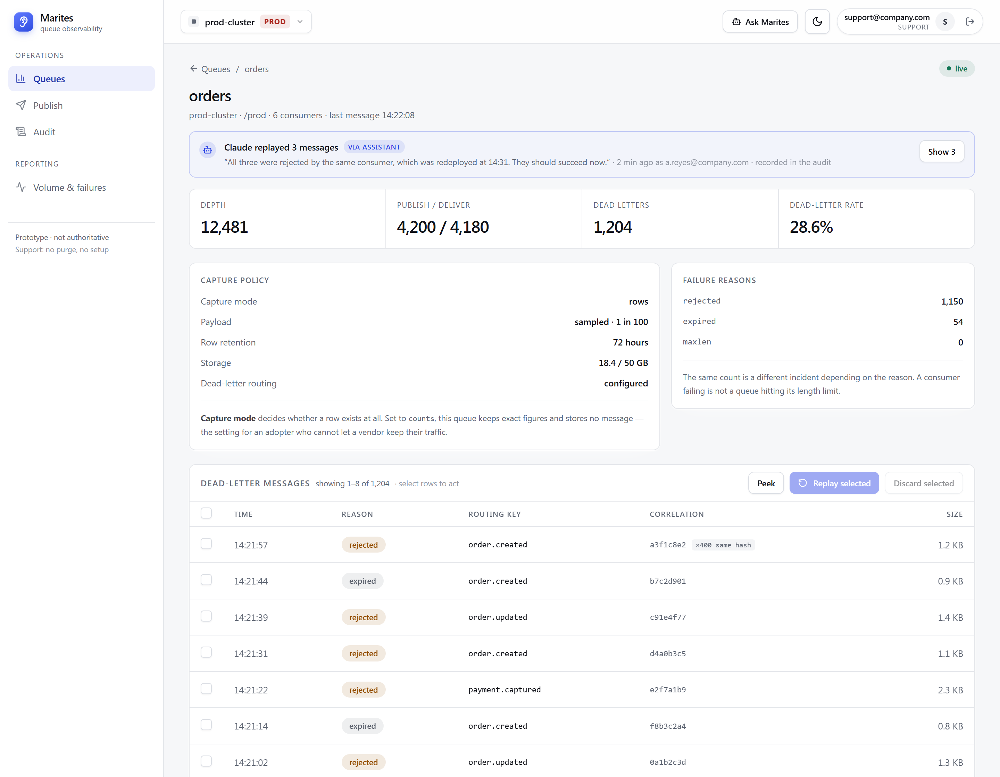

*The queue detail. The metric strip, the action bar sitting on the same line as the checkboxes that enable it, the capture policy, and the reason breakdown.*

### 3.3 Message list and detail

```
┌──────────────────────────────────────────────────────────────────────┐
│ ← orders    [reason ▾] [routing key] [correlation id] [time ▾]      │
├──────────────────────────────────────────────────────────────────────┤
│ 14:21:57  rejected    order.created   a3f1…  1.2 KB   ×400 same hash│
│ 14:21:44  expired     order.created   b7c2…  0.9 KB                 │
└──────────────────────────────────────────────────────────────────────┘
```

| Element | Behaviour |
|---|---|
| Filter row | Filters combine conjunctively; changing any filter discards the paging cursor |
| Duplicate grouping | A count and a hash prefix, expanding to the individual messages. This is the view that matters when a DLQ is flooding |
| Message detail | Headers, `x-death` detail, payload. Payload absent under `sampled`/`none` is stated as a policy outcome, not an error |

### 3.4 The operation dialog — the one screen that must be slow

```
┌─────────────────────────────────────────────────────────────────────┐
│ Replay dead letters — orders                    prod · /prod        │
├─────────────────────────────────────────────────────────────────────┤
│ Dry run: 1,204 messages would be replayed.                          │
│ 1,150 rejected · 54 expired                                         │
│ ⚠ 1,150 of these were rejected by the same consumer. Replaying them │
│   will dead-letter again unless the consumer is fixed first.        │
├─────────────────────────────────────────────────────────────────────┤
│ Rate: [ 60 ] per minute     Estimated time: 20 min                  │
│ Type prod to confirm: [            ]                                │
├─────────────────────────────────────────────────────────────────────┤
│                                   [ Cancel ]  [ Replay 1,204 ]      │
└─────────────────────────────────────────────────────────────────────┘
```

Three properties, each preventing a specific incident:

- **The dry run is the dialog, not a step before it.** The count and the death reasons are what the operator needs in order to decide, so they are in the same place as the button.
- **The warning names the mechanism**, not the risk. "They will dead-letter again" is actionable; "this operation may be risky" is not.
- **The confirm button carries the count.** A button reading "Replay 1,204" is harder to press by accident than one reading "Confirm".

After execution the dialog becomes a progress view (`/operations/:id`): processed, failed, state, and a halt control.


*Replay. The selection's count and reasons, the body as published and editable, the validity check that keeps the button locked, and the typed environment confirmation.*

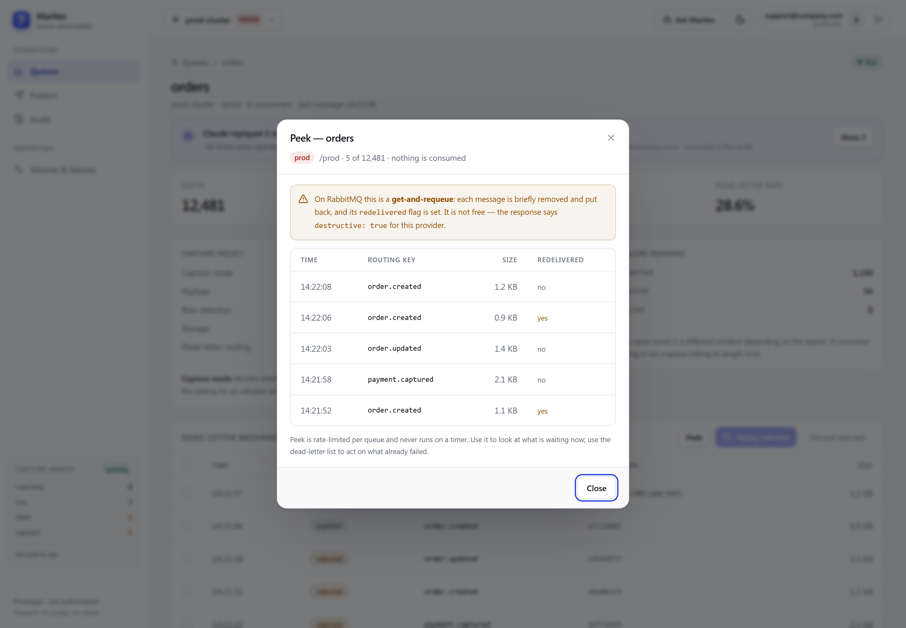

*Peek. Live messages with the `redelivered` flag, and the get-and-requeue caveat stated where the operator acts rather than in a footnote.*

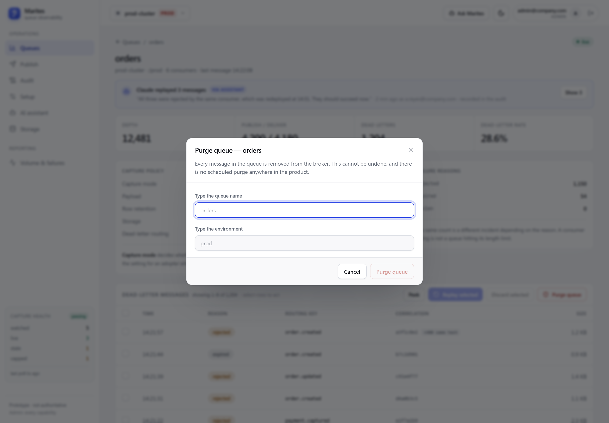

*Purge. Two typed fields — queue name and environment — and a button that stays disabled until both match.*

### 3.5 Setup wizard (`/setup`)

Five steps. Four block the next; **step 2 does not**. The step strip is a control, not a decoration: completed steps are clickable, and steps 4 and 5 are **locked** until preflight passes, labelled *preflight first*.

| Step | Screen | Blocking condition |
|---|---|---|
| 1 Profile | Provider, endpoint, credential kind, write-only credentials; beside it, a card stating **what enabling capture will create** | — |
| 2 Message store *(optional)* | Engine, host, database, schema, both roles; **Test connection**, and a plain statement of what skipping costs — no counts, no message list, no search, and recovery unaffected (DEC-016) | **None** — it may be skipped, which sets live-only |
| 3 Preflight | One row per check, with a remedy on each failure and `ERR-BRK-001` on a topology failure | A mandatory failure blocks step 4 |
| 4 Select queues | Every discoverable queue and exchange, with backlog and dead-letter routing. **Queues with a DLX are pre-selected**, because they are the ones that can explain a failure | At least one selection |
| 5 Capture | What will be watched, the storage ceiling, and the **backfill offer**: the messages already sitting there, rate-limited and opt-in. With no message store this step says so rather than offering a policy that could not be honoured | — |

**Preflight is re-runnable, and that is the designed path out of step 2.** The most common onboarding outcome is a missing grant; the operator adds it in the broker, re-runs, and the wizard continues. A wizard that cannot recover from its own failure state is a wizard that ends in a support ticket.

Capture is forward-only (C-002), so the backfill offer is the only way to see what is already queued. It is a checkbox, not a default, because it reads the adopter's queue at a rate the operator chooses.


*Step 1, profile. The provider, the credential kind, and a card stating what enabling capture will create in the broker.*

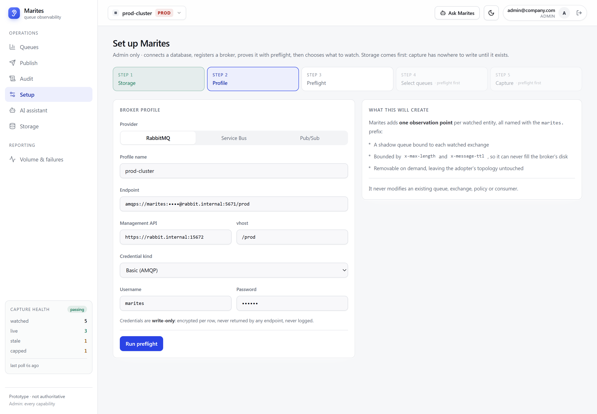

*Step 2, message store. Optional, and it says what skipping costs: history, not recovery.*


*Step 3, preflight. One row per check, and a failing check names the grant that is missing.*

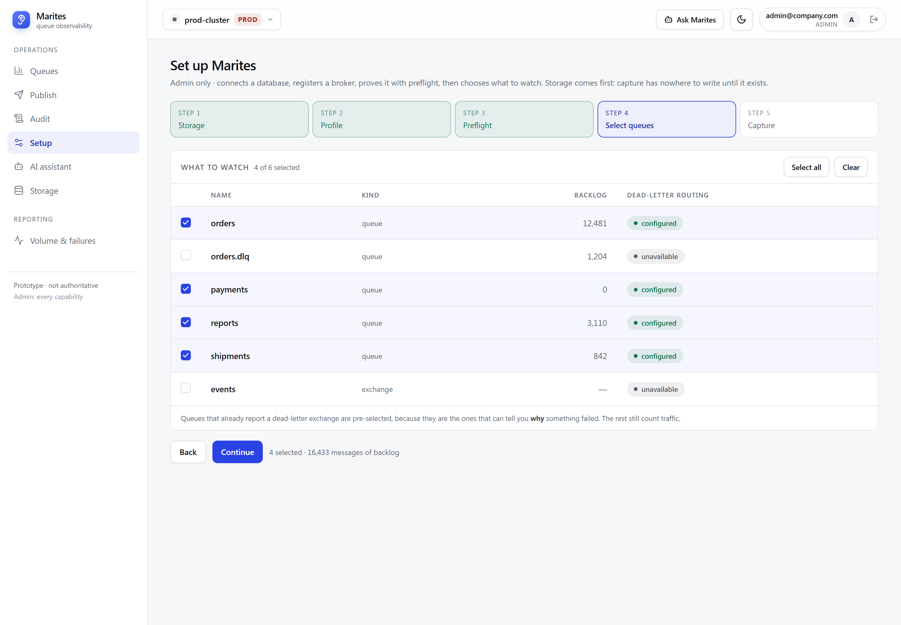

*Step 4, queues. Pre-selected by dead-letter routing, because those are the queues that can explain a failure.*

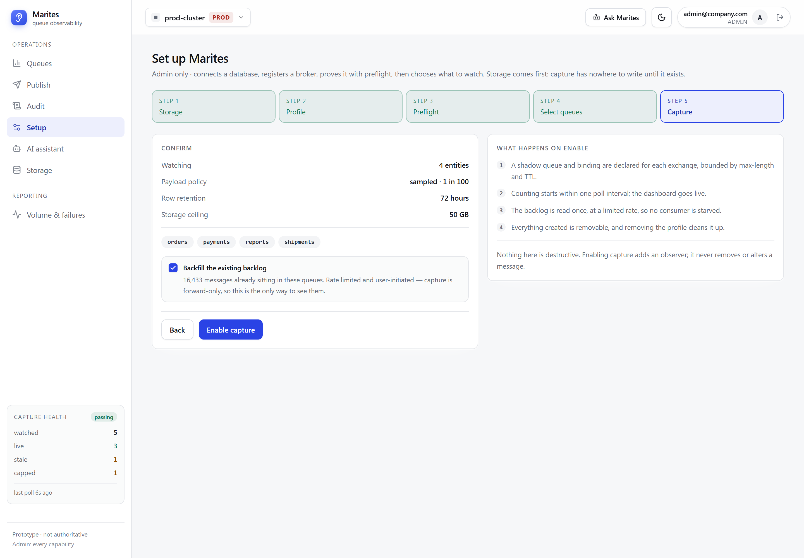

*Step 5, capture. What will be watched, the ceiling, and the backfill offer as a checkbox rather than a default.*

### 3.6 Publish composer (`/publish`)

The highest-risk screen in the product: it injects a message into a live business flow.

```
┌ Message ──────────────────────────────┬ Target ────────────────────┐
│ Exchange [orders ▾]  Key [order.…]    │ Exchange   orders          │
│ Payload  json      [Format][Template] │ Key        order.created   │
│ ┌───────────────────────────────────┐ │ Environment  [prod]        │
│ │ { "orderId": "ORD-88301", … }     │ │ Payload hash  a91f3c02     │
│ └───────────────────────────────────┘ │ Idempotency  9f2c1a44…     │
│ Valid JSON · 14 lines · 312 bytes     │                            │
├───────────────────────────────────────┼────────────────────────────┤
│                                       │ ⚠ Valid JSON is not a      │
│                                       │   valid message            │
│                                       │ Type [prod] to confirm     │
│                                       │ [ Publish message ]        │
└───────────────────────────────────────┴────────────────────────────┘
```

| Guard | Why it is visible rather than implied |
|---|---|
| Body must parse | The button stays disabled and the line under the editor names the error |
| Target restated | Exchange, key and environment beside the body you typed, so the thing you are hitting is legible |
| Idempotency key shown | A double-click cannot produce two messages; a retry returns `AlreadyApplied` |
| Payload hash shown | It is what the audit row records — not the body |
| `prod` typed | The only typed confirmation publish carries, because it is the only one it needs |

The warning closes the loop: *valid JSON is not a valid message*. A well-formed body with wrong semantics passes every check this tool can make, and the consumer rejects it into the dead-letter queue you started from.

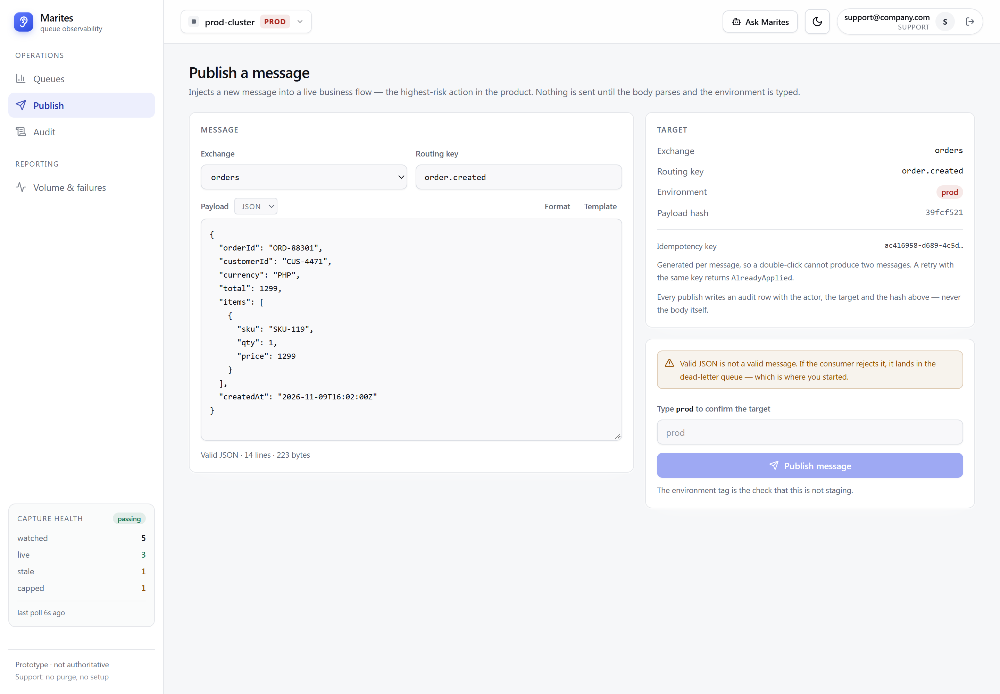

*Publish. The target restated with its environment, the payload hash, and the typed environment tag that unlocks the button.*

### 3.7 Dead-letter list and bulk actions (`/queues/:id`)

The queue detail carries a paginated dead-letter list — time, reason, routing key, correlation id, size — with a checkbox per row and a tri-state select-all in the header cell.

**The actions live in the table header, beside the selection that enables them.** Peek, replay, discard and purge sit on the same line as the count, because an action bar two hundred pixels from the checkboxes is an action bar nobody connects to the checkboxes.

| Rule | Why |
|---|---|
| Nothing acts on "everything" by default | Buttons read `Replay 3` once rows are chosen and are disabled at zero. The label carries the count, so the confirmation cannot be mistaken for a bulk operation |
| Single selection exposes the payload | With one message selected, the replay dialog shows the body and allows it to be edited; with several, it says so plainly and sends each as published |
| Duplicate grouping is a column, not a filter | `×400 same hash` is one producer bug, not four hundred incidents |

**The confirmation shows what it is about to destroy.** Discard and purge open a confirmation that lists the affected messages with their bodies, one click each, before the command is issued — not only in the audit afterwards. This is the same read-only payload dialog the audit uses (§3.11.1), opened in preview: the hash is not shown because it does not exist yet, and the footer says so.

```
┌ Discard 3 messages?                                                    ✕ ┐
│ Each body is written to the audit before the message is acknowledged.    │
│ If the record cannot be written, nothing is discarded.                   │
├──────────────────────────────────────────────────────────────────────────┤
│ What will be discarded                       3 bodies · open any one     │
│  ORD-88213  1.2 KB  { "orderId": "ORD-88213", "total": 2499.0, … }   ⤢   │
│  ORD-88197  1.4 KB  { "orderId": "ORD-88197", "status": "shipped", …}⤢   │
│  ORD-88190  1.1 KB  { "orderId": "ORD-88190", "total": 1299.0, … }   ⤢   │
├──────────────────────────────────────────────────────────────────────────┤
│ Type the queue name to confirm  [ orders            ]                    │
│                                              [Cancel]  [Discard 3]       │
└──────────────────────────────────────────────────────────────────────────┘
```

The list is not a preview of a *sample*: every message the confirmation will act on is in it, for the same reason the evidence keeps one row per message (DEC-018). What changes between the confirmation and the audit is only the tense — *will be discarded* becomes *was discarded*.

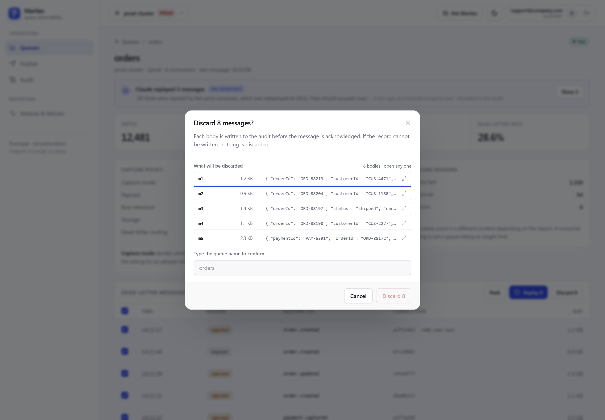

*Discard. Every affected body listed before the command, each one openable, and the note that the copy is written before the message is acknowledged.*

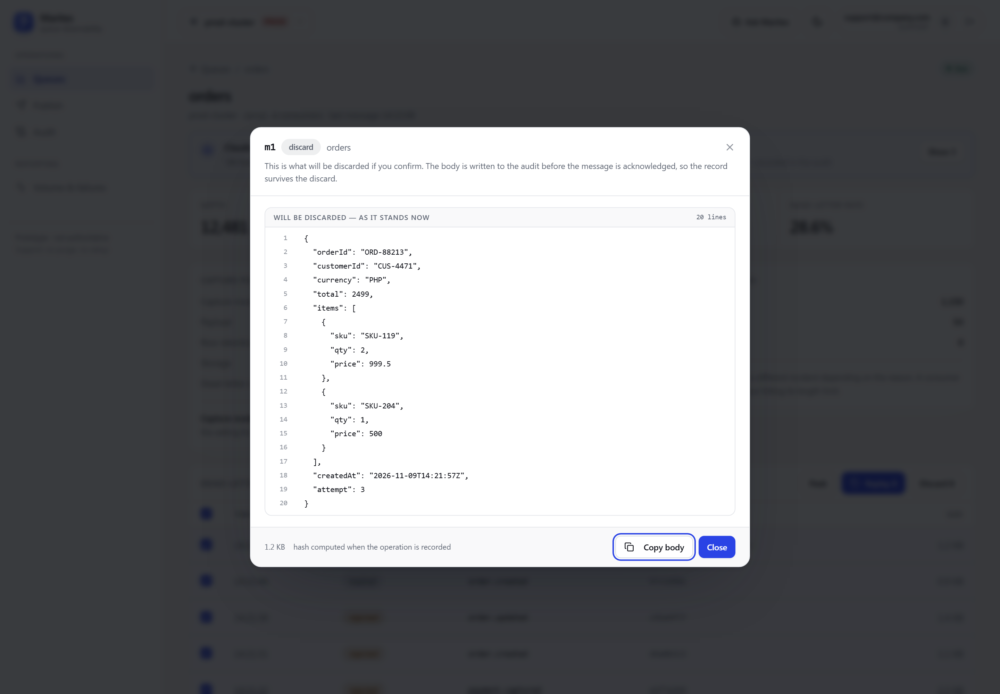

*The same body in preview, opened from the confirmation: no hash and no retention date, because neither exists until the operation runs.*

### 3.8 Agent proposals

An agent may read every queue, message and metric, and may **propose** an action. It cannot execute one ([agent access](../05-architecture/mcp-integration.md)).

```
┌──────────────────────────────────────────────────────────────────────┐
│ 🤖 Claude suggested replaying 3 messages            [AGENT]          │
│    "All three were rejected by the same consumer, which was          │
│     redeployed at 14:31. They should succeed now."                   │
│    proposed 2 min ago on behalf of a.reyes@company.com               │
│                                            [ Review 3 ]  [ Dismiss ] │
└──────────────────────────────────────────────────────────────────────┘
```

| Property | Why |
|---|---|
| The reasoning is shown | A proposal you cannot evaluate is worse than no proposal |
| It is a suggestion, not an alert | Indigo, not amber: nothing is wrong with the queue |
| Review selects exactly those messages and opens the normal dialog | The agent gets no shortcut through the guard chain — it gets a pre-filled form |
| The dialog states who is recorded as the actor | *Approving this records you as the actor. The proposal stays in the audit log beside it* |
| Dismissal is recorded | A pattern of dismissed proposals is how you learn the agent's judgement is off |


*An assistant's replay, already done. Attributed to the person whose credential carried it, with no approval step — and the reasoning kept with it.*

### 3.9 The assistant drawer

A panel over whatever screen is open, because an operator should not leave the queue to ask about it. It is the same agent as the MCP server, over the same tool registry, filtered by the signed-in user's credential ([agent access](../05-architecture/mcp-integration.md) §9).

```
┌───────────────────────────── drawer, 440px ──────────────────────────┐
│ 🤖 Ask Marites                                   llama3.1:8b    [×]  │
│    headers and reasons only                                          │
├──────────────────────────────────────────────────────────────────────┤
│                        ┌──────────────────────────────┐              │
│                        │ Why is orders failing?       │  ← user      │
│                        └──────────────────────────────┘              │
│ 🤖 1,150 rejected by the same consumer, 54 expired.                  │
│    Rejections start at 14:31 — a consumer was redeployed then.       │
│    ┌────────────────────────────────────────────┐                    │
│    │ Queue      orders · prod                   │  ← evidence        │
│    │ Rejected   1,150 since 14:31               │                    │
│    │ Capture    live · last message 14:22:08    │                    │
│    └────────────────────────────────────────────┘                    │
│    ┌ Propose replaying 3 messages ── [PROPOSAL] ┐                    │
│    │ You review the dry run and type the tag.   │                    │
│    │ I never send it.            [ Review 3 ]   │                    │
│    └────────────────────────────────────────────┘                    │
├──────────────────────────────────────────────────────────────────────┤
│ [ Ask about a queue, a failure, a trend…            ]  [ ↵ ]         │
│ Headers, reasons and counts are sent to the configured provider.      │
└──────────────────────────────────────────────────────────────────────┘
```

| Rule | Why |
|---|---|
| The header states the model and what it can see | "headers and reasons only" versus "reads message bodies" is the disclosure, visible on every screen rather than buried in settings |
| The answer is a finding, then evidence, then a proposal | A conclusion without the numbers is a guess with good grammar |
| The proposal card is the same card as the queue screen | One proposal, one review dialog, one audit path — the drawer is a second door, not a second process |
| `Review` closes the drawer and opens the queue | The action happens in the guard chain, never in the chat |
| The empty state offers three questions | An operator mid-incident should not have to think of a good prompt |

**When no model is connected the drawer is still reachable**, and says so: *no model connected*, with **Connect a model** for an Admin and *ask an administrator* for everyone else. The header button is never hidden — hiding it would mean Support never learns the feature exists and the Admin is never prompted.

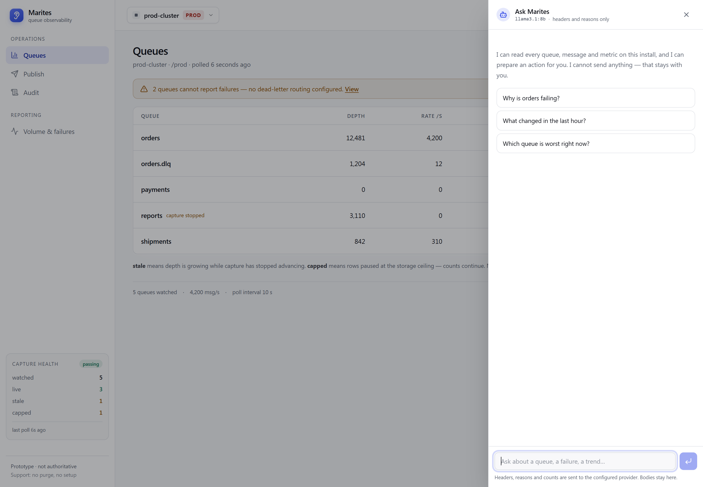

*The drawer open over the queue list, with three suggested questions rather than an empty box.*


*An answer: the finding, an evidence table, and the completed action card naming who it was done as.*


*Provider settings. The provider, the model, the payload switch, and a list of every tool with its read or act badge.*

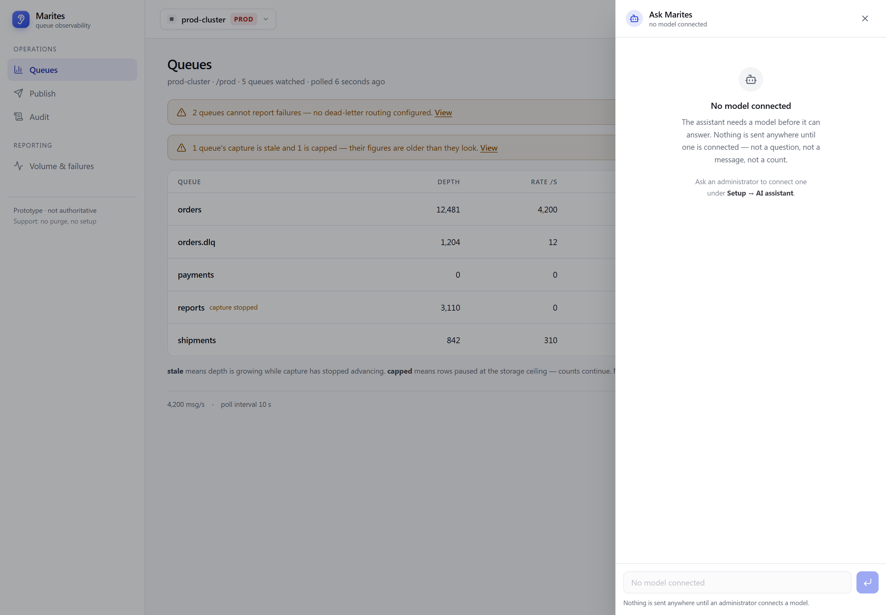

*No model connected. The button is still there, the drawer explains, and it names who can fix it.*

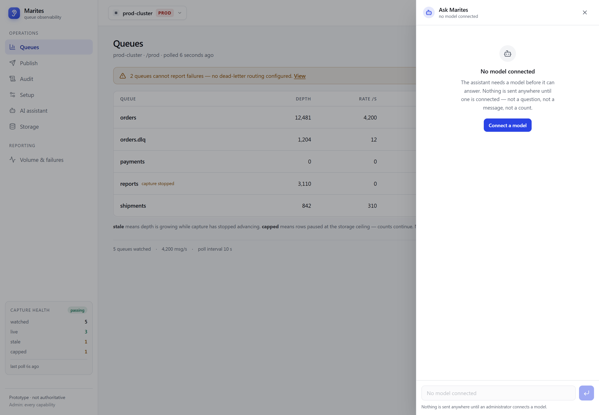

*The same state for an Admin, with the fix in it.*

### 3.10 Storage settings (`/storage`)

Storage is asked for at first run (§3.5, step 2) and can be **skipped**, which puts the install in **live-only** mode ([DEC-016](../01-project/decisions-and-open-questions.md)). This screen is where it is added later, tested, or replaced.

| State | What the screen shows |
|---|---|
| **Live-only** | The engine form, and the consequence: *counts begin when this is connected; the period before was never recorded*. It also says what does **not** change — recovery and the audit keep working, because they never lived here |
| **Connected** | Engine, host, database, schema, both roles, schema version, counting-since; **Test connection** and **Replace…** |
| **Replacing** | A warning that captured rows are not migrated and counts restart from the new database |

**No usage figures on this screen, on purpose.** Rows, bytes, the age of the oldest capture row and usage against the ceiling are answered from the database itself — the adopter already monitors the server it lives on, and duplicating that here would invite a reporting feature the product does not want to own. The queries are in [storage prerequisites §7](../11-operations/storage-prerequisites.md).

**The live-only banner appears only where the gap is felt** — the queue list, the report screen and any search — naming the reason and the fix. It must not appear on the audit log or beside a replay button, because neither is degraded: showing it there would teach the operator that their recovery is broken when it is not.

**What live-only costs, and what it does not.** Replay, discard, purge and publish **stay available**. Each owes an audit row (`FR-016`), and the audit lives in Marites' own store, so it is written whether or not the adopter ever connects a message store (DEC-016). What stops is *looking back*: counts over time, the message list, search, and the report screen. An install with no message store can still recover; it cannot remember.

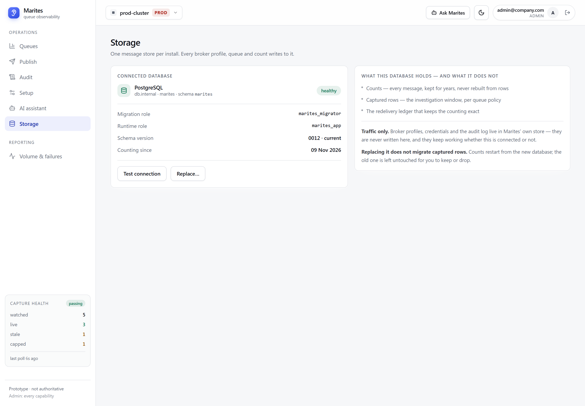

*Connected. Engine, host, schema, both roles, and what the store holds — and what it deliberately does not.*

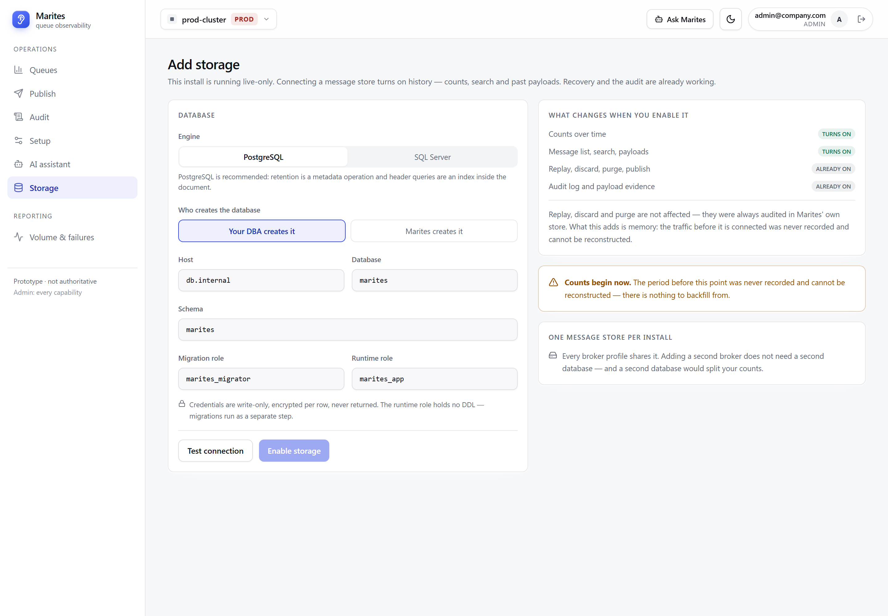

*Live-only. What turns on when a message store is connected, and what was already on.*

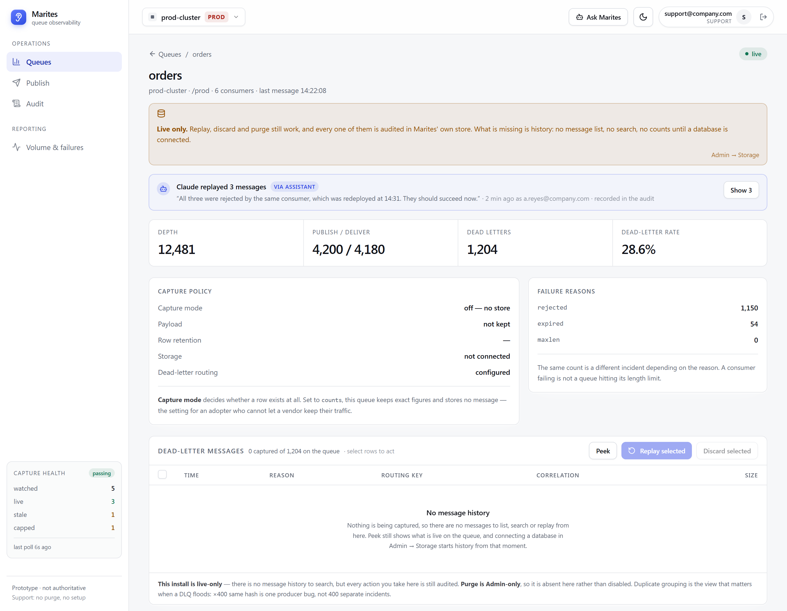

*Live-only on the queue detail: no history, and recovery still working.*

### 3.11 Audit history and payload evidence

Each audit row expands to show what the operation actually carried. The evidence is a snapshot taken when the operation ran — the bodies sent, or the bodies destroyed — and it lives on the **capture retention clock**, not the audit's (DEC-017). Two shapes, because a single message and a batch answer different questions.

**One message: what was sent, and did it change.** The panel shows the body **in full**, not a preview, and when the operator edited it before replaying, both versions sit side by side with the changed lines marked. The row itself carries an `edited` flag, so an administrator scanning the log sees that a replay was not a plain resend without opening anything.

```
┌ 14:31:02  a.reyes@company.com  SUPPORT  replay · orders  applied · 1 EDITED [▾] ┐
├─────────────────────────────────────────────────────────────────────────────────┤
│ Payload evidence · 1 body · retained until 13 Nov 14:31             abc3f1…     │
│ ┌ ORD-88213 · 1.2 KB · [payload edited] the replayed body is not the one       │
│ │   that was dead-lettered                                                     │
│ ├──────────────────────────────┬───────────────────────────────────────────────┤
│ │ BEFORE                       │ REPLAYED                                      │
│ │ {                            │ {                                             │
│ │   "orderId": "ORD-88213",    │   "orderId": "ORD-88213",                     │
│ │   "customer": "acme-pty",    │   "customer": "acme-pty",                     │
│ │ ▸ "total": 2499.0,           │ ▸ "total": 1999.0,                            │
│ │   "currency": "AUD",         │   "currency": "AUD",                          │
│ │   "status": "payment_pending"│   "status": "payment_pending"                 │
│ │ }                            │ }                                             │
│ └──────────────────────────────┴───────────────────────────────────────────────┘
└─────────────────────────────────────────────────────────────────────────────────┘
```

**A batch: every message, one row each.** The count in the header and the number of rows are the same number — a purge of ten shows ten, and the operator can scroll to any one of them.

```
┌ 14:18:55  m.cruz@company.com  ADMIN  purge · payments  applied · 10  [▾] ┐
├──────────────────────────────────────────────────────────────────────────┤
│ Payload evidence · 10 bodies · one record per message · until 13 Nov 14:18│
│   PAY-5591  2.3 KB  { "paymentId": "PAY-5591", "amount": 2499.0, … }     │
│   PAY-5588  1.9 KB  { "paymentId": "PAY-5588", "amount": 899.0, … }      │
│   … eight more rows, to PAY-5540                                         │
└──────────────────────────────────────────────────────────────────────────┘
```

after retention lapses, either shape:

```
┌ 13:52:44  a.reyes@company.com  SUPPORT  discard · orders  applied · 3  [▾] ┐
├───────────────────────────────────────────────────────────────────────────┤
│ Payload no longer retained · swept 06 Nov                    hash 4b7d02…  │
│ 3 bodies were kept on the same clock as the messages they came from — this │
│ queue's 3-day row retention — and were deleted with them. The operation and │
│ its hash survive; the content does not.                                    │
└───────────────────────────────────────────────────────────────────────────┘
```

| Rule | Why |
|---|---|
| **One row per message, always** | A purge of 1,204 writes 1,204 rows. A sample cannot answer *"was this message in there?"*, and that is the question a dispute asks (DEC-018) |
| **A single body is shown whole** | The administrator's question is *what exactly went back onto the queue*. A preview with an ellipsis answers it only for messages small enough not to matter |
| **Replay stores before and after, and marks the difference** | An edited replay sent something the original does not contain; only the pair proves the change, and the change must be visible without reading both bodies line by line (DEC-011, DEC-018) |
| **The row says `edited` before it is opened** | An edited replay and a plain one look identical in a list; the difference is the thing an administrator is looking for |
| **Peek stores what it showed** | The operator saw those bodies; the record should hold what they saw |
| **Truncation is visible** | Beyond `MARITES_EVIDENCE_MAX_ROWS` the rows stop and the row says `evidence truncated at 10,000 of N` — never a silent partial record |
| Expiry names the date and the rule | "No longer retained" alone invites the reader to think the record is broken. The panel says when it was swept, which retention applied, and that the hash is what survives — so the answer to *where is the payload* is a fact, not a shrug |

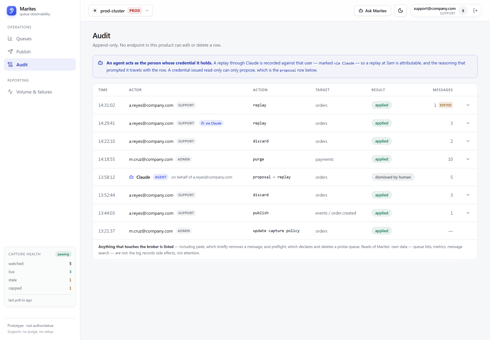

*The audit log. Human actions and assistant actions side by side, with `via Claude` on the executed one and a `proposal` row for a credential that may only propose.*

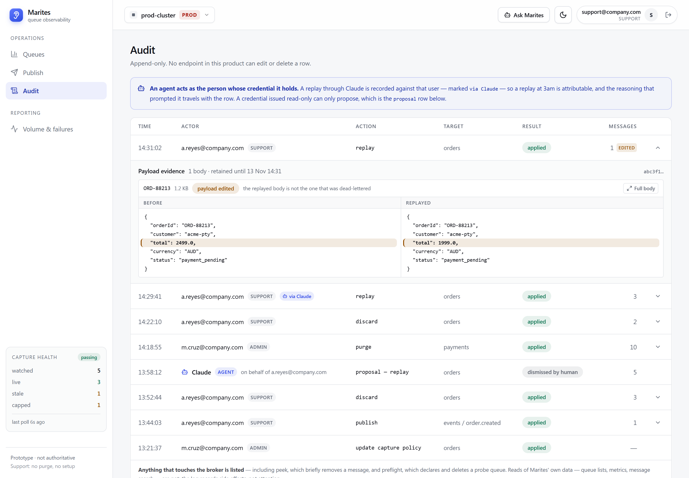

*One replayed message, expanded: the body whole, before and after, with the changed line marked.*


*A purge of ten, expanded: ten rows, one per message, because a sample cannot answer the question a dispute asks: was this one in there.*

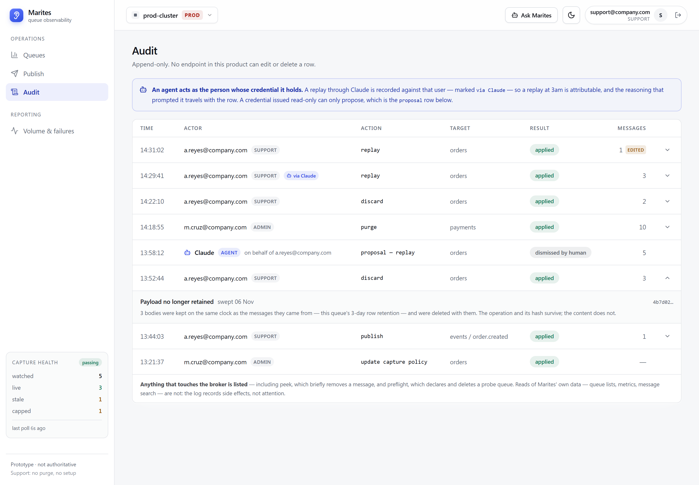

*Evidence past retention. When it was swept, which retention applied, and the hash that remains.*

### 3.11.1 The body itself

The expanded row is a summary, not the record. Any evidence row opens a dialog holding the complete body, and that dialog is the **same surface for all four operations** — replay, discard, purge and publish — because the question is the same one each time: *what exactly was in that message?*

```
┌ ORD-88213  replay  orders  [payload edited]                              ✕ ┐
│ The body replayed, beside the body it replaced. The marked line is the     │
│ only difference.                                                          │
├───────────────────────────────────┬───────────────────────────────────────┤
│ BEFORE — AS DEAD-LETTERED  7 lines│ REPLAYED — AS SENT          7 lines   │
│  1  {                             │  1  {                                 │
│  2    "orderId": "ORD-88213",     │  2    "orderId": "ORD-88213",         │
│  3    "customer": "acme-pty",     │  3    "customer": "acme-pty",         │
│  4 -  "total": 2499.0,            │  4 +  "total": 1999.0,                │
│  5    "currency": "AUD",          │  5    "currency": "AUD",              │
│  6    "status": "payment_pending" │  6    "status": "payment_pending"     │
│  7  }                             │  7  }                                 │
├───────────────────────────────────┴───────────────────────────────────────┤
│ 1.2 KB · retained until 13 Nov 14:31 · sha256 abc3f1…   [Copy body] [Close]│
└───────────────────────────────────────────────────────────────────────────┘
```

| Rule | Why |
|---|---|
| **One dialog, four operations** | Replay, discard, purge and publish all answer *what was in it*. Four surfaces would drift into four different amounts of evidence |
| **Line numbers, always** | An administrator comparing a body against an application log, or quoting a line back to a colleague, needs to name the line. "Third line down" is not a citation |
| **Side by side only when the body changed** | A single body in a two-column layout implies a comparison that is not there. One pane, at a narrower width, when there is nothing to compare |
| **The changed line is marked twice** | A tinted row and a `-`/`+` marker: colour alone fails in greyscale, in print, and for a red-green colour-blind reader |
| **Every line, with no scroll-to-find** | The dialog scrolls; the body is not cut to fit. A truncated body would make the evidence argue against itself |
| **The hash and the retention date travel with it** | A body shown without its expiry invites the reader to assume it will still be there tomorrow |

The dialog is read-only. Nothing in it can be edited and re-sent — replay edits in the replay dialog, where the dry run and the typed confirmation live (DEC-011).


*The dialog for an edited replay. Line numbers, both versions, and the change marked twice — a tinted row and a `−`/`+` — so it survives greyscale and print.*

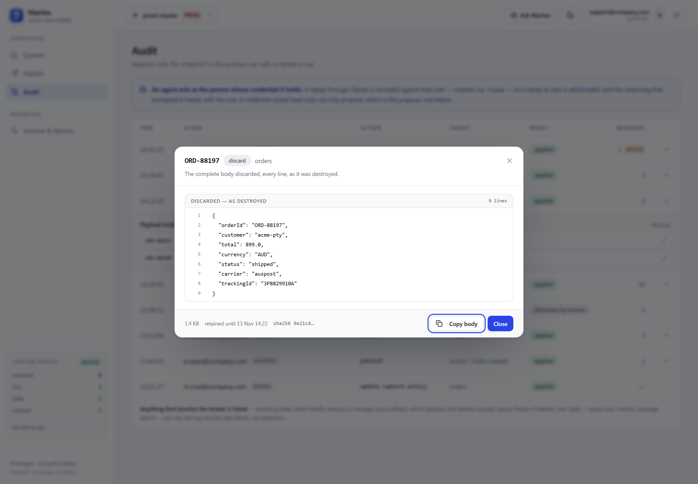

*The same dialog for a discard: one pane, because there is nothing to compare.*


*Opened from one row of a purge, so it shows that message and not the batch.*

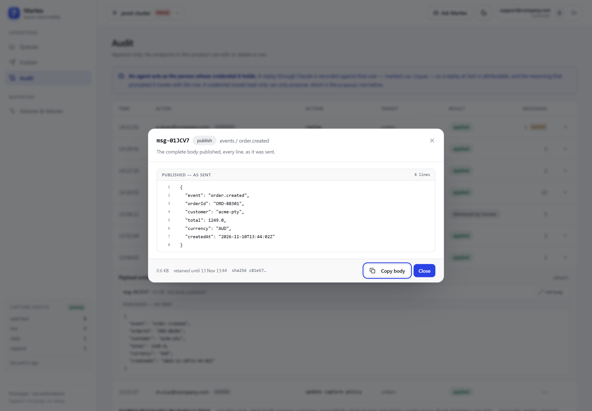

*What a publish sent.*

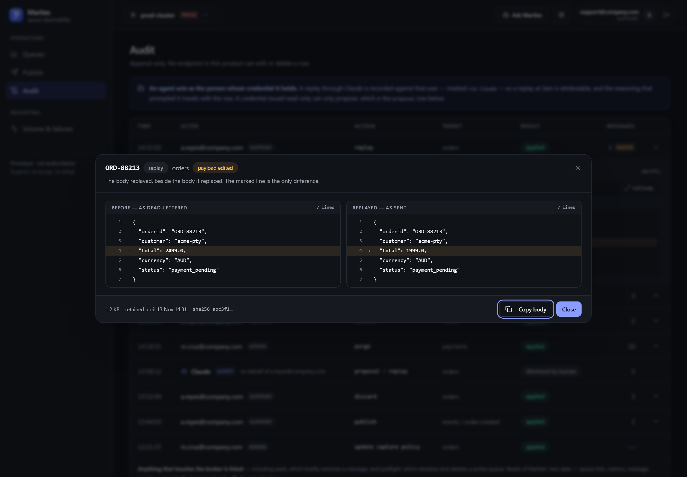

*The same diff in dark. The tint and the markers both survive the palette.*

## 4. Reporting dashboard (`/report`)

```
┌──────────────────────────────────────────────────────────────────────┐
│ Marites — reporting            [prod ▾]      [ 30 days ▾ ]  Viewer  │
├──────────────┬──────────────┬──────────────┬────────────────────────┤
│ Published    │ Dead letters │ Dead-letter  │ Peak rate              │
│ 41.2 M       │ 118,402      │ rate 0.29%   │ 4,800 /s               │
├──────────────┴──────────────┴──────────────┴────────────────────────┤
│  Daily totals                                          ▁▂▃▅▆▅▃▂    │
│  ─────────────────────────────────────────────────────────────      │
├──────────────────────────────────────────────────────────────────────┤
│ Per queue            Published    Dead letters   Rate    Last seen   │
│ orders               38.1 M       110,204        0.29%   2 min ago   │
│ payments              3.1 M         8,198        0.26%   2 min ago   │
└──────────────────────────────────────────────────────────────────────┘
```

| Rule | Where it is owned |
|---|---|
| Four tiles, never a combined total | [DOC-UX-001 §1](dashboard-and-operations.md) rule 1 |
| Dead-letter count never shown without its rate | rule 2 |
| Reason breakdown always present | rule 3 |
| Granularity in the caption, availability-driven selector | §1, the four granularity rules |
| No message bodies, no operation controls | §1.1 |
| A stale profile is marked, never zeroed | §4 |

The only thing this document adds is **layout**: tiles in a single row, trend beneath, per-queue table last. Everything about what the numbers mean is owned by DOC-UX-001 and is not repeated here.

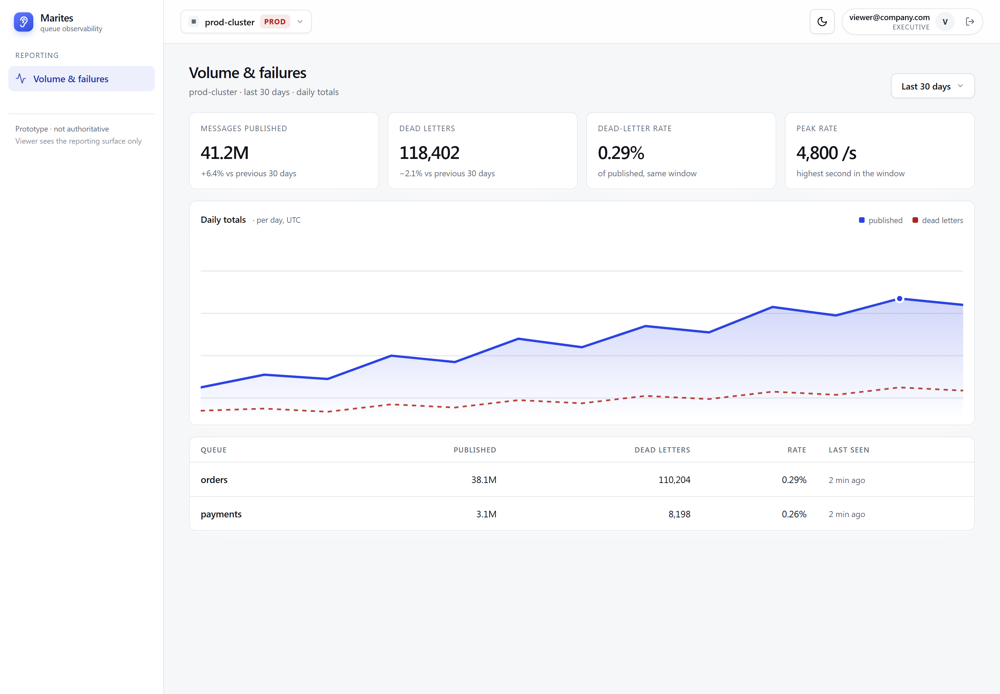

*Reporting. Four tiles, a trend, and the per-queue table last — with no message bodies and no operation controls anywhere on it.*

## 5. Authentication states

Identity is Entra ID (`ADR-008`), so **Marites renders no sign-in form** in the normal case: the SPA redirects, and the identity provider owns the page. That leaves five states this product does own, and they were undesigned until the prototype forced the question.

| State | What the user sees | Rule |
|---|---|---|
| Signed out | Redirect to Entra; nothing rendered in between | No Marites-branded login form |
| Callback | A quiet loading state, then the role's landing route | Never a flash of the wrong surface |
| `MARITES_AUTH_MODE=none` | No sign-in at all; loopback only | First run must not prompt for a sign-in that does not exist |
| Break-glass | A local form on the Marites origin — the only form Marites owns | Enabled by environment variable, disabled by default, every use audited |
| **Token expires mid-operation** | The dialog keeps its contents and offers re-authentication | **A replay dialog open for ten minutes must not lose its dry run and typed confirmation** |

The last row is the one that matters. A session that expires while an operator is confirming a destructive action must resume, not restart — losing the dry-run result would push them to re-run it quickly, which is exactly the wrong behaviour under pressure.


*The prototype's sign-in. Marites itself renders no form — the identity provider owns this page (ADR-008) — so this screen exists only to demonstrate the three roles.*


*The same, dark.*

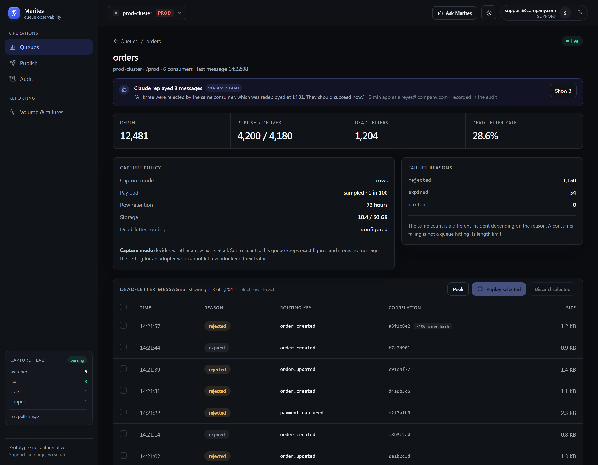

*The queue detail in dark: the same tokens, not a second palette.*

## 6. States that are not a screen

| State | Presentation | Owner |
|---|---|---|
| No broker configured | Redirect to `/setup`, never an empty dashboard | DOC-UX-001 §4 |
| Preflight failing | Console available; capture controls replaced by the failing check and its remedy | DOC-UX-001 §4 |
| Queue has no dead-letter routing | `unavailable` in the DLQ column, banner on the list | DOC-UX-001 §4 |
| Capture stopped | Stale badge with last-seen, beside a rising depth | DOC-UX-001 §4 |
| Window has no data | "No messages in this window", distinct from "capture unhealthy" | DOC-UX-001 §4 |
| Storage capped | "Capped" banner with an explanation that counts continue | DOC-UX-001 §5 |
| Agent proposal pending | A banner above the metrics, with the reasoning and two actions | §3.8 |
| Assistant not configured | The drawer explains, names the owner, and disables its input | §3.9 |
| **Live-only (no storage)** | A banner on the queue list, queue detail and audit log; recovery controls disabled with the reason stated | §3.10 |
| Proposal awaiting approval | `awaiting human` in the audit log, never "failed" | [agent access](../05-architecture/mcp-integration.md) §4 |

## 7. What is not designed

- **Responsive behaviour.** The console is assumed desktop-width; below 900px the rail collapses and the step strip wraps, but no phone layout is specified. The reporting view would be the sensible one to adapt first.
- **Onboarding copy.** The wizard's wording is the difference between an adopter fixing a grant and giving up, and it is unwritten.
- **Error surfaces.** Where a `429`, `503` or `Unresolved` appears on screen is implied by the operations but not laid out.
- **Empty and loading states for the agent banner.** A proposal that arrives while the queue is open has no arrival behaviour; it appears on next load.

Colour, type and spacing are no longer in this list — they are owned by [visual design](visual-design.md).

## 8. Document control

Revision 0.1 recorded the navigation model, nine routes and the operation dialog. Written November 2026.

*Amended November 2026:* the route map gained `/login`, `/publish` and `/audit` — three screens the contract served and this document had omitted, found while building the prototype. Added §3.6 (publish composer), §3.7 (dead-letter selection and header actions), §3.8 (agent proposals) and §5 (authentication states, including the expired-token rule). Visual design moved out to [DOC-UX-004](visual-design.md). A further amendment added §3.9 (the assistant drawer), the `/ai` and drawer routes, and the unconfigured state.
