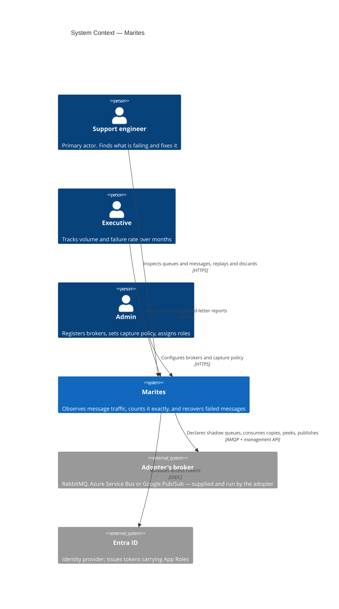
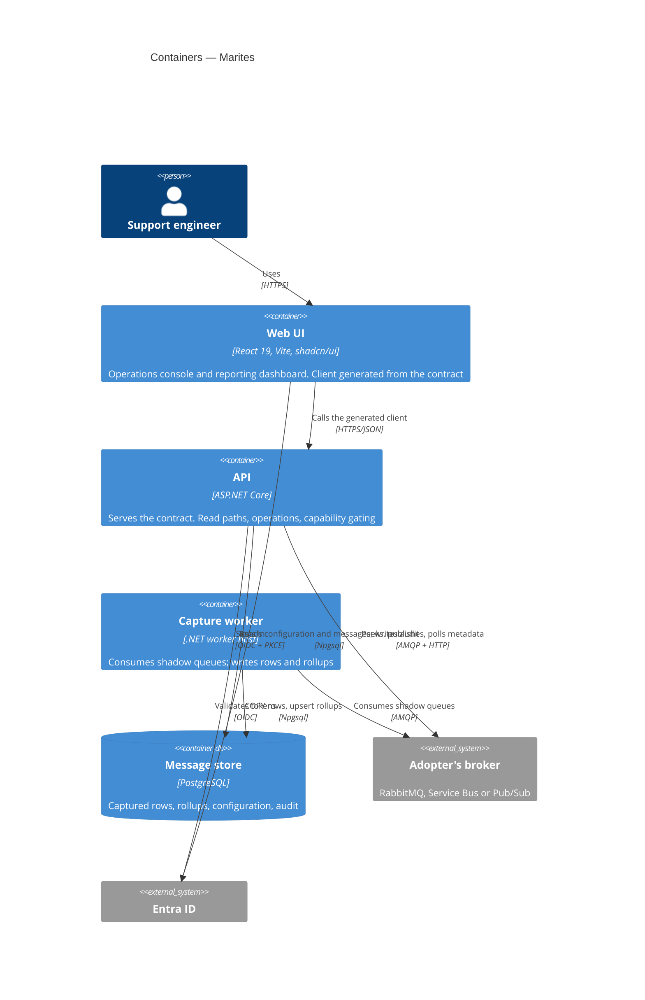
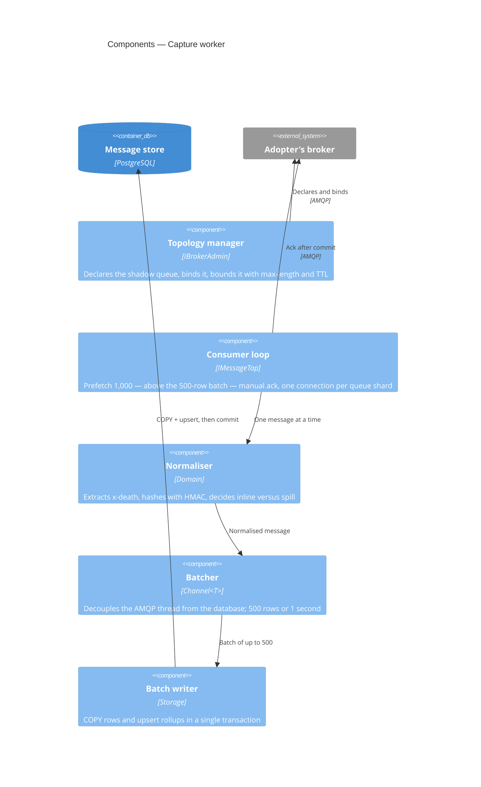

# C4 model

Version 0.1 | 07 November 2026 | Status: Draft

The system at three zoom levels, in the C4 notation. Each level answers a different question for a different reader; none of them restates the others.

| Level | Answers | Reader |
|---|---|---|
| **1 — Context** | Who uses this, and what does it depend on? | Anyone, including a non-technical stakeholder |
| **2 — Containers** | What are the deployable pieces, and what talks to what? | Engineer, reviewer, security assessor |
| **3 — Components** | What is inside the one container that does real work? | Whoever implements or debugs capture |
| 4 — Code | — | **Deliberately omitted.** See §5. |

Diagrams are inline Mermaid: one copy that renders in GitHub and in an editor. Nothing here is hand-drawn, so nothing can silently drift from the text.

## 1. System context

Marites sits between three kinds of person and two external systems. It owns no infrastructure the adopter did not already have, with one exception: its own database.

**What this level establishes, and what it deliberately hides.**

Marites is a **client** of the broker, not a peer of it. It never provisions, hosts or repairs one — that boundary is [ADR-001](decisions.md) and it is the single most consequential line in the whole design. Everything downstream follows from it: the prerequisite document, the preflight checks, and the fact that a misconfigured broker looks like a broken product.

The reverse arrow — broker delivering copies to Marites — is the only inbound flow, and it exists because Marites asked for it by binding a queue.

## 2. Containers

Four deployable pieces. Two of them are the same image with different entrypoints (`marites api`, `marites worker`), which is a deployment choice rather than an architectural one.

**Three properties worth reading off this diagram.**

**The API and the worker never talk to each other.** They share a database and nothing else. That is why `Marites.Capture` has no dependency on `Marites.Api` — the seam that would let capture scale out or split into its own service later.

**The web UI never talks to the broker.** Every broker interaction goes through the API. A browser holding broker credentials would be a security failure, and a dashboard that polled the broker directly would add load proportional to the number of open tabs.

**The database has two writers with disjoint tables.** The worker owns `message_capture` and `message_rollup`; the API owns configuration and `operation_audit`. One writer per table is what lets the API stay stateless.

## 3. Components — capture worker

The API is mostly request/response slices and reads well as a file tree ([architecture-overview.md](architecture-overview.md) §6). The worker is where the real machinery is, so it gets a component view.

**Why the batcher exists.** RabbitMQ's dispatch thread must never block on PostgreSQL. If it does, broker flow control engages and the broker's problem becomes Marites's problem — the one outcome a monitoring tool cannot afford. `Channel<T>` is the smallest thing that breaks that coupling.

**Why the ack is drawn last, and separately.** The commit must happen first. A crash between commit and ack produces a duplicate, which is recoverable; a crash between ack and commit would produce a gap, which is not.

**Why topology is a separate component from the consumer.** Declaring a queue is a privileged write to the adopter's broker; consuming is a read. Keeping them apart means the dangerous capability is exercised once at setup rather than continuously, and preflight can test it in isolation.

## 4. Dynamic view — one message

The static container view does not show ordering. For the ordering that matters — publish, fan-out, batch, commit, ack — see [workflows/capture-lifecycle.md](../workflows/capture-lifecycle.md).

## 5. Why there is no level 4

C4's fourth level is class diagrams. Three reasons not to maintain them here:

- **The contract is the better abstraction.** Anyone who needs to know how two parts interact reads `openapi.yaml`, not a class diagram that will be stale within a sprint.
- **The module map already covers structure.** [architecture-overview.md](architecture-overview.md) §6 lists twelve projects with a one-line responsibility each, which is what a code-level diagram would convey at this size.
- **They decay fastest.** A class diagram is correct for days. Maintaining one would produce a document that is confidently wrong, which is worse than no document.

## 6. What this model does not show

| Omitted | Why | Where it lives instead |
|---|---|---|
| Deployment topology (replicas, nodes, network zones) | Depends on the adopter's environment | [operations/deployment-and-onboarding.md](../operations/deployment-and-onboarding.md) §3 |
| Provider-specific internals | Three platforms, one capability model | [architecture-overview.md](architecture-overview.md) §6.1–6.3 |
| Authentication flows in detail | Token validation is a framework concern | [architecture-overview.md](architecture-overview.md) §8 |
| Failure and retry behaviour | Not a structural concern | [workflows/](../workflows/README.md) |

## 7. References

- Boundary decision: [decisions.md](decisions.md) ADR-001
- Capture design: [architecture-overview.md](architecture-overview.md) §2–§3
- Module structure: [architecture-overview.md](architecture-overview.md) §6
- Container behaviour in sequence: [workflows/capture-lifecycle.md](../workflows/capture-lifecycle.md)
